# LAXMAN-AUTONOMOUS Video Generation System: Project Overview

**Project Name:** LAXMAN-AUTONOMOUS Video Generation System  
**Repository:** `E:\audio-to-video`  
**Current Branch:** `agents-building`  
**Target Milestone:** v2.0.0 Production Release & Autonomous Hardening  
**Target Output:** Single Telugu audio file in, broadcast-ready 1080p documentary/motion-graphics MP4 video out.

---

## 1. System Goals & Scope

LAXMAN-AUTONOMOUS is an enterprise-grade autonomous video creation platform tailored for regional Telugu spoken-word narration, educational documentaries, and social media reels. The system autonomously transforms an ingested audio track into an aligned, timed, and professionally styled video using Remotion and FFmpeg.

### Core Objectives
1. **Zero-Touch Execution:** Autonomous end-to-end processing from audio ingest to final video export delivered directly to `Desktop/First Video Automation/`.
2. **21 Canonical Autonomous Agents:** 14 Video Generation Specialists and 7 System Guardians with private skills, shared memory, and AST-sandboxed execution.
3. **Truthful & Real-Time Telemetry:** Live pipeline tracking, agent-to-agent communication monitoring, and zero simulated/fake progress.
4. **Dual Visual Modes:**
   - **Use Images Mode:** Procedural combination of stock assets, user uploads, and dynamic motion graphics.
   - **Motion-Only Mode:** High-velocity kinetic typography, vector geometry, and procedural layouts requiring zero external images.
5. **Integrated Visual AI Editor:** In-app visual feedback collection, interactive LLM coding agent chat, plan review, syntax-highlighted code diffing, and live sandboxed preview.
6. **Robust Studio Ergonomics:** Studio Dark Theme, fixed left sidebar, fixed top navigation bar, and independently scrollable main content area with subtle dark scrollbars.

---

## 2. Technology Stack

| Layer | Technologies & Libraries |
| :--- | :--- |
| **Frontend UI** | React 18, TypeScript, Vite 5, Tailwind CSS, Studio Dark Theme tokens (`#0A0F1D`, `#111827`, `#1F2D42`), Lucide React, Server-Sent Events (SSE) Client |
| **Backend API** | Python 3.10+ / 3.12, FastAPI, Uvicorn, Pydantic v2, Threading & Process File Locks (`get_project_store_lock`) |
| **Video Engine** | Remotion 4.x (React frame-driven composition), Chromium Headless renderer, FFmpeg & FFprobe (audio analysis, loudness, silencing, stream muxing) |
| **Audio & Speech (ASR)** | Faster-Whisper (Large-v3 / custom), cross-attention forced alignment, Claude CLI transcript correction |
| **Agent Runtime** | Multi-Agent Swarm (21 agents), AST-sandboxed capability runner (`ast_sandbox.py`), LLM Gateway (Claude, Gemini, OpenAI) |
| **Testing & Quality** | Pytest (Python backend regressions), Playwright (Chromium E2E testing), Vitest (frontend component tests) |

---

## 3. Application Structure & Directory Layout

```
E:\audio-to-video/
├── config/                 # System configuration, approvals queue, memory, LLM usage
│   ├── approvals_queue.json
│   ├── shared_memory.json
│   └── llm_usage.json
├── docs/                   # Architectural specifications and operator manuals
│   ├── architecture.md
│   ├── motion.md
│   └── PRODUCTION_OPERATOR_GUIDE.md
├── VIDEO_ENGINE/remotion/  # Remotion React composition root and render pipeline
│   ├── src/
│   │   ├── motion/         # Text animations, motion graphics, phrase composer
│   │   ├── styleKit.ts     # Editorial style kit and palettes
│   │   └── Root.tsx        # Composition registration
│   └── package.json
├── resource-library/       # Curated vector assets, background footage, Telugu fonts
├── scripts/                # Packaging, smoke tests, and startup utilities
├── SYSTEM/                 # 21 Canonical Autonomous Agents
│   ├── agents/             # Ingestion, Transcription, Visual Planning, QC, Orchestrator...
│   ├── registries/         # Agent registry and skill registry
│   └── security_policy/    # AST sandbox and permission enforcers
├── tests/                  # Multi-stage automated regression test suites
│   ├── test_playwright_fixed_layout_scroll.py
│   ├── test_playwright_visual_ai_editor.py
│   ├── test_playwright_no_blinking.py
│   ├── test_stage9_final_release_acceptance.py
│   └── ...
├── UI/                     # Consolidated Application Core
│   ├── backend/            # FastAPI application
│   │   ├── main.py         # App entrypoint and router mounting
│   │   ├── routes/         # Pipeline, agents runtime, visual editor, approvals, projects
│   │   └── store.py        # Project persistence and file locking
│   └── frontend/           # Vite + React 18 frontend
│       ├── src/
│       │   ├── components/ # Sidebar, Header, Live Pipeline, Visual AI Editor, Stage Tracking
│       │   ├── api/        # Typed API client and backend contracts
│       │   ├── App.tsx     # Layout structure (Fixed Sidebar + Header + Scrollable Main)
│       │   └── index.css   # Global styles and subtle scrollbars
│       ├── package.json
│       └── vite.config.ts
└── VIDEO_ENGINE/           # Video processing pipelines and stages
    └── stages/
        ├── transcribe.py           # Faster-Whisper ASR
        ├── transcript_review.py    # LLM transcript review and correction (transcript_review.json, transcript_corrected.json)
        └── scene_segmentation.py   # Semantic scene boundary grouping (reads transcript_corrected.json)
```

---

## 4. Canonical 12-Stage Video Production Pipeline

The video compilation executes strictly across 12 sequential stages without fake progress:

```mermaid
flowchart LR
    S01[01 Audio Ingestion] --> S02[02 Audio Analyzer]
    S02 --> S03[03 Scene Segmentation]
    S03 --> S04[04 Visual Planning]
    S04 --> S05[05 Motion Planning]
    S05 --> S06[06 Motion Generation]
    S06 --> S07[07 Motion Validation]
    S07 --> S08[08 Timeline Assembly]
    S08 --> S09[09 Timeline Approval Gate]
    S09 --> S10[10 Remotion Render]
    S10 --> S11[11 Automated Video QC]
    S11 --> S12[12 Desktop Delivery]
```



1. **`01_audio` (Audio Ingestion):** Ingests Telugu audio (.mp3, .wav, .m4a, .flac, .ogg, .aac), validates stream integrity, extracts ffprobe metadata, and records project aspect ratio (16:9 or 9:16).
2. **`02_analyzer` (Audio Analyzer):** Faster-Whisper speech-to-text, Telugu loanword conversion, word probability scoring, and cross-attention forced alignment.
3. **`03_segmentation` (Scene Segmentation):** Meaning-driven grouping of words into semantic scenes with strict boundary and timestamp alignment.
4. **`04_planning` (Visual Planning):** Semantic scene breakdown, visual concept hierarchy, asset requirements, and safe-area geometry layout.
5. **`05_motion_plan` (Motion Planning):** Motion intent synthesis, layer sequencing, animation presets, and transition routing.
6. **`06_motion_gen` (Motion Generation):** Procedural Remotion composition assembly (`composition.json`), kinetic typography, and graphic descriptors.
7. **`07_motion_validation` (Motion Validation):** 12-point layout and geometry verification, font availability check, and quarter-size preview stills generation.
8. **`08_timeline` (Timeline Assembly):** Multitrack timeline generation (Video, Overlays, Image, Text, Motion Graphics, Narration, Background Music).
9. **`09_approval` (Timeline Approval Gate):** Explicit human sign-off checkpoint; validates scene limits, durations, and camera movements before invoking heavy rendering.
10. **`10_render` (Remotion Render Engine):** Chromium headless rendering to 1080p full HD video with FFmpeg audio multiplexing.
11. **`11_qc` (Automated Video QC):** Technical verification covering 9 checks: duration match, resolution, frame rate, audio presence, clipping, decode, black frames, and video freeze.
12. **`12_final` (Desktop Delivery & Final Release):** Autonomous delivery to `Desktop/First Video Automation/` with collision-safe naming and SHA-256 verification.

---

## 5. Agent Swarm Architecture

The system coordinates 21 autonomous agents categorized into two specialized groups:

### 14 Video Generation Specialists
1. `AudioIngestionAgent`: Ingestion and audio validation.
2. `AudioAnalyzerAgent`: ASR and alignment.
3. `SceneSegmentationAgent`: Scene grouping.
4. `VisualPlannerAgent`: Visual concepts and layout hierarchy.
5. `PromptWriterAgent`: Prompt composition for assets.
6. `AssetCuratorAgent`: Image and vector asset curation.
7. `MotionPlannerAgent`: Motion intent and preset assignment.
8. `MotionGeneratorAgent`: Remotion composition generation.
9. `TimelineComposerAgent`: Multitrack assembly.
10. `VideoAssemblerAgent`: Remotion render execution.
11. `AudioEngineerAgent`: Audio normalization and ducking.
12. `QCEngineerAgent`: 9-point technical quality audit.
13. `StyleDirectorAgent`: Editorial style kit and typography.
14. `ReleaseManagerAgent`: Packaging and desktop delivery.

### 7 System Guardians
1. `OrchestratorAgent`: Swarm coordination and pipeline state transitions.
2. `SecurityPolicyAgent`: AST sandboxing and dangerous call prevention.
3. `CapabilityFinderAgent`: Dynamic skill discovery and capability cataloging.
4. `SkillFactoryAgent`: Synthesizing specialized agent skills.
5. `VerificationAgent`: Automated test execution and regression checking.
6. `MonitoringAgent`: Health telemetry, memory tracking, and error reporting.
7. `SelfLearningAgent`: Experience memory reflection and parameter optimization.

---

## 6. Layout & UI Ergonomics Architecture

The application UI is structured for stability, zero visual jitter, and distraction-free operation:

```
+-------------------------------------------------------------------------+
| Top Navigation Bar (Fixed, height: 64px, zIndex: 90)                   |
+-------------------+-----------------------------------------------------+
| Left Sidebar      | Main Content Area (Independently Scrollable)        |
| (Fixed, w: 260px, |                                                     |
|  maxHeight: 100vh,| data-testid="main-content-scroll-area"              |
|  stationary at    | overflow-y: auto, overflow-x: hidden                |
|  x = 0)           | window.scrollY === 0 (Strictly Locked)              |
|                   | Subtle Dark Scrollbars (6px, thin)                  |
+-------------------+-----------------------------------------------------+
```

- **Fixed Sidebar:** Stays permanently stationary on the left; navigation items and brand headers never shift during vertical scrolling.
- **Fixed Header:** Pinned at top ($y=0$); content scrolls cleanly beneath it.
- **Independent Main Scroll:** Browser window scrolling is completely eliminated (`window.scrollY === 0`); only `<main>` scrolls vertically.
- **Subtle Dark Scrollbars:** 6px transparent-track scrollbar with semi-transparent thumb (`rgba(255, 255, 255, 0.14)`).

---

## 7. Visual AI Editor Architecture

The **Visual AI Editor** is an in-app workspace accessible from the main sidebar:
- **Tab 1: Feedback:** Interactive sticky notes linked to specific UI routes, DOM selectors, and component names.
- **Tab 2: AI Chat:** Interactive coding agent chat connected to the backend LLM (`/api/visual-editor/chat`) with agent persona, model badges, and execution logs.
- **Tab 3: Implementation Plan:** Formatted plan review with affected files, risk level, task checklists, and human approval gate (`Approve Plan`).
- **Tab 4: Code Diff:** Syntax-highlighted unified/split diff viewer detailing exact file additions and deletions.
- **Tab 5: Live Preview:** In-app sandbox iframe previewing the running application (`http://localhost:5173`) with live reload and final UI sign-off gate (`Approve UI Changes`).

---

## 8. Integrity Constraints

- `transcript.json` is the raw Whisper output and is never edited; the LLM review writes `transcript_review.json` and `transcript_corrected.json` beside it, and Scene Segmentation reads the corrected transcript.
- No stage is frozen: a stage may be changed when the work needs it, keeping the files later stages read (or updating every reader and test together).
---

## 9. Development & Verification Guide

### Starting the System
1. **Backend Service (Port 8000):**
   ```powershell
   $env:PYTHONPATH = "E:\audio-to-video"
   .venv\Scripts\python -m uvicorn UI.backend.main:app --host 127.0.0.1 --port 8000
   ```
2. **Frontend Dev Server (Port 5173):**
   ```powershell
   cd UI/frontend
   npm run dev
   ```

### Executing Automated Regressions
- **Layout & Scrolling E2E Test:**
  ```powershell
  .venv\Scripts\python -m pytest tests/test_playwright_fixed_layout_scroll.py
  ```
- **Visual AI Editor E2E Test:**
  ```powershell
  .venv\Scripts\python -m pytest tests/test_playwright_visual_ai_editor.py
  ```
- **Live Pipeline & No-Blinking Tests:**
  ```powershell
  .venv\Scripts\python -m pytest tests/test_playwright_no_blinking.py tests/test_playwright_pipeline_tabs.py tests/test_playwright_new_project_compact.py
  ```
- **Backend Acceptance Tests:**
  ```powershell
  .venv\Scripts\python -m pytest tests/test_stage9_final_release_acceptance.py tests/test_agent_routes.py
  ```
