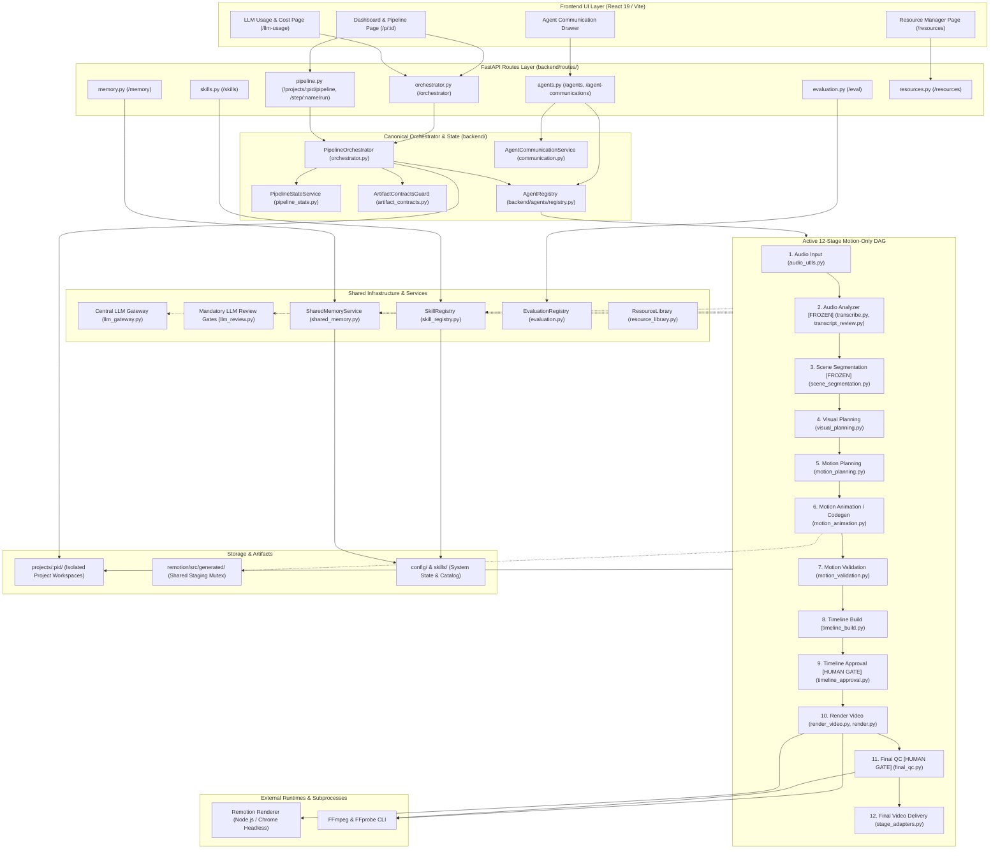

# A0 Dependency Map — Architecture, Dataflow & Concurrency Risks

**Audit ID:** A0-DEP-01  
**Timestamp:** 2026-10-16T14:15:00+05:30  
**Repository Root:** `E:\audio-to-video`  

---

## 1. System Architecture Diagram



---

## 2. Stage-by-Stage Dataflow & Artifact Contracts

The active pipeline follows a strictly linear, fail-closed contract progression:

```
Audio Input (audio.wav)
  │ (SHA-256 computed)
  ▼
Audio Analyzer (transcript.json, audio_analysis.json)
  │ [Telugu script preserved, phonetic English mapped]
  ▼
Scene Segmentation (scene_segmentation.json)
  │ [Duration bounds: 0.5s - 12.0s per scene]
  ▼
Visual Planning (visual_planning.json)
  │ [Semantic concepts, hierarchy, color palette, mandatory LLM review]
  ▼
Motion Planning (motion_planning.json)
  │ [Kinetic typography pacing, safe zones, spring curve timing]
  ▼
Motion Animation (scenes/scene_*.tsx, motion_manifest.json)
  │ [Real React/TSX synthesis, AST security audit, bounded repair]
  ▼
Motion & Timeline Validation (motion_validation_report.json)
  │ [12 deterministic checks, font verification, preview stills]
  ▼
Timeline Build (timeline.json)
  │ [Frame-exact arithmetic, total frames = duration * 30fps]
  ▼
Timeline Approval (timeline_approval.json, timeline_approval_history.json)
  │ [MANDATORY HUMAN GATE: binds timeline fingerprint, locks render]
  ▼
Render Video (out.mp4, render_report.json)
  │ [Remotion headless Chrome invocation, video stream encoding]
  ▼
Final QC (final_qc_report.json, final_qc_review.json)
  │ [MANDATORY HUMAN GATE: ffprobe check + playback review]
  ▼
Final Video Delivery (delivery_manifest.json)
  │ [All 4 gates audited, provenance sealed, delivery manifest published]
```

---

## 3. Imports & Path Sensitivities

### 3.1 Relative Import Chains in `backend/`
- `backend/agents/adapters/stage_adapters.py` uses deep relative imports:
  ```python
  from ... import final_qc, timeline_approval, timeline_gate, llm_review
  from ...artifact_contracts import validate_final_artifacts, _file_sha256, verify_path_confinement
  ```
  *Risk:* Any file move of `stage_adapters.py` or `backend/*.py` modules will break relative package traversal unless updated simultaneously.

### 3.2 Fixed Project Root Derivation
- `backend/config.py` defines `PROJECT_ROOT = Path(__file__).resolve().parent.parent`.
- `backend/resource_library.py` fixes `BASE = config.PROJECT_ROOT` at import time.
- `skills/` and `config/` paths are anchored to `PROJECT_ROOT`.
  *Impact:* Code must execute with working directory or Python module resolution rooted at `E:\audio-to-video`.

### 3.3 Remotion Child Process Invocation
- `backend/render.py` invokes Remotion via CLI:
  ```python
  cmd = [npx_cmd, "remotion", "render", "src/index.ts", "Main", ...]
  ```
  *Sensitivity:* Must run with `cwd=config.PROJECT_ROOT / "remotion"`.

---

## 4. Shared Mutable Output Directories & Concurrency Risks

| Shared Resource | Access Pattern | Current Protection | Residual Risk | Recommended Mitigation |
|---|---|---|---|---|
| `remotion/src/generated/` | Multiple projects compile scene TSX here | Process-level mutex `_remotion_staging_lock` in `motion_animation.py` | Cross-process workers (e.g. multiple Uvicorn workers) will bypass in-memory mutex | Keep single Uvicorn instance for now; migrate to isolated temp composition directories in future |
| `projects/<pid>/` | Single project writes state, manifests, TSX | Per-project lock `_PROJECT_LOCKS[pid]` in `orchestrator.py` | Low risk; concurrency within same project is strictly serialized | Maintain per-project mutex |
| `skills/catalog.json` | Central skill updates | Atomic write with `threading.RLock` in `skill_registry.py` | Low risk; writes are atomic (write to temp file then replace) | Maintain atomic file replacement |
| `config/shared_memory.json` | Central memory updates | Atomic write with `threading.RLock` in `shared_memory.py` | Low risk; writes are atomic | Maintain atomic file replacement |
| `config/llm_usage.json` | Telemetry recording | Atomic write with `threading.Lock` in `llm_usage.py` | Low risk; writes are serialized | Maintain atomic file replacement |
