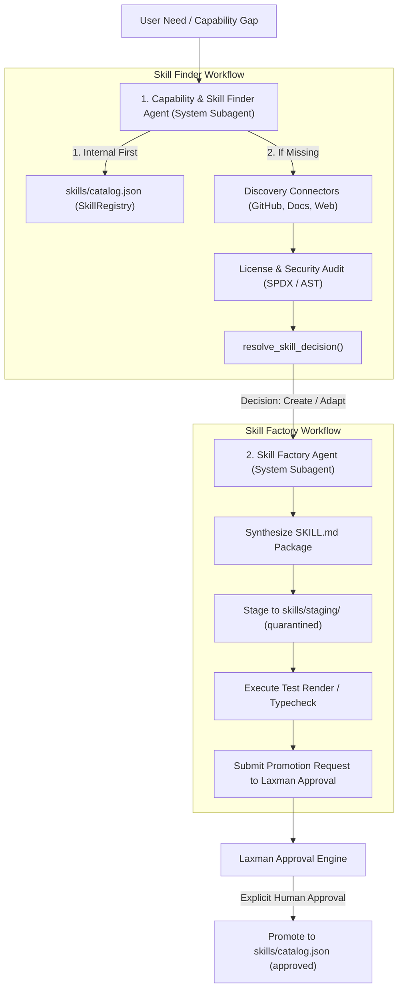

# A0 Skill Finder & Skill Factory Readiness Audit

**Audit ID:** A0-SKILL-01  
**Timestamp:** 2026-10-16T14:15:00+05:30  
**Repository Root:** `E:\audio-to-video`  

---

## 1. Executive Assessment

The current codebase possesses solid foundational infrastructure for skill governance (a versioned `SkillRecord` schema, a thread-safe `SkillRegistry`, static security auditing in `audit_skill_content()`, and an automated `resolve_skill_decision()` reuse evaluator). However, **neither the Capability & Skill Finder Agent nor the Skill Factory Agent exists as an autonomous agent in current source code**. Furthermore, remote discovery connectors and automated code generation for skill packages have not yet been built.

---

## 2. Capability Audit Matrix (17 Requirements)

| # | Capability Requirement | Current Status | Existing Module / Path | Evidence / Findings | Gaps Identified |
|---|---|---|---|---|---|
| 1 | **Capability Intake:** User need / category / URLs / batch intake | `partially_present` | `backend/routes/skills.py` (`POST /skills/stage-candidate`) | REST endpoint accepts manual JSON payload | No natural language need parser, no URL scraper, no batch discovery queue |
| 2 | **Project Capability Inspector:** Inspects codebase for capability gaps | `partially_present` | `backend/agents/registry.py` (`capabilities` field) | Agents declare static capabilities list | No dynamic AST scanner to identify missing capabilities from errors or tasks |
| 3 | **Internal Skill Search First:** Prioritizes existing internal approved skills before discovery | `verified_in_current_source` | `backend/skill_registry.py:SkillRegistry.search_skills()` | Evaluates exact/high-relevance reuse before proposing adapt/create | Keyword and tag matching only; lacks semantic embedding similarity |
| 4 | **Configured Discovery Connectors:** GitHub, package registries, web skill docs | `missing_after_scoped_search` | `backend/skill_registry.py` | Explicitly marked `DEFERRED & UNTRUSTED` in Phase 4 | Zero connector code for GitHub API, npm, PyPI, or external repositories |
| 5 | **Source Metadata & Pinned Commits:** Repository URL, commit SHA, version tracking | `partially_present` | `backend/skill_registry.py:SkillRecord` | Schema has `repository_url`, `commit_sha`, `version`, `content_sha256` | Schema fields exist but must be manually populated; no automated Git clone/pinning |
| 6 | **License & Provenance Checks:** License validation, attribution preservation | `partially_present` | `backend/skill_registry.py:resolve_skill_decision()` | Checks for permissive licenses (`Apache-2.0`, `MIT`, `BSD-3-Clause`, `CC-BY-4.0`) before adaptation | No automated SPDX file scanner or license text analyzer |
| 7 | **Security & Compatibility Audit:** Static security scan for prompt injection, shell execution, leakage | `verified_in_current_source` | `backend/skill_registry.py:audit_skill_content()` | Scans for prompt injection (`ignore previous`), shell execution (`os.system`, `subprocess`), API keys (`sk-...`), and path traversal (`../`) | Static regex-based scan only; no dynamic sandbox test execution |
| 8 | **Capability Classification:** Taxonomy classification with evidence/confidence | `partially_present` | `backend/skill_registry.py:SkillRecord` | Categorized by `domain` (`audio`, `motion`, `validation`) and `risk_level` | Manual classification only; lacks automated classifier agent |
| 9 | **Duplicate & Similarity Detection:** Checksum match and semantic deduplication | `partially_present` | `backend/skill_registry.py:register_skill()` | Collision detection by `skill_id` and SHA-256 content hash | Lacks semantic / embedding similarity to detect functionally identical skills |
| 10 | **Reuse Decision Engine:** Reuse as-is, adapt, reference-only, create-new, reject | `verified_in_current_source` | `backend/skill_registry.py:resolve_skill_decision()` | Implements 3-tier logic: 1. Reuse approved candidate; 2. Adapt domain skill if permissive; 3. Create or block | Fully implemented and verified in tests |
| 11 | **Skill Package Creation / Update:** Authoring canonical Markdown package & structure | `partially_present` | `skills/staging/` | Manual authoring supported; schema validated by `SkillRegistry` | No autonomous agent that authors `SKILL.md` from raw code or external repo |
| 12 | **Integration Adapters:** Seamless integration with existing agent runtime | `partially_present` | `backend/agents/base_agent.py` | `BaseAgent.get_skill()` and `search_skills()` methods exist | Skills are currently injected as prompt context; no executable plugin system |
| 13 | **Focused Test / Render Validation:** Verifying skill via test render before promotion | `partially_present` | `tests/test_skills_and_shared_memory.py`, `backend/evaluation.py` | Pytest suite tests skill loading; `evaluation.py` supports test suites | No automated pipeline that renders a synthetic Remotion composition to verify a new skill |
| 14 | **Registry Updates & Versioning:** Idempotent, atomic catalog persistence and changelog | `verified_in_current_source` | `backend/skill_registry.py` (`skills/catalog.json`) | Thread-synchronized atomic JSON replacement; version and SHA-256 tracking | Fully implemented and verified |
| 15 | **Checkpoint / Resume & Caching:** Resumable batch jobs and discovery caching | `partially_present` | `backend/pipeline_state.py` | Pipeline state supports checkpoints, but no batch discovery job runner exists | Lacks dedicated job state for long-running skill discovery |
| 16 | **Bounded Self-Improvement & Rollback:** Proposing improvements and rolling back regressions | `verified_in_current_source` | `backend/evaluation.py` | Hard technical checks beat LLM judge; baselines tracked; atomic rollback supported | Verified in `tests/test_evaluation_and_self_learning.py` |
| 17 | **UI & Status Reporting:** Dedicated screens for discovering, auditing, and promoting skills | `missing_after_scoped_search` | `frontend/src/api/client.ts` | TypeScript API client functions exist (`getSkills`, `getSkill`) | **Zero frontend UI pages or components exist for skills** |

---

## 3. Recommended Subagent Architecture for A1

To address these gaps without cluttering the 12-stage video pipeline, we recommend creating two distinct **System Subagents**:

