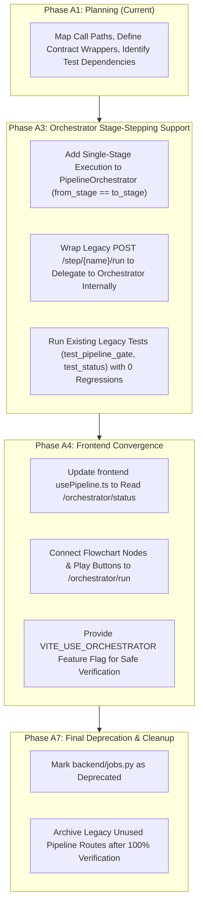

# A1 Execution Engine Migration Plan — JobRunner to PipelineOrchestrator

**Audit ID:** A1-MIG-01  
**Timestamp:** 2026-10-16T14:40:00+05:30  
**Repository Root:** `E:\audio-to-video`  

---

## 1. Context & Motivation

Phase A0 identified that two execution pathways currently coexist in `backend/`:
1. **`JobRunner` (`backend/jobs.py` + `backend/pipeline.py`):** The legacy single-step / chain runner built early in development. It powers existing stage buttons (`POST /projects/{pid}/step/{name}/run`) and status polling (`GET /projects/{pid}/pipeline`).
2. **`PipelineOrchestrator` (`backend/orchestrator.py`):** The canonical multi-stage DAG orchestrator built in Phase 8. It manages Phase 3 atomic checkpoints, bounded retries, concurrency locks, cooperative cancellation, correlation IDs, and agent telemetry.

Operating two parallel execution engines creates maintenance overhead, redundant route schemas, and potential state divergence. This document establishes an evidence-backed comparison and a gradual, reversible migration plan to converge on `PipelineOrchestrator`. **No code or execution switching occurs during Phase A1.**

---

## 2. In-Depth Architectural Comparison

| Dimension | Legacy `JobRunner` (`backend/jobs.py`) | Canonical `PipelineOrchestrator` (`backend/orchestrator.py`) | Convergence Advantage / Gap |
|---|---|---|---|
| **1. Primary Callers & Routes** | `POST /projects/{pid}/step/{name}/run`, `POST /projects/{pid}/pipeline/run` | `POST /projects/{pid}/orchestrator/run`, `POST /projects/{pid}/orchestrator/cancel` | `JobRunner` has direct UI wiring; `Orchestrator` has cleaner REST endpoints. |
| **2. Concurrency & Locking** | Global dictionary `_ACTIVE[pid]` checked via `jobs.is_running(pid)` | Per-project `_PROJECT_LOCKS[pid]` with strict mutex serialization & HTTP 409 conflict | `Orchestrator` provides true thread safety and prevents race conditions. |
| **3. State Ownership & Persistence** | Writes `projects/<pid>/job.json` (simple status + step list) | Writes Phase 3 `pipeline_state.json` + `projects/<pid>/orchestrator_runs.jsonl` | `Orchestrator` state is auditable, immutable, and tracks full lineage. |
| **4. Checkpoint & Safe Resume** | Relies on filesystem heuristics (checking if output file exists on disk) | Atomic Phase 3 checkpoints (`checkpoints/stage_<id>.json`) with DAG resume plans | `Orchestrator` eliminates re-computation of verified upstream stages. |
| **5. Retries & Fault Tolerance** | Zero retry logic; any exception marks job as failed | Bounded retries (max 3) for transient failures only; fails closed on auth/gate errors | `Orchestrator` prevents pipeline hangs while avoiding endless retry loops. |
| **6. Cancellation Semantics** | In-memory flag; child subprocesses must be manually killed | Cooperative cancellation with tracked child process process-group termination (`procs.py`) | `Orchestrator` safely terminates headless Chrome and FFmpeg without orphaned procs. |
| **7. Inter-Agent Communication & Logs** | Writes plain-text progress messages to `job.json` | Emits authentic `AgentMessage` records with correlation IDs to `communications.jsonl` | `Orchestrator` powers the real-time Agent Communication Drawer. |
| **8. Review & Approval Gates** | Gate checks performed in individual route handlers | Native orchestrator evaluation of mandatory LLM reviews and human approval gates | `Orchestrator` enforces gates centrally before dispatching downstream stages. |
| **9. Error Propagation & UI Polling** | Frontend polls `/pipeline` every 1.5s; parses error string | Supports both structured `/orchestrator/status` polling and SSE stream events | `Orchestrator` provides richer diagnostics, blocker hints, and capabilities. |
| **10. Test Coverage & Fixtures** | Tested in `test_pipeline_gate.py`, `test_render_video.py` | Tested in `test_orchestrator_and_monitoring.py`, `test_e2e_production_readiness.py` | Both are heavily tested; backward compatibility must be maintained. |

---

## 3. Gradual, Multi-Phase Migration Sequence

### Detailed Steps:
1. **Phase A3: Add Single-Stage Stepping to Orchestrator:**
   - Enhance `PipelineOrchestrator.start_run()` with an optional `single_stage: bool = False` or `target_stage: str | None = None` parameter.
   - When `target_stage` is specified, the orchestrator verifies upstream prerequisites via Phase 3 contracts, executes only the target stage adapter, persists the checkpoint, and halts without auto-advancing.
2. **Phase A3: Internal Route Delegation (Zero Breaking Changes):**
   - Refactor `backend/routes/pipeline.py` stage run endpoints (e.g., `POST /projects/{pid}/step/{name}/run`) to instantiate `PipelineOrchestrator` and execute the single stage.
   - Keep the HTTP response schema identical (`JobStarted` / `job.json`) so older callers receive the expected payload.
3. **Phase A4: Frontend UI Direct Connection:**
   - Update `frontend/src/pipeline/usePipeline.ts` to consume `/projects/{pid}/orchestrator/status`.
   - Update `PipelinePage.tsx` run buttons to call `api.startOrchestratorRun(...)`.
   - Provide a feature flag toggle (`VITE_USE_ORCHESTRATOR=true`) for reversible rollout.
4. **Phase A7: Safe Deprecation:**
   - Deprecate `backend/jobs.py` only after the entire test suite (121+ tests) passes with delegation enabled.

---

## 4. Rollback & Reversibility Strategy

- **Reversible Routing Wrapper:** The delegation in `backend/routes/pipeline.py` will use an environment flag `USE_CANONICAL_ORCHESTRATOR=true` (defaulting to `false` during initial testing).
- **Instant Rollback:** If any subtle regression or timing mismatch occurs during testing, toggling `USE_CANONICAL_ORCHESTRATOR=false` instantly restores original `JobRunner` execution without code changes.
- **Contract Parity Assurances:** Pre-migration and post-migration test suites will run side-by-side using deterministic synthetic project fixtures to verify identical artifact generation and SHA-256 output.
