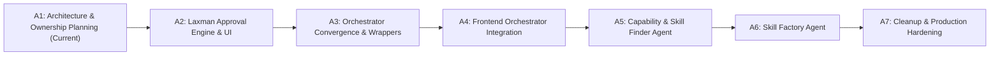

# A1 Implementation Phase Plan — Multi-Phase Roadmap (A2 through A7)

**Audit ID:** A1-ROADMAP-01  
**Timestamp:** 2026-10-16T14:40:00+05:30  
**Repository Root:** `E:\audio-to-video`  

---

## 1. Roadmap Overview

The transformation from the audited baseline to the complete target architecture is structured across 6 subsequent implementation phases. Each phase is self-contained, guarded by strict entry/exit criteria, requires explicit human authorization before starting, and introduces zero regressions to existing test suites.

---

## 2. Phase-by-Phase Implementation Specifications

### Phase A2: Central Laxman Approval Engine & Dedicated UI
- **Scope:**
  - Build `backend/approvals/approval_engine.py` (central request queue, state machine, cryptographic fingerprint binding).
  - Implement PIN verification service using constant-time comparison (`hmac.compare_digest`) against `LAXMAN_APPROVAL_PIN` / `config/.laxman_pin_hash`.
  - Implement anti-brute-force rate limiter and zero-logging sanitizer.
  - Implement integration adapters wrapping existing timeline approval (`backend/timeline_approval.py`), final QC review (`backend/final_qc.py`), and candidate promotion (`backend/evaluation.py`).
  - Create dedicated operator screen: `frontend/src/pages/LaxmanApprovalPage.tsx` mounted at `/approvals`.
- **Dependencies:** A1 Architecture Plan approved.
- **Affected Files:**
  - Create: `backend/approvals/approval_engine.py`, `backend/approvals/pin_service.py`, `backend/approvals/adapters/*.py`, `backend/routes/approvals.py`, `frontend/src/pages/LaxmanApprovalPage.tsx`, `tests/test_laxman_approval.py`.
  - Modify: `backend/main.py` (mount approvals router), `frontend/src/App.tsx` (add `/approvals` route).
- **Exit Criteria:** 100% of targeted approval tests pass; protected actions fail closed without valid PIN; existing timeline and QC gates function seamlessly through the central queue.
- **Approval Gate:** Laxman Human Approval required to proceed to A3.

---

### Phase A3: Execution Engine Convergence & Backend Wrappers
- **Scope:**
  - Enhance `backend/orchestrator.py` (`PipelineOrchestrator`) to support single-stage execution (`target_stage: str`).
  - Implement feature flag `USE_CANONICAL_ORCHESTRATOR` in `backend/config.py`.
  - Refactor `backend/routes/pipeline.py` step run endpoints (`POST /projects/{pid}/step/{name}/run`) to delegate execution to `PipelineOrchestrator` when the flag is enabled.
  - Maintain identical response schemas (`JobStarted`, `job.json`) for backward compatibility.
- **Dependencies:** Phase A2 complete.
- **Affected Files:**
  - Modify: `backend/orchestrator.py`, `backend/routes/pipeline.py`, `backend/config.py`.
  - Create: `tests/test_orchestrator_convergence.py`.
- **Exit Criteria:** All existing pipeline gate and step tests (`test_pipeline_gate.py`, etc.) pass with delegation enabled; zero regressions across 121 baseline tests.
- **Approval Gate:** Tech Lead / Human Sign-off.

---

### Phase A4: Frontend Orchestrator Integration & UI Alignment
- **Scope:**
  - Update `frontend/src/pipeline/usePipeline.ts` to query `/projects/{pid}/orchestrator/status`.
  - Connect flowchart stage nodes in `frontend/src/pipeline/PipelineChart.tsx` to orchestrator monitoring states.
  - Create `frontend/src/pages/AgentsDirectoryPage.tsx` displaying Video Engine Agents and System Subagents in separate tabs.
  - Add `/agents` link to the main navigation header in `frontend/src/App.tsx`.
- **Dependencies:** Phase A3 complete.
- **Affected Files:**
  - Create: `frontend/src/pages/AgentsDirectoryPage.tsx`.
  - Modify: `frontend/src/pipeline/usePipeline.ts`, `frontend/src/pipeline/PipelinePage.tsx`, `frontend/src/App.tsx`, `frontend/src/api/client.ts`.
- **Exit Criteria:** `npm run typecheck` passes with 0 errors; frontend tests pass; flowchart reflects real-time orchestrator state transitions.
- **Approval Gate:** Human Operator Sign-off.

---

### Phase A5: Capability & Skill Finder Agent (System Subagent)
- **Scope:**
  - Implement `backend/agents/system/skill_finder.py` inheriting from `BaseAgent` (`category=AgentCategory.SYSTEM_SUBAGENT`).
  - Implement capability gap intake and project capability inspector.
  - Wire search to query internal `SkillRegistry` first before any external discovery.
  - Implement sandboxed external discovery connectors (GitHub API, web documentation) with automatic quarantine staging in `skills/staging/`.
  - Integrate license verification (SPDX checks) and static security scan (`audit_skill_content`).
  - Record traceable reuse decisions (`resolve_skill_decision`) and submit candidate promotion proposals to Laxman Approval.
- **Dependencies:** Phase A2 (Laxman Approval) and Phase A4 complete.
- **Affected Files:**
  - Create: `backend/agents/system/skill_finder.py`, `backend/agents/system/connectors/*.py`, `tests/test_skill_finder_agent.py`.
  - Modify: `backend/agents/registry.py` (register `skill_finder` as system subagent).
- **Exit Criteria:** Agent queries internal catalog first; external candidates quarantined; static security scan rejects malicious tokens; promotion requires Laxman PIN.
- **Approval Gate:** Laxman Human Approval required.

---

### Phase A6: Skill Factory Agent (System Subagent)
- **Scope:**
  - Implement `backend/agents/system/skill_factory.py` inheriting from `BaseAgent` (`category=AgentCategory.SYSTEM_SUBAGENT`).
  - Implement canonical `SKILL.md` synthesis from approved proposals.
  - Enforce structural schema validation and path confinement in `skills/`.
  - Build automated Remotion test render verification harness: renders a synthetic test composition to prove the new skill functions in Remotion.
  - Manage atomic versioning, changelog generation, and atomic updates to `skills/catalog.json`.
  - Submit final promotion request with test render evidence to Laxman Approval.
- **Dependencies:** Phase A5 complete.
- **Affected Files:**
  - Create: `backend/agents/system/skill_factory.py`, `backend/agents/system/skill_validator.py`, `tests/test_skill_factory_agent.py`.
  - Modify: `backend/agents/registry.py` (register `skill_factory` as system subagent).
- **Exit Criteria:** Generated skills compile cleanly; Remotion test render executes with exit code 0; skill promoted to catalog only upon Laxman PIN approval.
- **Approval Gate:** Laxman Human Approval required.

---

### Phase A7: Repository Cleanup & Production Hardening
- **Scope:**
  - Execute approved cleanup of `REMOVE-CANDIDATE` items: delete orphaned `dashboard/` (reclaiming 175 MB) and `.claude/worktrees/` (reclaiming 32 MB) after taking local zip backups.
  - Refactor `tests/test_status.py` to decouple from root `STATUS.json` or archive both under `docs/archive/`.
  - Deprecate legacy `backend/jobs.py`.
  - Update `docs/OPERATOR_RUNBOOKS.md` with Laxman Approval operational procedures.
  - Run full end-to-end cross-phase regression test suite.
- **Dependencies:** Phases A2 through A6 complete and verified.
- **Affected Files:**
  - Delete: `dashboard/` (untracked), `.claude/worktrees/` (untracked).
  - Archive/Refactor: `STATUS.json`, `STATUS.md`, `tests/test_status.py`, `backend/jobs.py`.
- **Exit Criteria:** 207 MB disk space reclaimed; 100% of test suites pass with zero regressions; frontend typecheck passes with 0 errors; final production sign-off.
- **Approval Gate:** Final Human Operator Sign-off.
