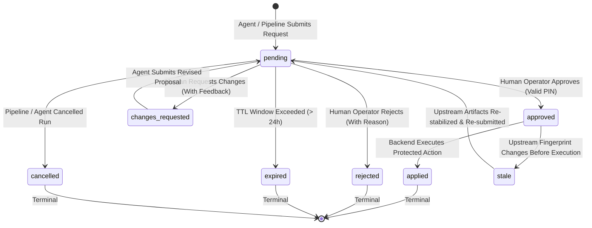

# A1 Laxman Approval Design — Central PIN-Protected Authorization

**Audit ID:** A1-APP-DESIGN-01  
**Timestamp:** 2026-10-16T14:40:00+05:30  
**Repository Root:** `E:\audio-to-video`  

---

## 1. Executive Purpose & User Decisions Applied

As directed by the user, **Laxman Approval** is a centralized, server-enforced permission request queue and operator inbox UI. It is **not an agent**. It acts as the authoritative human governance gate for all protected side-effects across the multi-agent system.

### Key Mandates
1. **PIN Protection is Mandatory:** Approval actions require a verified PIN. Protected actions must fail closed (`403 Forbidden`) if the PIN is missing or invalid.
2. **Zero Plaintext Secrets:** The PIN is **never** committed to Git, hardcoded in source code, echoed in API responses, or printed in logs.
3. **Backend Authorization Enforcement:** The backend authorization engine validates approval and PIN immediately before executing any protected side-effect. Hiding or disabling UI buttons is **never** considered security.
4. **Exact-Action Cryptographic Binding:** Approvals bind to the exact input artifact fingerprint (SHA-256). Any material modification to upstream assets immediately invalidates approval (`status="stale"`), locking protected operations.
5. **Strict Three-Way Review Separation:**
   - **LLM Review:** Automated heuristic rubric scoring (in `backend/llm_review.py`).
   - **Technical Validation:** Deterministic checks, tests, schemas, ffprobe media checks.
   - **Laxman Approval:** Explicit human authorization submitted with a valid PIN.

---

## 2. PIN Security & Verification Specification

### 2.1 Storage & Configuration
- **Primary Source:** Environment variable `LAXMAN_APPROVAL_PIN` (set in `.env` or system environment).
- **Secondary / Persistent Source:** `config/.laxman_pin_hash` (stores a PBKDF2-HMAC-SHA256 salted hash with 100,000 iterations, never plaintext).
- **Initial Setup / Secret Storage:** If neither is configured, the server starts in uninitialized approval mode: read-only status viewing is permitted, but all protected action requests fail closed with `approval_pin_not_configured`. An operator setup script (`scripts/set_laxman_pin.py`) or API initializes the salted hash file.
- **Git Protection:** `config/.laxman_pin_hash` is explicitly added to `.gitignore`.

### 2.2 Constant-Time Verification & Anti-Brute-Force Controls
- **Timing Attack Defense:** Verification strictly uses Python's standard `hmac.compare_digest()` to ensure constant-time string comparison.
- **Rate-Limiting & Backoff:**
  - Maximum 5 failed attempts per IP / session within a 15-minute rolling window.
  - Progressive backoff delay: 1st failure = 0.5s, 2nd = 1.0s, 3rd = 2.0s, 4th = 4.0s, 5th = 8.0s.
  - After 5 consecutive failures, the approval endpoint locks for 15 minutes and emits a high-priority security audit event to `config/approvals_audit.jsonl`.
- **Zero-Logging Guarantee:** Fast-fail logging sanitizers redact any header matching `X-Laxman-PIN` or JSON field matching `"pin"`, replacing values with `***REDACTED_PIN***`.

---

## 3. Standardized Approval Request Schema (`ApprovalRequest`)

Persisted in `config/approvals_queue.json` (thread-synchronized atomic JSON):

```json
{
  "request_id": "appr_7f3e9b12_4a8c",
  "idempotency_key": "idem_proj01_render_16x9_v1",
  "created_at": "2026-10-16T14:40:00Z",
  "requester_agent_id": "render_video",
  "project_id": "proj_test_01",
  "action_type": "timeline_render",
  "risk_level": "medium",
  "action_summary": "Authorize Remotion headless video render for 16:9 composition (15 frames, 0.5s)",
  "affected_files": [
    "projects/proj_test_01/timeline.json",
    "projects/proj_test_01/generated_motion/scene_1.tsx",
    "projects/proj_test_01/out.mp4"
  ],
  "action_fingerprint": "a1b2c3d4e5f6...",
  "upstream_evidence": {
    "timeline_fingerprint": "a1b2c3d4e5f6...",
    "motion_validation_status": "passed",
    "llm_review_score": 0.95,
    "preview_stills": [
      "projects/proj_test_01/preview_scene_1.jpg"
    ]
  },
  "expected_outcomes": [
    "Produce out.mp4 video file",
    "Capture render telemetry report"
  ],
  "reversibility": "rerunnable",
  "rollback_plan": "Delete generated out.mp4 and render_report.json; restore previous state",
  "status": "pending",
  "decision": null,
  "reviewer": null,
  "decision_reason": null,
  "decision_at": null,
  "expires_at": "2026-10-17T14:40:00Z"
}
```

---

## 4. State Machine & Lifecycle Transitions



### Allowed Transitions
1. `pending` $\rightarrow$ `approved` (Requires valid Laxman PIN + operator identifier).
2. `pending` $\rightarrow$ `rejected` (Requires non-empty rejection reason).
3. `pending` $\rightarrow$ `changes_requested` (Requires structured change instructions).
4. `pending` $\rightarrow$ `expired` (Automated when timestamp > `expires_at`).
5. `pending` $\rightarrow$ `cancelled` (Automated if run is cancelled cooperatively).
6. `approved` $\rightarrow$ `applied` (Executed by backend runner; verified matching fingerprint).
7. `approved` $\rightarrow$ `stale` (Triggered if any upstream artifact SHA changes prior to execution).

---

## 5. Protected Side-Effects & Backend Enforcement Points

| Protected Side-Effect | Requesting Agent / Subsystem | Enforcement Point | Staleness Criteria | Fallback / Block Action |
|---|---|---|---|---|
| **Remotion Video Render** | `render_video` | `backend/render_video.py:require_approved()` | `timeline.json` SHA or remotion config SHA changes | Render subprocess is blocked; returns HTTP 403 / 409 |
| **Final Video Delivery Publication** | `final_video_delivery` | `backend/agents/adapters/stage_adapters.py:FinalVideoDeliveryAdapter` | Candidate `out.mp4` SHA changes | Delivery manifest generation blocked; returns `needs_review` |
| **Skill Package Promotion to Production** | `skill_factory` (Planned) | `backend/skill_registry.py:transition_status("approved")` | Staged `SKILL.md` SHA changes | Skill remains quarantined in `skills/staging/` |
| **Shared Memory Item Promotion** | `shared_memory` | `backend/shared_memory.py:promote_candidate()` | Proposed observation modified | Observation remains in `status="proposed"` |
| **Autonomous Code Patch Application** | Future Self-Learning Repair | Self-learning code generator | Target file SHA changes | Patch rejected; diagnostic loop re-runs |

---

## 6. Integration Adapters for Existing Fragmented Gates

To avoid duplicate approval systems, Phase A2 will implement lightweight integration adapters bridging existing stage files to the central `ApprovalEngine`:

1. **Timeline Approval Adapter (`backend/approvals/adapters/timeline_adapter.py`):**
   - Automatically projects `timeline_approval_history.json` records into the central approval queue.
   - Submitting an approval via `Laxman Approval` writes both to the central audit log and the project's canonical `timeline_approval_history.json`, maintaining 100% backward compatibility with `backend/timeline_gate.py`.
2. **Final QC Playback Sign-off Adapter (`backend/approvals/adapters/qc_adapter.py`):**
   - Bridges human video playback reviews from `final_qc_review.json` into the central inbox.
   - Signing off in Laxman Approval writes the review event and SHA-256 into `final_qc_review.json`.
3. **Evaluation Candidate Promotion Adapter (`backend/approvals/adapters/eval_adapter.py`):**
   - Surfaces candidate skills and memory observations from `config/eval_candidates.json` as pending approval items in the Laxman Approval inbox.

---

## 7. Dedicated UI Screen (`frontend/src/pages/LaxmanApprovalPage.tsx`)

Mounted at route `/approvals`:
- **Top Metrics Bar:** Total Pending, Approved (Last 24h), Changes Requested, Stale / Expired.
- **Filter Tabs:** All Requests, Video Renders, Final Delivery, Skills & Memory, System Operations.
- **Request Inspection Card:**
  - Requester Agent badge and target project ID.
  - Plain-language action summary and risk badge (`LOW`, `MEDIUM`, `HIGH`, `CRITICAL`).
  - Evidence viewer: Staged preview stills, media player with audio, code diff, or license audit.
  - Action fingerprint (short SHA) and timestamp.
- **Action Modal / Controls:**
  - **Approve Button:** Opens PIN confirmation modal. Requires 4-to-8 digit PIN. Submits with `X-Laxman-PIN` header.
  - **Request Changes Button:** Opens feedback dialog to input specific revision notes.
  - **Reject Button:** Rejects request permanently with mandatory rationale.
