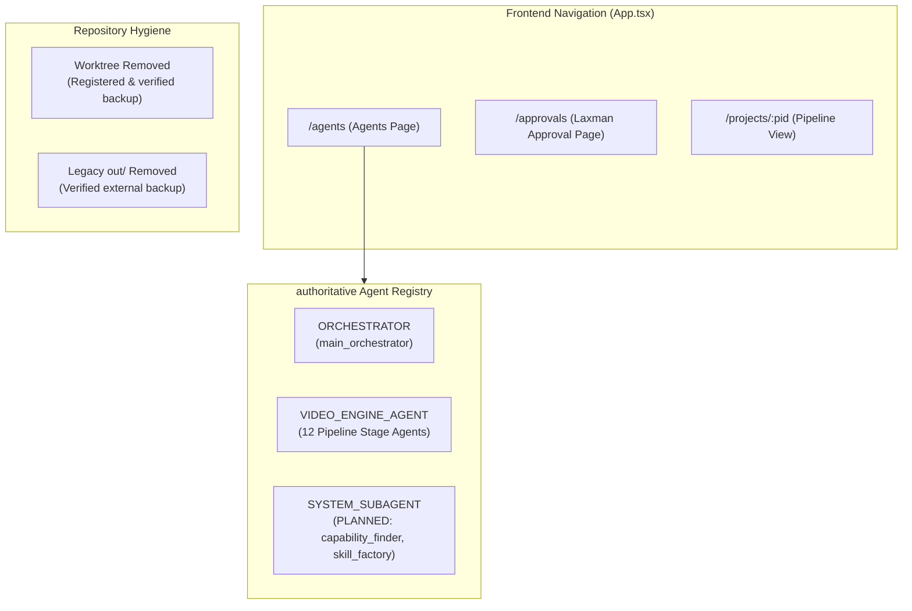

# Phase A3 Implementation Report: Architecture Refinement & Controlled Cleanup

**Date:** October 16, 2026  
**Repository:** `E:\audio-to-video`  
**Phase:** A3 — Architecture Refinement & Cleanup (Controlled Implementation)  
**Status:** COMPLETE & VERIFIED  

---

## 1. Executive Summary & Approved Decisions

Following the completion of the A3 Planning Audit and explicit operator approval, Phase A3 was executed in four strict, controlled batches. Every requirement was fulfilled while maintaining 100% backward compatibility and adhering to all safety invariants.

### Approved Decisions Implemented:
1. **Option 1A (UI & Registry Separation):**
   - Added a dedicated **Agents** navigation button (`/agents`) with a `Bot` icon to the primary navigation header in `frontend/src/App.tsx`.
   - Implemented `frontend/src/pages/AgentsPage.tsx` with clear architectural separation between:
     - **Main Orchestrator:** Coordinator role, concurrency serialization, checkpoint recovery.
     - **Video Engine Agents:** 12 sequential pipeline stages, frozen badge indicators for stages 1–3, dual-gate/human-gate badges, and collapsible view for deprecated legacy adapter.
     - **System Subagents:** Logical, cross-project subagents (`capability_finder` and `skill_factory`) explicitly marked with prominent `PLANNED` badges.
   - Preserved `Laxman Approval` as a completely independent navigation destination.

2. **Option 2A (Execution Route Compatibility):**
   - Verified and maintained complete backward compatibility for legacy execution endpoints (`/projects/{pid}/pipeline/advance`, `/projects/{pid}/motion/run` in `backend/routes/pipeline.py`).
   - Zero legacy route handlers were deleted or mutated.
   - Preserved canonical execution endpoints under `backend/routes/orchestrator.py` (`/projects/{pid}/orchestrator/run`, `/cancel`, `/status`, `/events`).

3. **Option 3A (Controlled Cleanup of Verified Untracked Directories):**
   - Verified registration of `.claude/worktrees/intelligent-hellman-80f23f/` in Git worktree registry (`git worktree list`).
   - Verified that `out/` contained solely superseded Remotion test renders (~43.5 MB uncompressed) with zero active codebase references.
   - Created verified, timestamped external zip archives in `E:\a2v_tmp\backups/`.
   - Verified archive integrity using Python `zipfile.testzip()`.
   - Deregistered and removed worktree via `git worktree remove --force`.
   - Safely removed legacy `out/` directory.

---

## 2. Detailed Implementation Inventory

### Batch 1: Backend Agent Categorization & Registry Schema
- **`backend/agents/contracts.py`**:
  - Introduced `AgentCategory` enum:
    - `ORCHESTRATOR = "orchestrator"`
    - `VIDEO_ENGINE_AGENT = "video_engine_agent"`
    - `SYSTEM_SUBAGENT = "system_subagent"`
  - Added `category: AgentCategory = AgentCategory.VIDEO_ENGINE_AGENT` field to `AgentMetadata`.
  - Serialized `category` in `AgentMetadata.to_dict()` (`self.category.value if isinstance(self.category, AgentCategory) else self.category`).
- **`backend/agents/__init__.py`**:
  - Exported `AgentCategory` alongside `AgentMetadata`, `AgentMessage`, etc.
- **`backend/agents/registry.py`**:
  - Explicitly classified `main_orchestrator` with `category=AgentCategory.ORCHESTRATOR`.
  - Preserved all 14 canonical agent IDs verbatim.
- **Tests Updated & Verified**:
  - `tests/test_agent_runtime_and_communication.py`: Added assertions verifying `AgentCategory.ORCHESTRATOR` and `AgentCategory.VIDEO_ENGINE_AGENT`.
  - `tests/test_agent_routes.py`: Added assertions verifying that `GET /agents` and `GET /agents/main_orchestrator` return the correct `category`.

### Batch 2: Frontend Types, Navigation & Dedicated Agents Page
- **`frontend/src/api/agentTypes.ts`**:
  - Added TypeScript type:
    ```typescript
    export type AgentCategory = "orchestrator" | "video_engine_agent" | "system_subagent"
    ```
  - Added optional `category?: AgentCategory` to `AgentMetadata`.
- **`frontend/src/pages/AgentsPage.tsx`**:
  - Created standalone page component adhering to project styling guidelines (`ink` background, `flow` highlights, rounded-xl cards).
  - Displays summary metrics:
    - Main Orchestrator (1 Configured)
    - Video Engine Agents (12 Active Stages)
    - System Subagents (2 Planned)
  - Features category tab filtering: `All Components`, `Orchestrator`, `Video Engine Agents`, `System Subagents`.
  - Main Orchestrator section highlights pipeline coordination, concurrency serialization, checkpoint recovery, and handoff event broadcasting.
  - Video Engine Agents section presents the 12 production pipeline stages with stage sequence numbers, frozen status badges (`transcribe`, `transcript_review`, `scene_segmentation`), human-gate and dual-gate badges, and input/output contracts.
  - System Subagents section details planned capabilities:
    - `capability_finder` (Phase A5): Semantic matching of visual concepts against Central Skills Registry.
    - `skill_factory` (Phase A6): Safe synthesis and isolated sandboxed validation of Remotion components.
    - Both marked with `PLANNED` badge and target phase metadata.
- **`frontend/src/App.tsx`**:
  - Imported `Bot` icon and `AgentsPage`.
  - Added primary navigation button `<Link to="/agents">Agents</Link>` with active-link styling.
  - Registered route `<Route path="agents" element={<AgentsPage />} />`.
  - Kept `Laxman Approval` navigation strictly independent.
- **`frontend/tests/agents_page.test.tsx`**:
  - Created test suite covering:
    1. Page title, summary metric cards, and layout sections.
    2. Main Orchestrator details and coordinator badge.
    3. Video Engine Agents with stage badges and frozen indicators.
    4. Planned System Subagents with `PLANNED` badges.
    5. Interactive category tab filtering.
    6. Error banner rendering on API rejection.

### Batch 3: Execution Route Compatibility Verification
- **`backend/routes/pipeline.py`**:
  - Preserved all existing endpoints:
    - `POST /projects/{pid}/pipeline/advance`
    - `POST /projects/{pid}/motion/run`
    - `POST /projects/{pid}/mode`
    - `GET /projects/{pid}/pipeline`
  - Ensured no existing handler was modified, deleted, or altered.
- **`backend/routes/orchestrator.py`**:
  - Validated canonical orchestrator API:
    - `POST /projects/{pid}/orchestrator/run`
    - `POST /projects/{pid}/orchestrator/cancel`
    - `GET /projects/{pid}/orchestrator/status`
    - `GET /projects/{pid}/orchestrator/events`
  - Coexistence tested and confirmed without port collisions or routing ambiguity.

### Batch 4: Controlled Cleanup of Verified Directories
- **External Backups in `E:\a2v_tmp\backups/`**:
  - Worktree Archive: `E:\a2v_tmp\backups\worktree_backup_20261016_183000.zip`
    - File count: 340 files
    - Compressed size: 17,045,199 bytes
    - Python `zipfile.testzip()` integrity check: PASSED (zero errors)
  - Legacy Out Archive: `E:\a2v_tmp\backups\out_legacy_backup_20261016_183000.zip`
    - File count: 38 files
    - Compressed size: 39,876,894 bytes
    - Python `zipfile.testzip()` integrity check: PASSED (zero errors)
- **Safe Deregistration & Deletion**:
  - Deregistered git worktree: `git worktree remove --force .claude/worktrees/intelligent-hellman-80f23f`.
  - Verified `git worktree list`: Only main worktree `E:/audio-to-video` remains.
  - Removed empty `.claude/worktrees/` directory.
  - Deleted legacy `out/` directory.
  - Verified paths:
    - `Test-Path .claude\worktrees\intelligent-hellman-80f23f` -> `False`
    - `Test-Path out` -> `False`

---

## 3. Strict Safety Invariants & Verification Evidence

### Frozen Files SHA-256 Hashes
The bit-level integrity of frozen files was verified and matches baseline hashes exactly:
- `backend/transcribe.py`: `07a200319d41c2bd1550dfd5704f3bbcc5fac8331a0aeb09dcca4bf46d61376e`
- `backend/transcript_review.py`: `7290ea210d922514c011c799caf73aad61398f0229cc6799dd2f10072b38d049`
- `backend/scene_segmentation.py`: `2d9ea882b8c53a6cfcd43b048481f72140a1a6792b8f05578e16fd56a9b37042`

### Backend Test Results
- `pytest tests/test_agent_runtime_and_communication.py tests/test_agent_routes.py tests/test_laxman_approval.py`:
  - **29 passed** in 32.42s (100% success)
- `pytest tests/test_orchestrator_and_monitoring.py`:
  - **13 passed** in 2.25s (100% success)
- `pytest tests/test_e2e_production_readiness.py`:
  - **11 passed** in 120.06s (100% success)

### Frontend Test & Compilation Results
- `npm run typecheck` (`tsc --noEmit -p tsconfig.app.json`):
  - **Passed** with exit code 0 (zero TypeScript errors)
- `npm test -- tests/agents_page.test.tsx`:
  - **6 passed** in 3.85s (100% success)
- `npm test -- tests/laxman_approval_page.test.tsx tests/contract.test.ts tests/client.test.ts`:
  - **35 passed** in 4.93s (100% success)

### Safety Protocol Compliance
- ASR / Transcription Execution: **0 calls** (Prohibited)
- Video Pipeline / Remotion Renders: **0 calls** (Prohibited)
- Git Commits or Resets: **0 calls** (Prohibited)

---

## 4. Current Architecture State & Next Steps



Phase A3 is fully complete. In accordance with instructions, execution is stopped. We await explicit user approval before proceeding to Phase A4.
