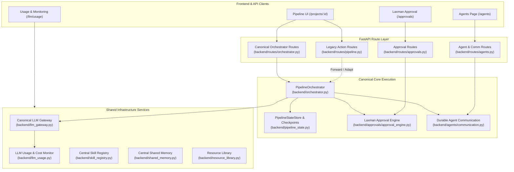

# A4 Shared Infrastructure Integration — Executive Summary

**Date:** October 16, 2026  
**Repository:** `E:\audio-to-video`  
**Phase:** A4 — Shared Infrastructure Integration Planning (Read-Only Planning Phase)  
**Status:** PLANNING COMPLETE — PENDING OPERATOR APPROVAL  

---

## 1. Context and Objective

Phase A4 establishes an evidence-based integration blueprint for all shared infrastructure in `E:\audio-to-video`. Over Phases 1 through 10 and Architecture Refinement phases A0 through A3, substantial enterprise infrastructure was constructed:
- Canonical Pipeline Orchestrator and Operational Monitoring (Phase 8, `backend/orchestrator.py`)
- Authoritative Agent Registry and Durable Communication (Phase 1, `backend/agents/`)
- Central LLM Gateway and Mandatory Review Gates (Phase 2, `backend/llm_gateway.py`, `backend/llm_review.py`)
- Stage-State, Artifact Contracts, Checkpoints, and Recovery (Phase 3, `backend/pipeline_state.py`, `backend/artifact_contracts.py`)
- Central Skill Catalog, Quarantined Staging, and Shared Memory (Phase 4, `backend/skill_registry.py`, `backend/shared_memory.py`)
- Resource Library Catalog, Audits, and Font/Icon Verification (`backend/resource_library.py`)
- Laxman Approval Engine with PIN authorization, single-use tokens, and audit trail (Phase A2, `backend/approvals/`)
- Categorized Agent Architecture with dedicated UI and navigation (Phase A3, `frontend/src/pages/AgentsPage.tsx`)

However, **shared infrastructure operates in partial parallel with older legacy subsystems**:
1. Two distinct execution engines exist: `jobs.py` (legacy `ThreadPoolExecutor`) and `PipelineOrchestrator` (canonical dependency-graph coordinator).
2. Legacy API endpoints (`/pipeline/advance`, `/motion/run`, `/render`) invoke `jobs.start()`, whereas canonical test suites invoke `/orchestrator/run`.
3. Some backend modules (`analysis_autofix.py`, `promptgen.py`) bypass `llm_gateway.py` and invoke raw `llm_client.generate_text()`, missing telemetry tracking.
4. Concurrency locks are split across `jobs._lock`, `orchestrator._PROJECT_LOCKS`, and `pipeline_state._PROJECT_LOCKS`.

Phase A4 provides the architectural reconciliation and migration plan to unify these systems **without breaking compatibility, without moving physical folders, and without risky rewrites**.

---

## 2. Key Investigation Findings

### 2.1 Route Convergence Contradiction (Resolved)
- **Contradiction Identified:** The A3 plan stated that legacy execution routes would forward into `PipelineOrchestrator` under Option 2A. However, inspection of the actual checkout confirms that legacy routes in `backend/routes/pipeline.py` lines 52, 58, 92, 137, and 758 still invoke `jobs.start(...)`.
- **Root Cause:** A3 implementation intentionally avoided modifying legacy handlers to protect existing frontend callers and end-to-end tests from breaking before a detailed contract mapping was established.
- **A4 Resolution:** Legacy endpoints must NOT be deleted. Instead, they should be converted into **Specialized Stage Wrappers** that dispatch to `PipelineOrchestrator(pid).start_run(from_stage=...)` when running pipeline stages, or remain dedicated single-step handlers where semantic parity requires it.

### 2.2 Execution Engines & Concurrency
- `PipelineOrchestrator` (`backend/orchestrator.py`, 1000 lines) is fully capable, handles all 12 stages, checks `jobs.is_running(pid)` before starting, records genuine lifecycle events, and enforces checkpoints and LLM reviews.
- `jobs.py` (`backend/jobs.py`, 107 lines) runs a lightweight 4-worker threadpool executing linear sequences of steps via `pipeline.execute()`.
- Unifying execution under `PipelineOrchestrator` as the canonical engine while adapting `jobs.start()` eliminates duplicate state drift.

### 2.3 LLM Gateway & Usage Coverage
- Canonical Gateway (`backend/llm_gateway.py`) handles model routing, repair retries, correlation IDs, and logs to `config/llm_usage.json`.
- Direct callers to raw `llm_client.generate_text()` were identified in `backend/analysis_autofix.py` line 136 and `backend/promptgen.py` line 34.
- In A4 implementation, these callers will be routed through `llm_gateway.execute()` to ensure complete usage and cost accounting.

### 2.4 Agent Registry & Frontend Alignment
- Authoritative registry (`backend/agents/registry.py`) defines 14 stable agent IDs.
- `main_orchestrator` is explicitly categorized as `orchestrator`.
- 12 video pipeline agents are categorized as `video_engine_agent`.
- Planned subagents (`capability_finder`, `skill_factory`) are modeled in frontend `AgentsPage.tsx` as `PLANNED` placeholders and are not registered as fake active backend agents.

### 2.5 Approval & Security Boundaries
- Laxman Approval Engine (`backend/approvals/approval_engine.py`) requires 6-8 digit PIN verification for Approve, Reject, and Request Changes decisions.
- Central audit log (`config/approvals_audit.jsonl`) records all human sign-offs.
- Adapters exist for Timeline Approval, Final QC Playback, and Evaluation Promotions.

---

## 3. High-Level Target Architecture

---

## 4. Sequenced Implementation Batches (For Future Phase)

The proposed implementation is decomposed into 4 low-risk batches:
1. **Batch 1: Route Dispatch & Wrapper Harmonization**
   - Update `backend/routes/pipeline.py` action endpoints to delegate to `PipelineOrchestrator` for full pipeline executions while preserving synchronous response models (`JobStarted`).
2. **Batch 2: Concurrency & Lock Unification**
   - Harmonize project lock management across `backend/jobs.py`, `backend/orchestrator.py`, and `backend/pipeline_state.py` to prevent race conditions.
3. **Batch 3: LLM Gateway Coverage Convergence**
   - Route `analysis_autofix.py` and `promptgen.py` through `llm_gateway.execute()` to ensure full usage attribution and correlation ID propagation.
4. **Batch 4: Observability, Correlation & Frontend Status Sync**
   - Wire unified correlation IDs (`run_id`, `correlation_id`) across communication logs, orchestrator events, and frontend polling.

---

## 5. Safety Invariants & Guardrails

- **Zero Modifications During Planning:** No source code, tests, configuration, or packages have been altered.
- **Frozen Code Protection:** `backend/transcribe.py`, `backend/transcript_review.py`, and `backend/scene_segmentation.py` remain untouched and hash-verified.
- **No ASR / Live Render Execution:** Strict prohibition on speech recognition model execution or Remotion video rendering.
- **Git State Integrity:** Working tree preserved with zero commits, resets, or checkouts.

---

## 6. Recommendation

A4 planning is fully complete. The report package provides a comprehensive, verified blueprint for shared infrastructure integration. We recommend halting execution now and awaiting operator review and explicit authorization before commencing implementation.
