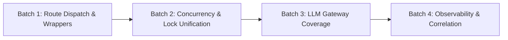

# A4 Implementation Batches & Sequencing Plan

**Date:** October 16, 2026  
**Repository:** `E:\audio-to-video`  
**Phase:** A4 — Shared Infrastructure Integration Planning  
**Status:** PLANNING ONLY — PENDING OPERATOR APPROVAL  

---

## 1. Batch Decomposition Strategy

To minimize risk, avoid regressions, and preserve working code at every step, implementation of Phase A4 is decomposed into **4 sequential, test-verified batches**. Each batch defines its exact file scope, affected contracts, verification tests, and rollback trigger.

---

## 2. Detailed Batch Specifications

### Batch 1: Route Dispatch & Wrapper Harmonization
- **Objective:** Convert legacy execution routes in `backend/routes/pipeline.py` into thin wrappers dispatching to `PipelineOrchestrator(pid).start_run(from_stage=...)`.
- **Affected Files:**
  - `backend/routes/pipeline.py`:
    - `run_motion()` (`POST /projects/{pid}/motion/run`) -> calls `PipelineOrchestrator.start_run(from_stage="motion_plan")`.
    - `run_timeline_build()` (`POST /projects/{pid}/timeline-build/run`) -> calls `PipelineOrchestrator.start_run(from_stage="timeline")`.
    - `run_final_qc()` (`POST /projects/{pid}/final-qc/run`) -> calls `PipelineOrchestrator.start_run(from_stage="qc")`.
    - Wrap in feature flag `config.improve("orchestrator_wrapper")` defaulting to enabled with instant fallback.
- **Contract Impact:** Zero external API break. Return models remain `JobStarted(project=..., label=..., steps=...)`.
- **Preconditions:** `PipelineOrchestrator` passes all tests in `tests/test_orchestrator_and_monitoring.py`.
- **Success Criteria:** Calling `POST /projects/{pid}/motion/run` triggers orchestrator run, records lifecycle events in `communications.jsonl`, updates `.pipeline_state.json`, and returns 202 Accepted.
- **Verification Tests:**
  - `pytest tests/test_orchestrator_and_monitoring.py`
  - `pytest tests/test_motion_only_mode.py`
  - `npm --prefix frontend test -- tests/client.test.ts`
- **Rollback:** Set `A2V_ORCHESTRATOR_WRAPPER=0` to immediately revert to `jobs.start()`.

---

### Batch 2: Concurrency & Lock Unification
- **Objective:** Establish a single authoritative per-project lock helper to prevent simultaneous execution races between legacy endpoints and orchestrator runs.
- **Affected Files:**
  - `backend/store.py`: Add `get_project_lock(pid: str) -> threading.Lock` backed by global mutex.
  - `backend/jobs.py`: Use `store.get_project_lock(pid)` in `jobs.start()` and check `orchestrator.is_running(pid)`.
  - `backend/orchestrator.py`: Use `store.get_project_lock(pid)` in `start_run()` and check `jobs.is_running(pid)`.
- **Contract Impact:** None. Internal thread-synchronization improvement.
- **Preconditions:** Batch 1 verified.
- **Success Criteria:** Concurrent requests to `/motion/run` and `/orchestrator/run` serialize safely; second request raises HTTP 409 `job_running`.
- **Verification Tests:**
  - `pytest tests/test_orchestrator_and_monitoring.py -k test_concurrency`
  - `pytest tests/test_agent_runtime_and_communication.py`
- **Rollback:** Revert `store.get_project_lock` references to module-local locks.

---

### Batch 3: LLM Gateway Coverage Convergence
- **Objective:** Migrate direct callers of raw `llm_client.generate_text()` to `llm_gateway.execute()`.
- **Affected Files:**
  - `backend/analysis_autofix.py`: Replace `llm_client.generate_text()` (line 136) with `llm_gateway.LlmGatewayRequest(purpose="repair", model_profile="fast_structured")`.
  - `backend/promptgen.py`: Replace `llm_client.generate_text()` (line 34) with `llm_gateway.LlmGatewayRequest(purpose="generation", model_profile="fast_structured")`.
- **Contract Impact:** None. Return values remain strings / dicts.
- **Preconditions:** Batch 2 verified.
- **Success Criteria:** Analysis autofix and prompt generation calls are recorded in `config/llm_usage.json` with token counts, latency, and estimated cost attribution.
- **Verification Tests:**
  - `pytest tests/test_llm_gateway.py`
  - `pytest tests/test_llm_usage.py`
- **Rollback:** Revert `analysis_autofix.py` and `promptgen.py` to direct `llm_client` calls.

---

### Batch 4: Observability, Correlation & Frontend Status Sync
- **Objective:** Propagate unified `correlation_id` and `run_id` across communication logs, orchestrator status, and frontend polling.
- **Affected Files:**
  - `backend/pipeline_view.py`: Augment `pipeline_view.build()` to read canonical `.pipeline_state.json` status and review score if present.
  - `backend/routes/pipeline.py`: Include `run_id` and `correlation_id` in action responses.
  - `frontend/src/api/client.ts`: Update `PipelinePage` and `PipelineChart` to consume canonical stage states.
- **Contract Impact:** Additive only.
- **Preconditions:** Batch 3 verified.
- **Success Criteria:** Full end-to-end run displays unified correlation ID across frontend event drawer, pipeline chart, and backend logs.
- **Verification Tests:**
  - `npm --prefix frontend run typecheck`
  - `npm --prefix frontend test -- tests/pipeline_ui.test.tsx`
  - `pytest tests/test_e2e_production_readiness.py`
- **Rollback:** Revert `pipeline_view.py` to legacy file aggregation.
