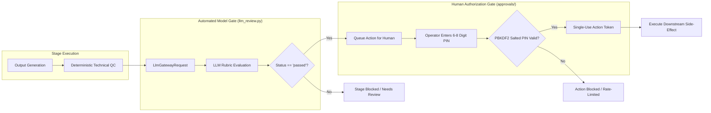

# A4 LLM Gateway and Review Gate Integration Matrix

**Date:** October 16, 2026  
**Repository:** `E:\audio-to-video`  
**Phase:** A4 — Shared Infrastructure Integration Planning  
**Status:** COMPLETE  

---

## 1. Overview and Core Invariants

The LLM integration architecture consists of:
1. **`backend/llm_gateway.py`**: The canonical LLM Gateway providing typed request/response envelopes, profile routing (`fast_structured`, `reasoning_review`, `code_generation`), bounded retries, JSON repair, and telemetry attribution.
2. **`backend/llm_review.py`**: The mandatory review gate requiring structured model verification for every pipeline stage before completion.
3. **`backend/llm_client.py`**: The underlying multi-provider transport (Gemini, Anthropic, OpenAI, Claude CLI, Groq, DeepSeek, Ollama) and credential store (`config/llm_settings.json`).
4. **`backend/llm_usage.py`**: The persistent token usage and cost accounting monitor (`config/llm_usage.json`).

### Non-Negotiable Invariants:
- **No LLM Output Alone is an Approval:** LLM reviews provide automated technical and semantic grading. They NEVER replace human Laxman PIN authorization for protected gates (Timeline Sign-off, Playback QC, Baseline Promotions).
- **Mandatory Review Gate:** A pipeline stage CANNOT be marked `completed` if its review status is `blocked`, `needs_review`, `failed`, or missing.
- **Fail-Closed on Unavailability:** If an LLM provider is unreachable or returns malformed JSON after retry bounds, the stage halts safely without guessing.

---

## 2. LLM Call Path & Caller Audit

| Module / Component | Invocations Path | Model / Purpose | Uses `LlmGateway`? | Direct `llm_client` Bypass? | Token Usage Tracked? | Risk & Convergence Recommendation |
| :--- | :--- | :--- | :--- | :--- | :--- | :--- |
| **`backend/llm_review.py`** | `run_stage_review()` | `reasoning_review` (structured review for 12 stages) | **YES** | No | Yes (`config/llm_usage.json`) | Canonical review path. Fully compliant. |
| **`backend/motion_animation.py`** | `_generate_scene_code()` | `code_generation` (React/TSX generation) | **YES** | No | Yes (`config/llm_usage.json`) | Canonical code generation path. Fully compliant. |
| **`backend/analysis_autofix.py`** | `autofix()` (Line 136) | Contextual speech-to-text word repair | **NO** | **YES** (`llm_client.generate_text`) | **NO** (Bypassed) | **Critical Gap:** Calls raw `llm_client`. Migrate to `llm_gateway.execute(purpose="repair")`. |
| **`backend/promptgen.py`** | `start()` (Line 34) | Image prompt generation (Use Images=ON mode) | **NO** | **YES** (`llm_client.generate_text`) | **NO** (Bypassed) | **Gap:** Calls raw `llm_client`. Migrate to `llm_gateway.execute(purpose="generation")`. |
| **`backend/motion_template_selection.py`** | Line 98 | Legacy template selection | **NO** | **YES** (`llm_client.generate_text`) | **NO** | Legacy adapter. Motion-Only pipeline uses custom TSX; keep deprecated. |
| **`backend/routes/llm.py`** | Settings & Connection Test | Test probe | N/A | Direct to `llm_client.test_connection` | N/A (Diagnostic) | Expected for settings UI. Keep as diagnostic endpoint. |
| **`backend/scene_segmentation.py`** | Line 285 | Model name resolution | N/A | Reads config only | N/A | Frozen file. Preserved verbatim. |
| **`backend/transcript_review.py`** | Line 410 | Model name resolution | N/A | Reads config only | N/A | Frozen file. Preserved verbatim. |

---

## 3. Mandatory LLM Review Gates Contract

For all 12 Motion-Only pipeline stages, `backend/llm_review.py` enforces structured reviews saved to `projects/{pid}/reviews/{stage}_review.json`:

```typescript
interface LlmReviewResult {
  schema: "1.0"
  version: 1
  stage: string
  aspect: "16:9" | "9:16"
  status: "passed" | "needs_review" | "blocked" | "failed"
  score: number           // 0.0 - 100.0 (Grade scale)
  summary: string
  findings: Array<{
    severity: "blocker" | "error" | "warning" | "info"
    category: string
    message: string
    scene_id?: string | number
    recommendation?: string
  }>
  input_fingerprint: string
  output_fingerprint: string
  reviewed_at: number
  provider: string
  model: string
  latency_ms: number
  error: string | null
}
```

### Review Pass/Block Conditions:
- `passed`: All checks pass, 0 blockers, 0 errors, score >= 75.0.
- `needs_review`: Non-blocking warnings or score between 60.0 and 74.9. Requires operator acknowledgment or revision.
- `blocked`: One or more `blocker` severity findings, or score < 60.0. Pipeline cannot proceed.
- `failed`: LLM call error, invalid JSON, or schema validation failure.

---

## 4. LLM vs Human Authorization Separation



---

## 5. Secret Redaction & Configuration Boundaries

1. **Secret Redaction**:
   - `llm_gateway.py` and `communication.py` automatically redact:
     - Anthropic API keys (`sk-ant-...`)
     - OpenAI API keys (`sk-...`)
     - Google Gemini keys (`AIza...`)
     - Bearer tokens (`Bearer ...`)
   - Telemetry logs and error messages never include credentials or auth headers.
2. **Provider Selection Boundary**:
   - Provider settings reside exclusively in `config/llm_settings.json`.
   - API endpoints (`GET /llm/settings`) return public sanitized settings masking secret keys (`sk-***`).
   - Client code cannot inject arbitrary API endpoints or bypass CORS/timeout bounds.
