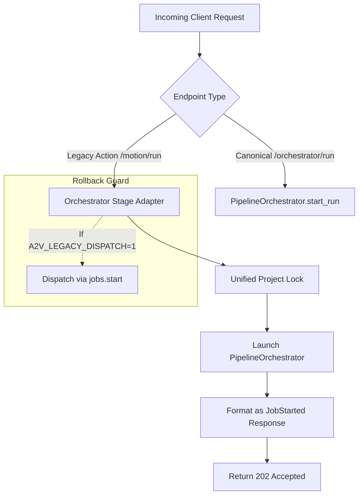

# A4 Orchestrator and Route Convergence Matrix

**Date:** October 16, 2026  
**Repository:** `E:\audio-to-video`  
**Phase:** A4 — Shared Infrastructure Integration Planning  
**Status:** COMPLETE  

---

## 1. Route Mapping and Dispatch Analysis

This document provides a line-level audit of all pipeline execution and orchestration endpoints, contrasting their current implementation with their target convergence classification.

### Classification Categories:
- **`FORWARD_TO_ORCHESTRATOR`**: Route represents a pipeline advancement or branch run that should dispatch directly into `PipelineOrchestrator.start_run(from_stage=...)`.
- **`WRAPPER_WITH_SPECIALIZED_SEMANTICS`**: Route performs specific manual stage mutations, validations, or parameterizations before or alongside orchestration.
- **`KEEP_SEPARATE_WITH_JUSTIFICATION`**: Route manages non-pipeline state (e.g., project mode, configuration, metadata) and should not run orchestration.
- **`DEPRECATE_LATER`**: Redundant route retained for backward compatibility with scheduled future retirement.

---

## 2. Comprehensive Route Matrix

| Endpoint / Method | Owning Route & Function | Current Dispatch Destination | Calls `PipelineOrchestrator`? | Status / Event Path | Cancellation Behavior | Request / Correlation ID | Active Callers (UI / Tests) | Recommended Convergence Decision |
| :--- | :--- | :--- | :--- | :--- | :--- | :--- | :--- | :--- |
| `POST /projects/{pid}/orchestrator/run` | `backend/routes/orchestrator.py:start_orchestrator_run` | `orchestrator.PipelineOrchestrator.start_run()` | **YES (Canonical)** | In-memory `RunRecord`, `.pipeline_state.json`, SSE stream | Cooperative cancellation via `cancel_run()` | Auto-generates `run_id` and `correlation_id` | `tests/test_orchestrator_*.py`, `test_e2e_production_readiness.py` | **CANONICAL_TARGET** |
| `POST /projects/{pid}/orchestrator/cancel` | `backend/routes/orchestrator.py:cancel_orchestrator_run` | `orchestrator.PipelineOrchestrator.cancel_run()` | **YES (Canonical)** | Updates `RunRecord.status="cancelled"`, emits lifecycle event | Sets run cancel flag and kills active child processes | Inherits `run_id` | Orchestrator test suites | **CANONICAL_TARGET** |
| `GET /projects/{pid}/orchestrator/status` | `backend/routes/orchestrator.py:get_monitoring_status` | `orchestrator.PipelineOrchestrator.get_status()` | **YES (Canonical)** | Reads `.pipeline_state.json`, `artifact_contracts`, reviews | Read-only | N/A | Orchestrator test suites, `api.getOrchestratorStatus` | **CANONICAL_TARGET** |
| `GET /projects/{pid}/orchestrator/events` | `backend/routes/orchestrator.py:stream_events` | `communication.stream_events()` | **YES (Canonical)** | SSE event stream from `communications.jsonl` | Read-only stream | Filtered by `correlation_id` or `run_id` | Orchestrator test suites | **CANONICAL_TARGET** |
| `POST /projects/{pid}/pipeline/advance` | `backend/routes/pipeline.py:advance` | `jobs.start(pid, "timeline", ...)` or `promptgen.start()` | **NO** (`jobs.py`) | Sets project status in `info.json`; polls `/pipeline` | Sets `job.cancel` flag via `/cancel` | Missing request/correlation ID | `frontend/src/pipeline/PipelineChart.tsx`, `useAutoAdvance.ts` | **WRAPPER_WITH_SPECIALIZED_SEMANTICS** |
| `POST /projects/{pid}/motion/run` | `backend/routes/pipeline.py:run_motion` | `jobs.start(pid, "motion", ...)` | **NO** (`jobs.py`) | Sets `info.json` status to `"building"`; polls `/motion` | Sets `job.cancel` flag | Missing request/correlation ID | `frontend/src/pages/MotionPlanningPage.tsx`, `MotionGenerationPage.tsx` | **FORWARD_TO_ORCHESTRATOR** |
| `POST /projects/{pid}/render` | `backend/routes/pipeline.py:render_video` | `jobs.start(pid, "render", ...)` | **NO** (`jobs.py`) | Sets `info.json` status; checks `RENDER_LOCK` | Sets `job.cancel` flag; calls `procs.kill(pid)` | Missing request/correlation ID | `frontend/src/pages/RenderVideoPage.tsx`, `tests/test_improve_p7.py` | **FORWARD_TO_ORCHESTRATOR** |
| `POST /projects/{pid}/cancel` | `backend/routes/projects.py:cancel_project` | `jobs.cancel(pid)` | **NO** (`jobs.py`) | Sets `job.cancel` event; calls `procs.kill(pid)` | Stops background thread loop | Missing correlation ID | `frontend/src/api/client.ts`, UI Cancel buttons | **WRAPPER_WITH_SPECIALIZED_SEMANTICS** |
| `POST /projects/{pid}/mode` | `backend/routes/pipeline.py:set_mode` | Updates `info.json["use_images"]` and rebuilds skeleton | **NO** (Synchronous configuration) | Updates `info.json`; rebuilds composition skeleton | N/A (Immediate) | N/A | `frontend/src/pages/AudioInputPage.tsx`, Mode toggles | **KEEP_SEPARATE_WITH_JUSTIFICATION** |
| `GET /projects/{pid}/pipeline` | `backend/routes/pipeline.py:get_pipeline` | `pipeline_view.build(pid)` | **NO** (Aggregator) | Synthesizes stage cards from files and `jobs.current()` | Read-only | N/A | Primary pipeline view polling in `PipelinePage.tsx` | **WRAPPER_WITH_SPECIALIZED_SEMANTICS** |
| `POST /projects/{pid}/transcribe` | `backend/routes/run.py:transcribe` | `jobs.start(pid, "transcribe", ...)` | **NO** (`jobs.py`) | Runs ASR chain; sets `info.status="transcribing"` | Standard job cancel | Missing correlation ID | `AudioInputPage.tsx`, audio upload handler | **KEEP_SEPARATE_WITH_JUSTIFICATION** |
| `POST /projects/{pid}/timeline-build/run` | `backend/routes/pipeline.py:run_timeline_build` | `jobs.start(pid, "timeline", ...)` | **NO** (`jobs.py`) | Rebuilds Remotion timeline from plan | Standard job cancel | Missing correlation ID | `TimelineBuildPage.tsx` | **FORWARD_TO_ORCHESTRATOR** |
| `POST /projects/{pid}/final-qc/run` | `backend/routes/pipeline.py:run_final_qc` | `jobs.start(pid, "qc", ...)` | **NO** (`jobs.py`) | Deterministic QC rules and video metadata check | Standard job cancel | Missing correlation ID | `FinalQcPage.tsx` | **FORWARD_TO_ORCHESTRATOR** |

---

## 3. Detailed Convergence Decisions

### 3.1 `POST /projects/{pid}/motion/run` -> `FORWARD_TO_ORCHESTRATOR`
- **Current Behavior:** Starts `jobs.start(pid, "motion", ["motion_plan", "motion_gen"], Ctx())`. Returns `{project, label, steps}` (`JobStarted`).
- **Target Wrapper Behavior:**
  1. Acquire unified project execution lock.
  2. Instantiate `PipelineOrchestrator(pid, aspect)`.
  3. Start asynchronous run starting from stage `"motion_plan"`.
  4. Return `JobStarted` model populated from `RunRecord` for 100% frontend compatibility.
- **Benefit:** Executes with Phase 3 checkpoints, mandatory Phase 2 LLM reviews, and correlation IDs.

### 3.2 `POST /projects/{pid}/pipeline/advance` -> `WRAPPER_WITH_SPECIALIZED_SEMANTICS`
- **Current Behavior:** Inspects current gate state (`review.gates(pdir)["analysis"]`). In Motion-Only mode, builds timeline; in image mode, starts prompt generation.
- **Why NOT Direct Forwarding:** In Motion-Only mode, `advance` performs an implicit human gate approval (`review.set_gate(pdir, "analysis", True)`) before triggering downstream work.
- **Target Wrapper Behavior:** Preserve the analysis approval logic, but when kicking off downstream processing, dispatch to `PipelineOrchestrator.start_run(from_stage="timeline")` instead of `jobs.start()`.

### 3.3 `POST /projects/{pid}/cancel` -> `WRAPPER_WITH_SPECIALIZED_SEMANTICS`
- **Target Wrapper Behavior:**
  Check both `jobs.is_running(pid)` AND `orchestrator.is_running(pid)`. Cancel whichever is active (or both), invoking child process termination via `procs.kill(pid)` and publishing a unified `job_cancelled` lifecycle event.

### 3.4 `GET /projects/{pid}/pipeline` -> `WRAPPER_WITH_SPECIALIZED_SEMANTICS`
- **Current Behavior:** Aggregates status cards for UI rendering. Inspects `jobs.current(pid)`.
- **Target Wrapper Behavior:** Augment `pipeline_view.build()` to read from canonical `PipelineStateStore` (`projects/{pid}/.pipeline_state.json`) as source of truth for stage readiness and error banners, falling back to legacy files if `.pipeline_state.json` is not yet initialized for a project.

---

## 4. Migration and Rollback Safety Strategy

A feature flag `A2V_ORCHESTRATOR_WRAPPER=1` will gate wrapper dispatch in implementation, allowing instantaneous rollback to `jobs.start()` without code reverts if regressions emerge during testing.
