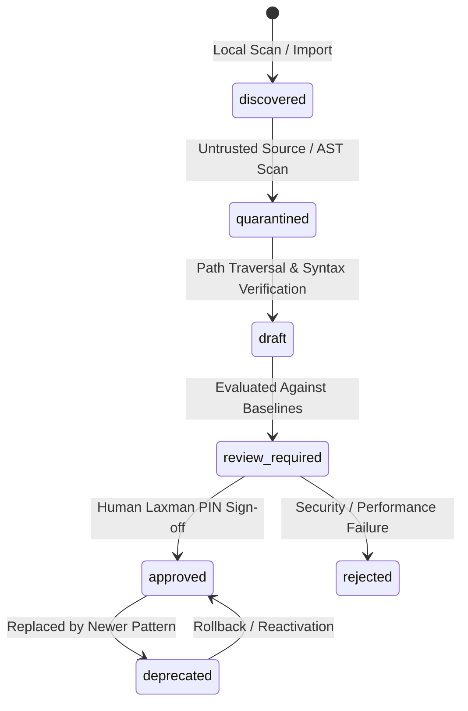

# A4 Skills, Memory, and Resource Library Boundaries

**Date:** October 16, 2026  
**Repository:** `E:\audio-to-video`  
**Phase:** A4 — Shared Infrastructure Integration Planning  
**Status:** COMPLETE  

---

## 1. Scope & Responsibility Boundaries

Three persistent knowledge and asset repositories support the video generation system:
1. **Central Skill Catalog & Registry (`skills/`, `backend/skill_registry.py`)**: Reusable motion design patterns, easing calculations, and Remotion TSX templates.
2. **Central Shared Memory Service (`config/shared_memory.json`, `backend/shared_memory.py`)**: Historical execution lessons, verified heuristics, and prompt guidelines across runs.
3. **Resource Library (`resource-library/`, `backend/resource_library.py`)**: Static media assets, licensed fonts, SVG icon drawings, and pre-rendered preview bundles.

---

## 2. Central Skill Catalog Lifecycle & Quarantine Protocol

### 2.1 Storage & Path Confinement
- Canonical Catalog: `skills/catalog.json` (Atomic, thread-safe JSON).
- Quarantined Staging Directory: `skills/staging/`
- **Security Guardrail:** `skill_registry.py` enforces path traversal protection (`Path(entrypoint).resolve().is_relative_to(SKILLS_DIR)`), rejecting any reference that attempts to escape `skills/`.
- **Static AST Audit:** Detects dangerous calls (`eval`, `child_process`, `exec`, `fs.unlink`) and network requests before admitting candidate code.

### 2.2 Skill Discovery Hierarchy
1. **Internal Verified Skills:** First search `skills/` for approved local skills matching requested tags.
2. **Candidate Staging:** Any externally proposed skill is isolated in `skills/staging/` with status `quarantined`.
3. **Human Approval Requirement:** No quarantined or draft skill may transition to `approved` without an explicit Laxman PIN authorization record.

---

## 3. Central Shared Memory Architecture

### 3.1 Strict 3-Way State Separation
To prevent hallucinations or unverified assumptions from corrupting project execution, `backend/shared_memory.py` enforces three distinct scopes:
1. **Project Execution State**: Ephemeral data restricted to `projects/{pid}/` (`.pipeline_state.json`).
2. **Proposed Candidates (`status="proposed"`)**: Automated observations, performance measurements, or prompt tweaks proposed by agents or evaluation suites.
3. **Verified Knowledge (`status="verified"`)**: Promoted heuristics and lessons backed by reproducible test runs and approved by an operator.

### 3.2 Implemented Invariants
- **No Self-Promotion:** Agents cannot verify their own proposed memory items.
- **LLM Output Alone Cannot Verify:** Promotion requires empirical evidence (e.g., benchmark score delta, deterministic QC pass).
- **Supersession Without Deletion:** When a memory item is updated, the previous item is marked `superseded` with a pointer to the replacement ID, preserving full provenance.

---

## 4. Resource Library Architecture

### 4.1 Physical Structure & Role
Located in `resource-library/`:
- `assets/`: Raw licensed media files (fonts, audio stingers, SVG icon drawings).
- `catalog/registry.json`: Canonical metadata registry (license type, author, checksum).
- `bundle/render_bundle.json`: Derived bundle generated by `backend/resource_library.py` for direct consumption by Remotion renderer.
- `licenses/`: Text license agreements and attribution manifests.
- `previews/`: Pre-rendered PNG frames verified by human review.

### 4.2 Integration Rules
- `resource-library/` is read-only during video rendering.
- The Remotion renderer references fonts and icons via `render_bundle.json` with zero external network downloads.
- Audits are executed via `backend/resource_audit.py` to ensure all assets have valid, permissive licenses before inclusion.
