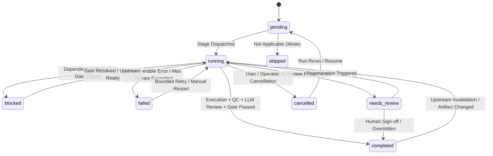

# A4 State, Checkpoint, and Task Queue Integration Matrix

**Date:** October 16, 2026  
**Repository:** `E:\audio-to-video`  
**Phase:** A4 — Shared Infrastructure Integration Planning  
**Status:** COMPLETE  

---

## 1. Overview and State Architecture

This document audits the state management, checkpointing, and background task scheduling architecture of the video generation system, identifying the single source of truth for each state facet, persistence locations, lifecycle transitions, concurrency controls, and failure recovery.

---

## 2. Data Ownership and Persistence Matrix

| State Facet | Source of Truth Module | Storage File Path | Schema Version | Writers | Readers | Invalidation / Recompute Triggers |
| :--- | :--- | :--- | :--- | :--- | :--- | :--- |
| **High-Level Project Info** | `backend/store.py` | `projects/{pid}/info.json` | Unversioned JSON dict | `store.py:create_project`, `set_state`, `set_mode` | Frontend, API routes, `pipeline_view.py` | Project creation, manual rename, status change |
| **Canonical Stage Lifecycle State** | `backend/pipeline_state.py` | `projects/{pid}/.pipeline_state.json` | Version 1.0 (`SCHEMA = "1.0"`) | `pipeline_state.py:set_stage_status`, `orchestrator.py` | `orchestrator.py`, `pipeline_state.py`, monitoring API | Stage start, stage completion, upstream invalidation |
| **Stage Checkpoints & Fingerprints** | `backend/pipeline_state.py` | `projects/{pid}/.checkpoints/{stage}_cp.json` | Version 1.0 | `pipeline_state.py:save_checkpoint` | `pipeline_state.py:restore_checkpoint`, `orchestrator.py` | Upstream stage artifact modification, failed validation |
| **Stage Artifact Contracts** | `backend/artifact_contracts.py` | Stage-specific JSON/MP4 files in `projects/{pid}/` | Strict schemas (`1.0`) | Stage execution services (`visual_planning.py`, `motion_animation.py`, etc.) | Upstream/downstream stages, `orchestrator.py`, QC | Input data changes, human edits, parameter updates |
| **Mandatory LLM Reviews** | `backend/llm_review.py` | `projects/{pid}/reviews/{stage}_review.json` | Version 1.0 (`VERSION = 1`) | `llm_review.py:run_stage_review` | `orchestrator.py`, `pipeline_state.py`, stage completion | Stage artifact regeneration (fingerprint mismatch) |
| **Human Approval Records** | `backend/approvals/approval_engine.py` | `config/approvals_queue.json`, `config/approvals_audit.jsonl` | Version 1.0 | `approval_engine.py:create_request`, `record_decision` | `guard.py`, `orchestrator.py`, UI | Upstream artifact fingerprint mutation invalidates token |
| **Legacy Step State (Compatibility)** | `backend/pipeline.py` | `projects/{pid}/.build_state.json` | Unversioned JSON dict | `pipeline.py:_write` | `pipeline.py:execute`, `jobs.py` | Fingerprint cache wipe on manual rerun |
| **In-Memory Active Runs** | `backend/orchestrator.py` | Process memory (`_ACTIVE_RUNS: dict[str, RunRecord]`) | Python dataclass | `PipelineOrchestrator.start_run`, `cancel_run` | `routes/orchestrator.py`, polling endpoints | Process restart (recovered via `.pipeline_state.json`) |
| **In-Memory Job Queue** | `backend/jobs.py` | Process memory (`_jobs: dict[str, Job]`) | Python dataclass | `jobs.start`, `jobs.cancel` | `routes/pipeline.py`, `pipeline_view.py` | Process restart |

---

## 3. Stage Lifecycle State Transitions

The canonical stage lifecycle is governed strictly by `backend/pipeline_state.py`:

### Strict Non-Negotiable Rules:
1. **No Silent Completion:** A stage can NEVER transition from `running` to `completed` without:
   - Output artifacts satisfying contract schema (`artifact_contracts.py`).
   - Technical / deterministic validation passing.
   - Structured LLM review returning `status="passed"` with zero blockers (`llm_review.py`).
   - Required human gate approval (Timeline Approval or QC Playback) verified with valid PIN token.
2. **Fail-Closed on Failure:** Any contract violation, unhandled exception, or gate refusal forces status to `failed` or `blocked`.

---

## 4. Task Scheduling & Concurrency Serialization

### Current Concurrency Mechanisms:
1. **`jobs._lock` & `_pool` (`backend/jobs.py`)**:
   - `ThreadPoolExecutor(max_workers=4)` handles background execution.
   - Global `_lock` enforces at most ONE running job per project ID (`jobs.is_running(pid)` raises HTTP 409).
   - Global `RENDER_LOCK` restricts Remotion renders to 1 at a time across all projects.
2. **`orchestrator._PROJECT_LOCKS` (`backend/orchestrator.py`)**:
   - Thread-safe dictionary of `threading.Lock` per project.
   - `start_run()` acquires lock, checks `jobs.is_running(pid)`, checks `is_project_running(pid)`, and records active thread.
3. **`pipeline_state._PROJECT_LOCKS` (`backend/pipeline_state.py`)**:
   - Mutexes disk read/modify/write cycles on `.pipeline_state.json`.

### Identified Concurrency Risk:
Because `jobs._lock` and `orchestrator._PROJECT_LOCKS` are separate data structures, an edge case exists where an external client calls a legacy `jobs.start()` endpoint simultaneously with a canonical `orchestrator.start_run()` endpoint before either sets `_jobs[pid]` or `_ACTIVE_RUNS[pid]`.
- **A4 Target Resolution:** Create a unified project execution mutex in `backend/store.py` (`store.get_project_lock(pid)`) that both engines acquire prior to any state mutation.

---

## 5. Checkpoints, Resume, and Restart Recovery

### 5.1 Checkpoint File Structure
Checkpoints are stored atomically in `projects/{pid}/.checkpoints/{stage}_cp.json`. Each checkpoint contains:
- `checkpoint_id`: Unique identifier (`cp_{stage}_{sha256[:12]}`).
- `stage_id`: Associated pipeline stage.
- `input_fingerprint`: Merkle hash of all direct input artifacts.
- `output_fingerprint`: Merkle hash of all generated output artifacts.
- `created_at`: UTC timestamp.
- `metadata`: Execution timing, token usage, model identifiers.

### 5.2 Deterministic Resume Graph
When `PipelineOrchestrator(pid).start_run(resume=True)` is called:
1. Reads `.pipeline_state.json` via `pipeline_state.calculate_resume_plan(pid)`.
2. Evaluates stage dependency order (1 to 12).
3. Verifies that all upstream artifacts exist and fingerprints match saved checkpoints.
4. If a stage's inputs changed or checkpoint is missing/invalid, that stage and ALL downstream stages are invalidated (reverted to `pending`).
5. Execution resumes automatically from the earliest invalid stage. Valid upstream stages are skipped without redundant computation or costs.

### 5.3 Orphaned Run Recovery (Server Restart)
When the FastAPI backend restarts while a run was in progress:
1. `orchestrator.recover_orphaned_runs()` scans all projects.
2. Any stage marked `running` without an active thread is transitioned to `failed` with error `process_restart_detected`.
3. An audit event is published to `communications.jsonl`.
4. Subsequent user request safely resumes from the checkpointed state.
