# A4 Target Integration Blueprint

**Date:** October 16, 2026  
**Repository:** `E:\audio-to-video`  
**Phase:** A4 — Shared Infrastructure Integration Planning  
**Status:** COMPLETE  

---

## 1. Architectural Principles

1. **Zero Mass-Relocation:** Physical repository roots remain fixed (`backend/`, `frontend/`, `remotion/`, `skills/`, `resource-library/`, `config/`, `projects/`).
2. **One Canonical Owner per Responsibility:** Eliminate competing implementations by wrapping or adapting secondary callers into canonical services.
3. **Behavior-Preserving Outer Contracts:** Existing API endpoints, request models, and frontend client calls remain backward compatible.
4. **Unified Concurrency & State:** Single project lock mutex; canonical `.pipeline_state.json` synced with high-level `info.json`.
5. **Fail-Closed Security & Secrets:** Automatic redaction in all logging streams; human PIN verification mandatory before destructive actions or video rendering.

---

## 2. End-to-End Target State Diagram

```mermaid
flowchart TD
    subgraph UI_Layer ["Frontend UI (Vite + React + Tailwind)"]
        NavHeader["Primary Header Nav: Pipeline | Projects | Laxman Approval | Agents | Settings"]
        PagePipeline["Pipeline Page (/projects/:id)"]
        PageAgents["Agents Page (/agents)"]
        PageApprovals["Laxman Approval (/approvals)"]
        DrawerComm["Agent Communication Drawer"]
    end

    subgraph API_Layer ["API Layer (FastAPI)"]
        RouteOrch["/projects/:id/orchestrator/* (Canonical)"]
        RouteLegacy["/projects/:id/pipeline/* (Legacy Action Adapter)"]
        RouteAgents["/agents/* & /projects/:id/agent-communications/*"]
        RouteApprovals["/approvals/*"]
        RouteShared["/skills/* & /memory/* & /llm/*"]
    end

    subgraph Core_Execution ["Canonical Core Engine"]
        Orchestrator["PipelineOrchestrator (backend/orchestrator.py)"]
        LockManager["Unified Project Lock (backend/store.py)"]
        StateStore["PipelineStateStore (backend/pipeline_state.py)"]
        ArtifactEngine["Artifact Contracts & Fingerprints (backend/artifact_contracts.py)"]
    end

    subgraph Stage_Services ["12-Stage Execution Services (Domain)"]
        S1["Audio Input (backend/audio_input.py)"]
        S2["Audio Analyzer (backend/transcribe.py - FROZEN)"]
        S3["Scene Segmentation (backend/scene_segmentation.py - FROZEN)"]
        S4["Visual Planning (backend/visual_planning.py)"]
        S5["Motion Planning (backend/motion_planning.py)"]
        S6["Motion Animation (backend/motion_animation.py)"]
        S7["Motion Validation (backend/motion_validation.py)"]
        S8["Timeline Build (backend/timeline_build.py)"]
        S9["Timeline Approval Gate (backend/timeline_approval.py)"]
        S10["Render Video (backend/render.py)"]
        S11["Final QC (backend/final_qc.py)"]
        S12["Final Video Delivery (backend/final_delivery.py)"]
    end

    subgraph Shared_Cross_Cutting ["Shared Cross-Cutting Infrastructure"]
        LLM_GW["LLM Gateway (backend/llm_gateway.py)"]
        LLM_Usage["Usage & Cost Monitor (backend/llm_usage.py)"]
        ApprovalEngine["Laxman Approval Engine (backend/approvals/)"]
        AgentRegistry["Authoritative Registry (backend/agents/registry.py)"]
        CommLog["Durable Communication Log (backend/agents/communication.py)"]
        SkillCatalog["Skill Registry (backend/skill_registry.py)"]
        MemoryStore["Shared Memory (backend/shared_memory.py)"]
    end

    %% Wiring
    PagePipeline --> RouteLegacy
    PagePipeline --> RouteOrch
    PageAgents --> RouteAgents
    PageApprovals --> RouteApprovals
    DrawerComm --> RouteAgents

    RouteLegacy -->|Wrapper Delegation| Orchestrator
    RouteOrch --> Orchestrator

    Orchestrator --> LockManager
    Orchestrator --> StateStore
    Orchestrator --> ArtifactEngine
    Orchestrator --> LLM_GW
    Orchestrator --> ApprovalEngine
    Orchestrator --> CommLog

    Orchestrator --> S1 & S2 & S3 & S4 & S5 & S6 & S7 & S8 & S9 & S10 & S11 & S12
    LLM_GW --> LLM_Usage
```

---

## 3. Component Responsibility Matrix

| Responsibility Area | Canonical Implementation | Supporting Adapters / Wrappers | Deprecated / Replaced Items |
| :--- | :--- | :--- | :--- |
| **Pipeline Run Orchestration** | `backend/orchestrator.py:PipelineOrchestrator` | `backend/routes/pipeline.py` (Delegates `/motion/run`, `/timeline-build/run`, `/final-qc/run`) | Direct `jobs.start()` in action routes replaced by wrapper dispatch. |
| **Stage State & Checkpoints** | `backend/pipeline_state.py:PipelineStateStore` | `backend/store.py` (Syncs `info.status` for UI header badge) | `.build_state.json` step cache relegated to read-only fallback. |
| **Model Invocations & Routing** | `backend/llm_gateway.py:LlmGateway` | `backend/llm_review.py`, `backend/motion_animation.py` | Direct `llm_client.generate_text()` in `analysis_autofix.py` and `promptgen.py` routed through Gateway. |
| **Human Authorization & PIN** | `backend/approvals/approval_engine.py` | `backend/approvals/adapters/timeline_adapter.py`, `qc_adapter.py` | Ad-hoc unauthenticated approval endpoints protected by PIN guard. |
| **Agent Registry & Metadata** | `backend/agents/registry.py:AgentRegistry` | `backend/routes/agents.py`, `frontend/src/pages/AgentsPage.tsx` | UI mock definitions replaced by canonical registry data. |
| **Agent Event Logging & SSE** | `backend/agents/communication.py` | `backend/routes/orchestrator.py:stream_events` | Duplicate console print statements replaced by structured JSONL events. |
| **Reusable Motion Skills** | `backend/skill_registry.py:SkillRegistry` | `skills/catalog.json`, `skills/staging/` | None. Canonical structure established in Phase 4. |
| **Cross-Run Shared Memory** | `backend/shared_memory.py:SharedMemoryStore` | `config/shared_memory.json` | None. Canonical structure established in Phase 4. |
| **Usage & Cost Accounting** | `backend/llm_usage.py:LlmUsageMonitor` | `backend/routes/llm.py`, `frontend/src/pages/LlmUsagePage.tsx` | Unattributed API calls routed through gateway for attribution. |
