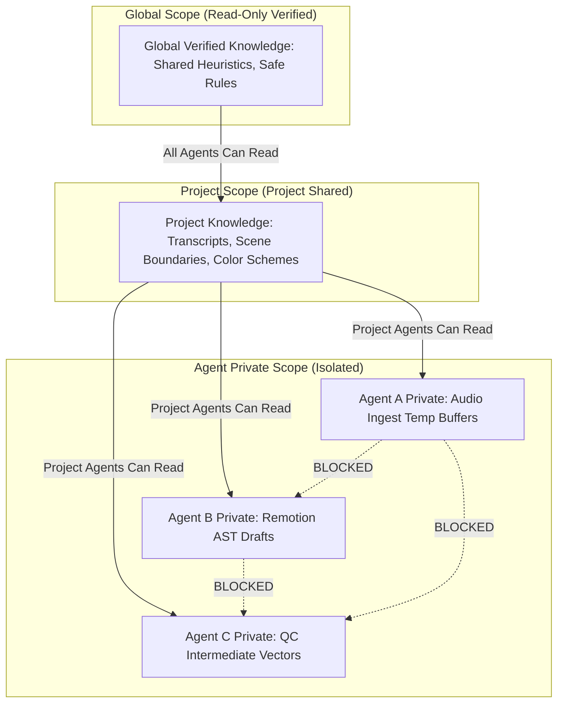

# Agent Memory Scoping and History Architecture Report

**Date:** 2026-10-17  
**Repository:** `E:\audio-to-video`  
**Components:** `ScopedMemoryManager`, `MemoryService`, `AgentMemoryAdapter`, `HistoryService`

---

## 1. Multi-Tiered Memory Scoping Hierarchy

To eliminate cross-agent state contamination and maintain data privacy across pipeline boundaries, the agent memory architecture implements a 3-tier scoping hierarchy:

### Scope Descriptions & Rules

1. **Agent-Private Scope (`scope="agent"`)**:
   - `owner = agent_id`
   - Strictly isolated to the owning agent.
   - Any query by another agent is rejected by `ScopedMemoryManager.is_access_allowed()`.
   - Prevents intermediate agent scratch data, raw tokens, or stage-specific buffers from leaking into other agents.

2. **Project-Shared Scope (`scope="project"`)**:
   - `project_id = <project_id>`
   - Accessible by any agent operating within the context of that specific project.
   - Used for handoffs, intermediate scene definitions, and approved transcript tokens.

3. **Global Scope (`scope="global"`)**:
   - `owner = "system"`
   - Read-only across all agents.
   - Contains verified cross-domain rules, layout safety boundaries, and spring physics presets.

---

## 2. Memory Services & Adapters

### `ScopedMemoryManager` (`SYSTEM/memory/memory_scoping.py`)
Central authorization and enforcement class:
- `is_access_allowed(item: MemoryItem, requesting_agent_id: str) -> bool`: Enforces permission checks.
- `read_scoped(requesting_agent_id, ...)`: Returns only memories the requesting agent is permitted to see.
- `write_agent_private(...)`: Enforces `permitted_readers=[owner_agent_id]`.
- `write_project_shared(...)`: Enforces `scope="project"` and `permitted_readers=["*"]`.

### `AgentMemoryAdapter` (`SYSTEM/agents/shared/memory_adapter.py`)
Transparent agent-level binding:
- Attached to each agent instance as `self.memory = AgentMemoryAdapter(self.agent_id)`.
- Automatically injects `requesting_agent_id=self.agent_id` on all read and write calls.
- Provides simple methods: `retrieve()`, `store_private()`, `store_project()`, `store_candidate()`.

---

## 3. Durable History Service (`SYSTEM/history/`)

The history architecture replaces unstructured event logging with three specialized, append-only JSONL ledgers:

### 1. Execution History (`execution_history.py`)
- **Schema:** `ExecutionRecord`
- **Fields:** `execution_id`, `agent_id`, `stage_id`, `project_id`, `task_id`, `started_at`, `completed_at`, `duration_ms`, `status`, `inputs_summary`, `outputs_summary`, `error_message`, `retry_count`.
- **Automatic Tracking:** `BaseAgent.invoke()` automatically records start time, execution status, error details, and duration in milliseconds upon completion.

### 2. Decision History (`decision_history.py`)
- **Schema:** `DecisionRecord`
- **Fields:** `decision_id`, `agent_id`, `decision_type`, `timestamp`, `rationale`, `chosen_option`, `alternatives_considered`, `project_id`, `task_id`, `parameters`.
- **Purpose:** Full auditability for why a specific planning decomposition, template choice, or delegation was selected.

### 3. Audit History (`audit_history.py`)
- **Schema:** `AuditRecord`
- **Fields:** `audit_id`, `event_type`, `timestamp`, `agent_id`, `target`, `outcome` (`allowed`/`denied`/`flagged`), `reason`, `details`.
- **Purpose:** Immutable tracking of security checks, human-in-the-loop approvals, and policy validations.

---

## 4. Verification Evidence

- `test_agent_private_memory_isolation`: **PASSED** (Agent B cannot access Agent A's private memory)
- `test_project_and_global_memory_sharing`: **PASSED** (Cross-agent sharing permitted only for project/global scopes)
- `test_execution_history_recording`: **PASSED** (Execution records saved and retrieved with duration)
- `test_decision_history_recording`: **PASSED** (Decision records saved with rationale and options)
- `test_audit_history_recording`: **PASSED** (Audit records saved and verified)
