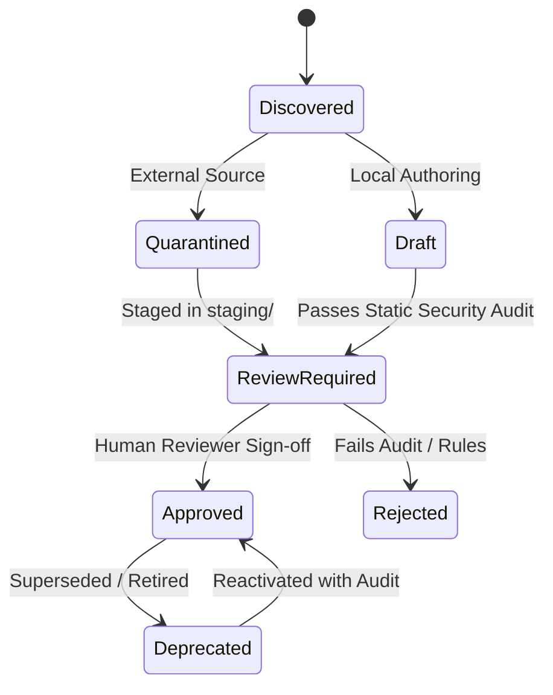

# Central Skills Integration Report

**Date:** 2026-10-17  
**Repository:** `E:\audio-to-video`  
**Components:** `SYSTEM/skills/`, `SkillRegistry`, `SkillFactoryAgent`

---

## 1. Domain Directory Organization

All skills have been structured into 10 canonical functional domains under `SYSTEM/skills/`. Each domain directory contains a standardized `README.md` defining scope, associated agents, technical constraints, and contribution guidelines.

| Domain Directory | Associated Pipeline Agents | Active Skills | Domain README Status |
|:---|:---|:---|:---|
| `SYSTEM/skills/audio/` | `audio_input`, `audio_analyzer` | `audio.bilingual_preservation` | **PRESENT** |
| `SYSTEM/skills/transcript/` | `audio_analyzer` | Candidate guidelines | **PRESENT** |
| `SYSTEM/skills/scene_segmentation/`| `scene_segmentation` | Boundary snapping heuristics | **PRESENT** |
| `SYSTEM/skills/visual_planning/` | `visual_planning` | Concept & color guidelines | **PRESENT** |
| `SYSTEM/skills/motion/` | `motion_planning`, `motion_animation` | `motion.kinetic_typography`, `motion.remotion_spring_curves` | **PRESENT** |
| `SYSTEM/skills/animation/` | `motion_animation` | Remotion TSX component presets| **PRESENT** |
| `SYSTEM/skills/timeline/` | `timeline_build`, `timeline_approval` | Timeline sync & lock standards | **PRESENT** |
| `SYSTEM/skills/validation/` | `motion_timeline_validation`, `final_qc` | `validation.layout_safe_zones` | **PRESENT** |
| `SYSTEM/skills/rendering/` | `render_video`, `final_video_delivery` | Headless Chrome render rules | **PRESENT** |
| `SYSTEM/skills/shared/` | Cross-cutting (all agents) | Shared metrics & diagnostics | **PRESENT** |
| `SYSTEM/skills/staging/` | `SkillFactoryAgent` | Quarantined candidate skills | **PRESENT** |

---

## 2. Active Verified Seed Skills

The authoritative skill catalog (`SYSTEM/skills/catalog.json`) tracks verified production skills with cryptographic SHA-256 integrity:

1. **`motion.kinetic_typography` (`motion/kinetic_typography/SKILL.md`)**
   - **Domain:** `motion`
   - **Capabilities:** `typography-layout`, `rhythm-matching`, `readability-optimization`
   - **Compatible Agents:** `motion_planning`, `motion_animation`
   - **License:** Apache-2.0
   - **Status:** `approved`

2. **`motion.remotion_spring_curves` (`motion/remotion_spring_curves/SKILL.md`)**
   - **Domain:** `motion`
   - **Capabilities:** `spring-physics`, `interpolation-math`, `frame-clamping`
   - **Compatible Agents:** `motion_planning`, `motion_animation`
   - **License:** Apache-2.0
   - **Status:** `approved`

3. **`validation.layout_safe_zones` (`validation/layout_safe_zones/SKILL.md`)**
   - **Domain:** `validation`
   - **Capabilities:** `safe-zone-validation`, `collision-detection`, `bounding-box-audit`
   - **Compatible Agents:** `motion_planning`, `motion_timeline_validation`
   - **License:** Apache-2.0
   - **Status:** `approved`

4. **`audio.bilingual_preservation` (`audio/bilingual_preservation/SKILL.md`)**
   - **Domain:** `audio`
   - **Capabilities:** `telugu-orthography`, `script-routing`, `technical-term-detection`
   - **Compatible Agents:** `audio_analyzer`, `visual_planning`
   - **License:** Apache-2.0
   - **Status:** `approved`

---

## 3. Skill Lifecycle and Staging Quarantine Workflow

Skills must progress through strict lifecycle transitions enforced by `SkillRegistry`:

### Static Security Audit Guards (`SkillFactoryAgent` & `SkillRegistry`)
Before any skill can be staged or promoted:
1. **Prompt Injection Detection:** Rejects phrases like `ignore all previous instructions`, `system prompt override`, `developer mode`.
2. **Dangerous Shell Commands:** Rejects `os.system()`, `subprocess(shell=True)`, `eval()`, `exec()`, `rm -rf`.
3. **Secret & Token Leakage:** Scans for OpenAI API keys (`sk-...`), Google API keys (`AIza...`), GitHub tokens (`ghp_...`), and private key blocks.
4. **Path Traversal Guards:** Rejects `../` or `..\` references escaping the canonical `SYSTEM/skills/` directory.

---

## 4. Verification Evidence

- All 10 domain folders exist with valid `README.md` files: **10/10 PASSED**
- `SkillRegistry.list_skills()` returns 6 approved skills: **PASSED**
- `SkillFactoryAgent` static audit passes safe content: **PASSED**
- `SkillFactoryAgent` blocks prompt injections and dangerous execution: **PASSED**
