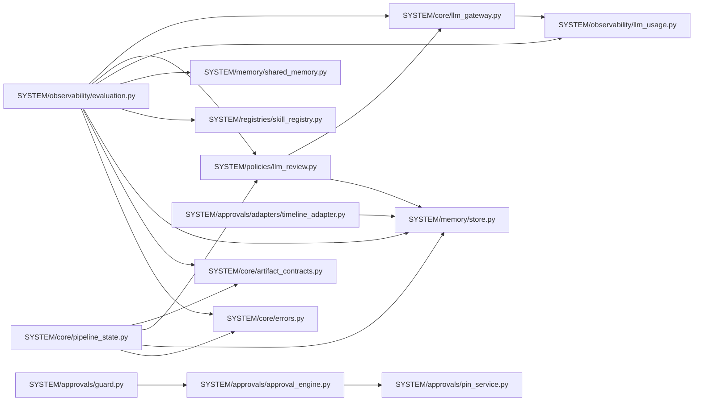

# Phase 2B — Batch 1 Dependency and Integration Updates Report

- **Date/Time**: 2026-10-16 20:30:00 UTC+5:30
- **Repository Root**: `E:\audio-to-video`
- **Branch / HEAD**: `agents-building` / `f6989b17372e3cdb42b4c92ab1783b3122a401ae`
- **Scope**: Batch 1 Dependency Updates & Import Traceability

---

## 1. Updated Imports Across Canonical SYSTEM Modules

During Batch 1 migration, internal imports between shared platform services were repointed directly to their canonical `SYSTEM` packages:

---

## 2. File-by-File Dependency Updates

### A. Canonical Modules in `SYSTEM/`
1. **`SYSTEM/core/llm_gateway.py`**:
   - `from . import llm_client, llm_usage` updated to:
     - `from SYSTEM.observability import llm_usage`
     - `try: from backend import llm_client except ImportError: import llm_client`
   - Agent communication dynamically attempts `SYSTEM.agents.shared.communication` and falls back to `backend.agents.communication`.
2. **`SYSTEM/core/pipeline_state.py`**:
   - Updated imports:
     - `from SYSTEM.core import artifact_contracts`
     - `from SYSTEM.policies import llm_review`
     - `from SYSTEM.memory import store`
     - `from SYSTEM.core.errors import ApiError`
   - In `reconcile_orphaned_jobs()`: `from . import jobs` updated to import `backend.jobs` safely.
3. **`SYSTEM/core/errors.py`**:
   - Imports `config` via safe fallback (`try: from backend import config except ImportError: import config`).
4. **`SYSTEM/memory/store.py`**:
   - Imports `from SYSTEM.core.errors import ApiError`.
   - Imports `config` via safe fallback.
5. **`SYSTEM/memory/shared_memory.py`**:
   - Imports `config` via safe fallback.
6. **`SYSTEM/registries/skill_registry.py`**:
   - Imports `config` via safe fallback.
   - Fixed `search_skills()` filtering bug: `if agent_id and agent_id not in skill.compatible_agents: continue` to ensure skills with empty `compatible_agents` are not falsely matched.
7. **`SYSTEM/policies/llm_review.py`**:
   - Updated imports:
     - `from SYSTEM.core import llm_gateway`
     - `from SYSTEM.memory import store`
8. **`SYSTEM/observability/evaluation.py`**:
   - Repointed all shared service imports to canonical `SYSTEM.*` modules (`artifact_contracts`, `llm_gateway`, `llm_review`, `llm_usage`, `shared_memory`, `store`, `skill_registry`, `ApiError`).
9. **`SYSTEM/approvals/pin_service.py` & `approval_engine.py`**:
   - Config path resolution updated to use `backend.config` safely.
10. **`SYSTEM/approvals/adapters/timeline_adapter.py`**:
    - Repointed store import: `from SYSTEM.memory import store`.

---

### B. Client & Route Callers Repointed Directly to `SYSTEM/`
1. **`scripts/set_laxman_pin.py`**:
   - Line 22 repointed: `from SYSTEM.approvals.pin_service import pin_service`
2. **`backend/routes/approvals.py`**:
   - Lines 9-17 repointed:
     - `from SYSTEM.approvals.approval_engine import ...`
     - `from SYSTEM.approvals.pin_service import pin_service`
     - `from SYSTEM.core.errors import ApiError`
     - `from SYSTEM.memory.store import project_dir`
3. **`backend/routes/evaluation.py`**:
   - Lines 9-10 repointed:
     - `from SYSTEM.observability import evaluation`
     - `from SYSTEM.core.errors import ApiError`
4. **`backend/routes/memory.py`**:
   - Line 9 repointed: `from SYSTEM.memory import shared_memory`
5. **`backend/routes/skills.py`**:
   - Line 9 repointed: `from SYSTEM.registries import skill_registry`
6. **`backend/routes/llm.py`**:
   - Lines 62, 69, 88, 102 repointed: `from SYSTEM.observability import llm_usage`

---

## 3. Backward Compatibility Aliases in `backend/`

For all 16 migrated components, legacy paths in `backend/` were converted into exact `sys.modules` aliases:
- `backend.artifact_contracts is SYSTEM.core.artifact_contracts`
- `backend.errors is SYSTEM.core.errors`
- `backend.llm_gateway is SYSTEM.core.llm_gateway`
- `backend.pipeline_state is SYSTEM.core.pipeline_state`
- `backend.approvals.pin_service is SYSTEM.approvals.pin_service`
- `backend.approvals.approval_engine is SYSTEM.approvals.approval_engine`
- `backend.approvals.guard is SYSTEM.approvals.guard`
- `backend.approvals.adapters.eval_adapter is SYSTEM.approvals.adapters.eval_adapter`
- `backend.approvals.adapters.qc_adapter is SYSTEM.approvals.adapters.qc_adapter`
- `backend.approvals.adapters.timeline_adapter is SYSTEM.approvals.adapters.timeline_adapter`
- `backend.shared_memory is SYSTEM.memory.shared_memory`
- `backend.store is SYSTEM.memory.store`
- `backend.skill_registry is SYSTEM.registries.skill_registry`
- `backend.llm_review is SYSTEM.policies.llm_review`
- `backend.llm_usage is SYSTEM.observability.llm_usage`
- `backend.evaluation is SYSTEM.observability.evaluation`

This guarantees that unmigrated modules and test suites can import via either name with 100% singleton state equivalence.
