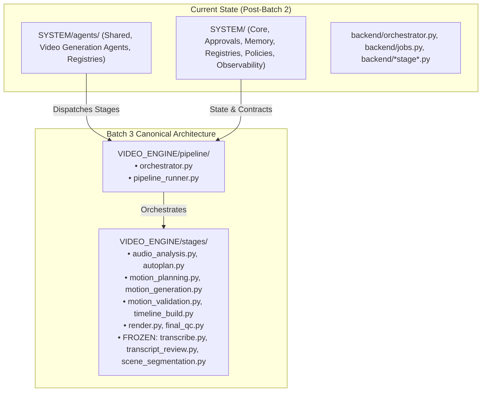

# Phase 2B — Batch 2 Handoff & Batch 3 Readiness Report

- **Date/Time**: 2026-10-16 20:50:00 UTC+5:30
- **Repository Root**: `E:\audio-to-video`
- **Branch / HEAD**: `agents-building` / `f6989b17372e3cdb42b4c92ab1783b3122a401ae`
- **Scope**: Batch 2 Completed Handoff & Batch 3 Detailed Execution Specification

---

## 1. Batch 2 Summary & Handoff State

Phase 2B Batch 2 (SYSTEM Agents Migration) is **100% complete and verified**:

- **Migrated Files**:
  - `backend/agents/contracts.py` -> `SYSTEM/agents/shared/contracts.py`
  - `backend/agents/communication.py` -> `SYSTEM/agents/shared/communication.py`
  - `backend/agents/base_agent.py` -> `SYSTEM/agents/shared/base_agent.py`
  - `backend/agents/adapters/stage_adapters.py` -> `SYSTEM/agents/video_generation_agents/stage_adapters.py`
  - `backend/agents/registry.py` -> `SYSTEM/registries/agent_registry.py` (and re-exported at `SYSTEM/agents/registry.py`)
  - Canonical package initialized at `SYSTEM/agents/__init__.py`.
- **Zero In-Memory Duplication**:
  - `backend/agents/` modules alias to canonical modules via `sys.modules[__name__] = _canonical`. Singletons, state, and type comparisons are completely preserved.
- **Verification**:
  - Direct canonical imports: 14/14 agents validated with 0 errors.
  - FastAPI app import: 65 routes mounted across 15 routers with 0 errors.
  - Focused Pytest suites: **57/57 tests passing (100%)** across 6 test suites in 8.35s.
  - Cumulative Phase 2B test pass count: **138/138 tests passing (100%)**.
  - Frozen file baseline integrity: **100% byte-for-byte identical (3/3 MATCH)**.

---

## 2. Transition to Batch 3: VIDEO_ENGINE Pipeline & Stages

Batch 3 represents the core video generation pipeline migration: transitioning pipeline execution, stage orchestration, and individual stage logic into `VIDEO_ENGINE/`.

---

## 3. Batch 3 Scope of Work

### A. Target Directories
- `VIDEO_ENGINE/pipeline/`
- `VIDEO_ENGINE/stages/`

### B. Files Scheduled for Migration in Batch 3
1. **Pipeline Execution Engine**:
   - `backend/orchestrator.py` -> `VIDEO_ENGINE/pipeline/orchestrator.py`
   - `backend/jobs.py` -> `VIDEO_ENGINE/pipeline/jobs.py` (or converged into pipeline runner)
   - Canonical `VIDEO_ENGINE/pipeline/__init__.py`
2. **Video Generation Stages**:
   - `backend/audio_analysis.py` -> `VIDEO_ENGINE/stages/audio_analysis.py`
   - `backend/autoplan.py` -> `VIDEO_ENGINE/stages/autoplan.py`
   - `backend/motion_planning.py` -> `VIDEO_ENGINE/stages/motion_planning.py`
   - `backend/motion_generation.py` -> `VIDEO_ENGINE/stages/motion_generation.py`
   - `backend/motion_validation.py` -> `VIDEO_ENGINE/stages/motion_validation.py`
   - `backend/timeline_build.py` -> `VIDEO_ENGINE/stages/timeline_build.py`
   - `backend/render.py` -> `VIDEO_ENGINE/stages/render.py`
   - `backend/final_qc.py` -> `VIDEO_ENGINE/stages/final_qc.py`
   - Canonical `VIDEO_ENGINE/stages/__init__.py`
3. **FROZEN FILE GATE (Strict Protection Protocol)**:
   - Target files:
     - `backend/transcribe.py`
     - `backend/transcript_review.py`
     - `backend/scene_segmentation.py`
   - **Protocol**:
     1. Pre-operation SHA-256 calculation and verification against baseline hashes.
     2. Migration to `VIDEO_ENGINE/stages/` preserving exact byte content (no formatting, no header additions, no import changes).
     3. Post-operation SHA-256 calculation verifying identical hash.
     4. Backward compatibility wrappers in `backend/` pointing to canonical locations.

---

## 4. Batch 3 Acceptance Criteria

To successfully complete Batch 3:
1. `VIDEO_ENGINE/pipeline/` and `VIDEO_ENGINE/stages/` fully operational.
2. All 3 frozen files retain 100% exact SHA-256 hashes.
3. Zero duplicate business logic between `VIDEO_ENGINE` and `backend/`.
4. Orchestrator and stage tests execute and pass 100%.
5. FastAPI app starts cleanly and all routes remain functional.
6. Zero ASR execution, zero pipeline runs, zero Remotion renders triggered.
7. Zero dead code deleted (Image Mode files remain intact until Batch 6).

---

## 5. Next Step

**STOP AND AWAIT USER APPROVAL**:
Do not begin Batch 3 migration until the user reviews this report and explicitly authorizes proceeding with **Phase 2B — Batch 3: VIDEO_ENGINE Pipeline & Stages Migration**.
