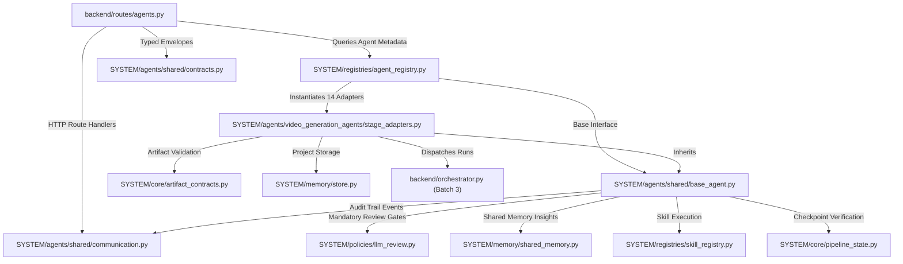

# Phase 2B — Batch 2 Import and Dependency Report

- **Date/Time**: 2026-10-16 20:50:00 UTC+5:30
- **Repository Root**: `E:\audio-to-video`
- **Branch / HEAD**: `agents-building` / `f6989b17372e3cdb42b4c92ab1783b3122a401ae`
- **Scope**: Batch 2 Import Reconnection & Dependency Traceability

---

## 1. Subsystem Integration Graph

With Batch 2 complete, agent implementations are cleanly connected to the canonical SYSTEM platform services established in Batch 1:

---

## 2. Detailed Import Updates by File

### A. `SYSTEM/agents/shared/base_agent.py`
- Repointed shared platform dependencies directly to canonical Batch 1 services:
  - `from SYSTEM.registries import skill_registry`
  - `from SYSTEM.memory import shared_memory`
  - `from SYSTEM.policies import llm_review`
  - `from SYSTEM.core import pipeline_state`
- Relative imports preserved within shared agent package:
  - `from .communication import publish_lifecycle_event, publish_message`
  - `from .contracts import AgentMetadata, AgentRequest, AgentResult, ArtifactRef, MessageType`

### B. `SYSTEM/agents/shared/communication.py`
- Repointed store import: `from SYSTEM.memory import store`.
- Config lookup made robust with fallback (`try: from backend import config except ImportError: import config`).
- Relative imports preserved: `from .contracts import AgentMessage, ArtifactRef, MessageType`.

### C. `SYSTEM/agents/video_generation_agents/stage_adapters.py`
- Repointed shared agent interfaces:
  - `from SYSTEM.agents.shared.base_agent import BaseAgent`
  - `from SYSTEM.agents.shared.contracts import AgentMetadata, AgentRequest, AgentResult, AgentStatus, ArtifactRef`
- Repointed canonical storage & contracts:
  - `from SYSTEM.memory import store`
  - `from SYSTEM.core.artifact_contracts import (verify_path_confinement, validate_analyzer_artifacts, validate_segmentation_artifacts, validate_planning_artifacts, validate_timeline_artifacts, validate_approval_artifacts, validate_render_artifacts, validate_qc_artifacts, validate_final_artifacts, _file_sha256)`
- External stage dependencies (`from backend import ...`) maintained as compatibility imports until stages are migrated in Batch 3.

### D. `SYSTEM/registries/agent_registry.py`
- Repointed agent interfaces and stage adapters:
  - `from SYSTEM.agents.shared.base_agent import BaseAgent`
  - `from SYSTEM.agents.shared.contracts import AgentCategory, AgentMetadata, AgentStatus`
  - `from SYSTEM.agents.video_generation_agents.stage_adapters import (...)`

### E. `SYSTEM/agents/__init__.py`
- Unified package root re-exporting:
  - All dataclasses, enums, and messages from `SYSTEM.agents.shared.contracts`
  - All messaging functions from `SYSTEM.agents.shared.communication`
  - `BaseAgent` from `SYSTEM.agents.shared.base_agent`
  - `AgentRegistry`, `registry` instance, and `get_agent_registry` from `SYSTEM.registries.agent_registry`
  - Submodules `contracts`, `communication`, `base_agent`, `stage_adapters`, and `registry`

### F. `backend/routes/agents.py`
- Updated route imports to point directly to canonical `SYSTEM` modules:
  - `from SYSTEM.agents.shared import communication`
  - `from SYSTEM.registries.agent_registry import registry`
  - `from SYSTEM.agents.shared.contracts import AgentMessage, ArtifactRef, MessageType`

---

## 3. Backward Compatibility Aliases in `backend/agents/`

All 6 source paths under `backend/agents/` were converted into exact `sys.modules` aliases:
- `backend.agents.contracts is SYSTEM.agents.shared.contracts`
- `backend.agents.communication is SYSTEM.agents.shared.communication`
- `backend.agents.base_agent is SYSTEM.agents.shared.base_agent`
- `backend.agents.adapters.stage_adapters is SYSTEM.agents.video_generation_agents.stage_adapters`
- `backend.agents.registry is SYSTEM.registries.agent_registry`
- `backend.agents is SYSTEM.agents`

This ensures that unmigrated modules (`backend/orchestrator.py`, legacy tests, etc.) can import from either `backend.agents` or `SYSTEM.agents` with 100% singleton state equivalence.
