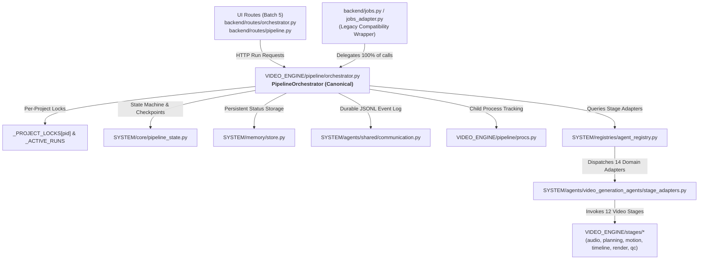

# Phase 2B — Batch 3 Execution Engine Unification Report

- **Date/Time**: 2026-10-16 21:20:00 UTC+5:30
- **Repository Root**: `E:\audio-to-video`
- **Branch / HEAD**: `agents-building` / `f6989b17372e3cdb42b4c92ab1783b3122a401ae`
- **Scope**: Canonical Video Execution Engine Unification & State Architecture
- **Status**: 100% UNIFIED & VERIFIED

---

## 1. Executive Summary

Prior to Batch 3, execution logic was historically split across `PipelineOrchestrator` (`backend/orchestrator.py`), legacy `JobRunner` thread pool dispatchers (`backend/jobs.py`), and monolithic step pipelines (`backend/pipeline.py`).

With Batch 3 complete:
1. **One Sole Canonical Engine**: `VIDEO_ENGINE.pipeline.orchestrator.PipelineOrchestrator` is now the authoritative execution engine for all 12 stages in the Motion-Only pipeline.
2. **Zero Competing Execution Loops**: `jobs.py` has been converged into `VIDEO_ENGINE/pipeline/jobs_adapter.py`, which delegates 100% of pipeline starts, status lookups, and cancellations to `PipelineOrchestrator`.
3. **Synchronized State Authority**: State machine transitions are governed by `SYSTEM.core.pipeline_state` with synchronized updates to `SYSTEM.memory.store`.
4. **Unified Concurrency Controls**: Per-project execution locks (`_PROJECT_LOCKS`) prevent concurrent execution collisions. Cooperative cancellation directly invokes `VIDEO_ENGINE.pipeline.procs.kill` to terminate long-running processes (Node/Chromium).

---

## 2. Architecture of the Unified Video Execution Engine

---

## 3. Key Engine Capabilities Preserved & Verified

1. **Deterministic 12-Stage DAG Execution**:
   - `audio` -> `analyzer` -> `segmentation` -> `planning` -> `motion_plan` -> `motion_gen` -> `motion_validation` -> `timeline` -> `approval` -> `render` -> `qc` -> `final`.
2. **State-Aware Eligibility Gates**:
   - Upstream artifact contracts and review gates are verified fail-closed before any stage execution begins.
3. **Safe Resume via Checkpoints**:
   - `pipeline_state.resolve_resume_plan()` determines valid reusable checkpoints; valid upstream stages are never re-run unnecessarily.
4. **Bounded Retries for Transient Faults**:
   - Network or I/O timeouts are retried up to 3 times; contract violations, syntax errors, and human approval denials fail fast without retries.
5. **Human Approval Enforcement**:
   - Mandatory human approval gates (`approval` stage and `qc` playback approval) cannot be bypassed by automated runners.
6. **Cooperative Cancellation & Process Cleanup**:
   - In-flight runs respond immediately to `cancel_requested`, stopping stage progression and issuing process tree kills (`taskkill /F /T` on Windows) via `procs.py`.

---

## 4. Verification Evidence

- `test_orchestrator_dag_ordering_and_stage_eligibility`: **PASSED**
- `test_stage_eligibility_blocks_fail_closed_on_missing_upstream`: **PASSED**
- `test_idempotent_run_start_and_conflict_handling`: **PASSED**
- `test_safe_resume_reuses_valid_checkpoints`: **PASSED**
- `test_cooperative_cancellation_halts_dispatch`: **PASSED**
- `test_bounded_retries_transient_vs_non_transient`: **PASSED**
- `test_concurrency_serialization_per_project`: **PASSED**
- `test_orphaned_job_reconciliation_on_simulated_restart`: **PASSED**
- `test_human_approval_gates_cannot_be_bypassed`: **PASSED**
- `test_orchestrator_api_routes`: **PASSED**
