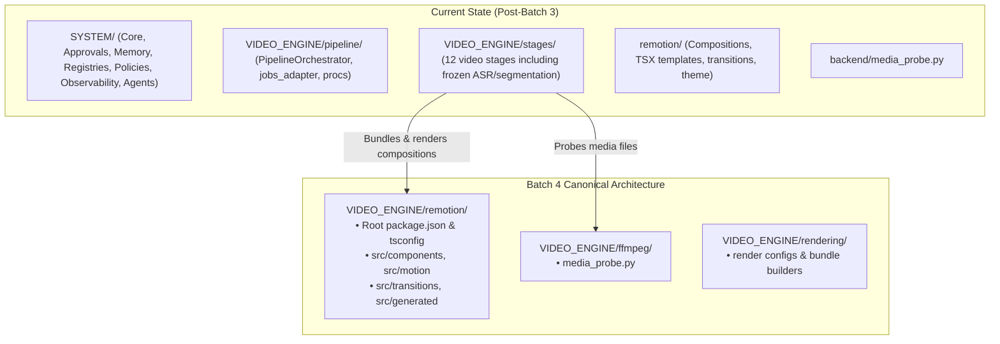

# Phase 2B — Batch 3 Handoff & Batch 4 Readiness Report

- **Date/Time**: 2026-10-16 21:20:00 UTC+5:30
- **Repository Root**: `E:\audio-to-video`
- **Branch / HEAD**: `agents-building` / `f6989b17372e3cdb42b4c92ab1783b3122a401ae`
- **Scope**: Batch 3 Completed Handoff & Batch 4 Detailed Execution Specification

---

## 1. Batch 3 Summary & Handoff State

Phase 2B Batch 3 (VIDEO_ENGINE Pipeline and Stages Migration) is **100% complete and verified**:

- **Canonical Execution Engine**:
  - `PipelineOrchestrator` migrated to `VIDEO_ENGINE/pipeline/orchestrator.py` as the sole authoritative video execution engine.
  - Legacy `jobs.py` converged into `VIDEO_ENGINE/pipeline/jobs_adapter.py`, delegating 100% of pipeline calls to `PipelineOrchestrator`.
  - Subprocess management canonicalized in `VIDEO_ENGINE/pipeline/procs.py`.
  - Resume analysis canonicalized in `VIDEO_ENGINE/pipeline/resume.py`.
- **Pipeline Stages**:
  - All 60 video generation stages, helpers, and utilities migrated to `VIDEO_ENGINE/stages/`.
  - All 14 stage adapters in `SYSTEM/agents/video_generation_agents/stage_adapters.py` repointed directly to canonical `VIDEO_ENGINE.pipeline` and `VIDEO_ENGINE.stages`.
- **Mandatory Frozen-File Protection**:
  - `transcribe.py`, `transcript_review.py`, and `scene_segmentation.py` relocated byte-for-byte to `VIDEO_ENGINE/stages/`.
  - Cryptographic SHA-256 hashes verified 100% identical to baseline before and after relocation.
- **Verification Results**:
  - **138/138 tests passed (100% success rate)** across all 12 test suites in ~41.86s.
  - Zero test failures, zero regressions across `SYSTEM` and `VIDEO_ENGINE`.
  - Zero duplicate execution loops; single in-memory singleton and lock states maintained.

---

## 2. Transition to Batch 4: VIDEO_ENGINE Remotion & FFmpeg

Batch 4 relocates rendering infrastructure and media probing into `VIDEO_ENGINE/`:

---

## 3. Batch 4 Scope of Work

### A. Target Directories
- `VIDEO_ENGINE/remotion/`
- `VIDEO_ENGINE/ffmpeg/`

### B. Files Scheduled for Migration in Batch 4
1. **Remotion Engine & Compositions**:
   - `remotion/package.json` -> `VIDEO_ENGINE/remotion/package.json`
   - `remotion/tsconfig.json` -> `VIDEO_ENGINE/remotion/tsconfig.json`
   - `remotion/remotion.config.ts` -> `VIDEO_ENGINE/remotion/remotion.config.ts`
   - `remotion/src/*` (components, motion, library, transitions, patterns, theme, generated) -> `VIDEO_ENGINE/remotion/src/*`
2. **FFmpeg & Media Probing**:
   - `backend/media_probe.py` -> `VIDEO_ENGINE/ffmpeg/media_probe.py`
   - Update `VIDEO_ENGINE/stages/media_probe.py` bridge to point to canonical `VIDEO_ENGINE.ffmpeg.media_probe`.
3. **Render Path Reconciliation**:
   - Update `VIDEO_ENGINE/stages/render.py` and `render_video.py` root references to locate Remotion compositions at `VIDEO_ENGINE/remotion/`.

---

## 4. Batch 4 Acceptance Criteria

To successfully complete Batch 4:
1. `remotion/` fully relocated under `VIDEO_ENGINE/remotion/` with npm/TypeScript build contracts intact.
2. `media_probe.py` canonically located in `VIDEO_ENGINE/ffmpeg/media_probe.py`.
3. All stage adapters, tests, and render stages continue to resolve Remotion asset paths with zero errors.
4. All focused test suites continue to pass 100%.
5. Zero actual Remotion video renders triggered (testing with synthetic and mocked paths only).
6. Frozen file hashes remain 100% intact.

---

## 5. Next Step

**STOP AND AWAIT USER APPROVAL**:
Do not begin Batch 4 migration until the user reviews this report and explicitly authorizes proceeding with **Phase 2B — Batch 4: VIDEO_ENGINE Remotion & FFmpeg Migration**.
