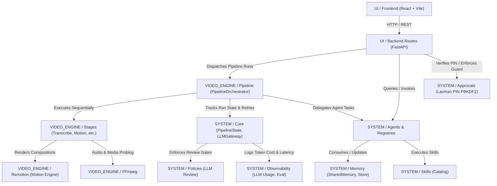

# Phase 2 — Dependency and Risk Register Report

- **Date/Time**: 2026-10-16 20:05:00 UTC+5:30
- **Repository Root**: `E:\audio-to-video`
- **Branch / HEAD**: `agents-building` / `f6989b17372e3cdb42b4c92ab1783b3122a401ae`
- **Phase**: Phase 2A (Scaffolding & File Mapping Only; Strictly No File Migrations)

---

## 1. Architecture Ownership & Dependency Boundaries

To eliminate the historical tight coupling and duplicate execution paths, the canonical target architecture establishes strict ownership boundaries:

### Ownership Rules
1. **`SYSTEM/`** owns all agent logic (`SYSTEM/agents/`), registries (`SYSTEM/registries/`), skills (`SYSTEM/skills/`), approvals (`SYSTEM/approvals/`), memory (`SYSTEM/memory/`), policies (`SYSTEM/policies/`), observability (`SYSTEM/observability/`), and core runtime primitives (`SYSTEM/core/`).
2. **`VIDEO_ENGINE/`** owns video pipeline execution (`VIDEO_ENGINE/pipeline/`), individual stage logic (`VIDEO_ENGINE/stages/`), Remotion compositions (`VIDEO_ENGINE/remotion/`), and FFmpeg utilities (`VIDEO_ENGINE/ffmpeg/`).
3. **`UI/`** owns presentation (`UI/frontend/`) and transport adapters/routes (`UI/backend/`). `UI/backend/` must never contain business logic, stage execution loops, or duplicated state.
4. **Data Stores** (`projects/`, `resource-library/`) remain canonical at repository root and are never copied into code folders.

---

## 2. Duplicate Execution Engine and Route Analysis

### Current State
1. **Canonical Engine**: `PipelineOrchestrator` (`backend/orchestrator.py`).
2. **Legacy Execution Loop**: `backend/jobs.py` historically ran an independent thread pool with `ThreadPoolExecutor(max_workers=2)`. In Phase A4 partial work, `jobs.start()` and `jobs.cancel()` were modified to delegate to `PipelineOrchestrator`, but legacy wrapper functions remain.
3. **Legacy Monolithic Pipeline**: `backend/pipeline.py` contains monolithic chain runners (`chain_for`, `CHAINS`, `run_stage`).
4. **Active Route Entry Points**:
   - `backend/routes/orchestrator.py`: Directly exposes orchestrator run/cancel/status endpoints (`/projects/{pid}/orchestrator/run`).
   - `backend/routes/run.py`: Exposes `/projects/{pid}/transcribe`, `/projects/{pid}/submit`, `/projects/{pid}/cancel`, calling `jobs.start()` / `jobs.cancel()`.
   - `backend/routes/pipeline.py`: Exposes `/projects/{pid}/pipeline/run`, `/projects/{pid}/pipeline/advance`, calling `jobs.start()`.
5. **Frontend API Callers**:
   [`frontend/src/api/client.ts`](file:///e:/audio-to-video/frontend/src/api/client.ts) actively calls BOTH legacy routes (`transcribe`, `submit`, `cancel`, `advancePipeline`) and canonical orchestrator routes (`startOrchestratorRun`, `cancelOrchestratorRun`, `getOrchestratorStatus`).

### Target Resolution Plan (Phase 2B / Phase 3)
- Keep `UI/backend/routes/` as thin compatibility wrappers that delegate 100% of pipeline commands to `PipelineOrchestrator`.
- Retire redundant thread pool loops in `jobs.py`.
- Gradually update frontend client callers to invoke canonical orchestrator routes directly.

---

## 3. Motion-Only Inventory & Image Mode Remnants

The target architecture is strictly **Motion-Only**. Image generation has been deprecated.

### Detailed Findings
- `backend/imagegen.py`: **DOES NOT EXIST** (Verified in filesystem; reported historically in earlier notes, but confirmed absent).
- `backend/image_gate.py`: **DEAD CODE** (Verified: 0 production callers across `backend/` and `routes/`; referenced only in 3 legacy tests `test_m7.py`, `test_pipeline_gate.py`, `test_stock.py`). Target action: `REMOVE`.
- `backend/bg_remove.py`: **DEAD CODE CANDIDATE** (Only called by `fill_slots.py`). Target action: `REMOVE`.
- `backend/fill_slots.py`: **DEAD CODE CANDIDATE** (Legacy image slot filler; scenes are now dynamic motion components). Target action: `REMOVE`.
- `backend/prompts_writer.py`: **DEAD CODE CANDIDATE** (Generates image prompt text files). Target action: `REMOVE`.
- `backend/store.py`: `uses_images(pdir)` is hardcoded to return `False`. Target action: Phase out callers, enforce motion-only mode cleanly.
- `remotion/src/components/ImageLayer.tsx`: **RETAIN/REVIEW** (Used to render general images/logos/stickers in motion templates; not image-generation mode specific).
- User Project Assets (`projects/*/s*_*.png`, `remotion/public/projects/*/`): **MUST PRESERVE** (Historical user renders and project assets must never be deleted).

> [!IMPORTANT]
> In Phase 2A, **NO image mode code was deleted or modified**. All removals are deferred to Phase 2B/Phase 3 under explicit operator approval.

---

## 4. Prioritized Risk Register

| Risk ID | Severity | Category | Affected Paths | Description / Evidence | Consequence | Mitigation Strategy | Phase Scheduled |
|---|---|---|---|---|---|---|---|
| **RSK-001** | `BLOCKER` | Frozen Files Integrity | `backend/transcribe.py`, `backend/transcript_review.py`, `backend/scene_segmentation.py` | Core Whisper transcription and scene segmentation algorithms are strictly frozen. | Byte corruption, formatting change, or CRLF conversion invalidates baseline. | Mandatory SHA-256 pre-move and post-move assertion. Exact byte match required. Zero reformatting. | Phase 2B / Phase 3 |
| **RSK-002** | `HIGH` | Execution Concurrency & Dual State | `backend/orchestrator.py`, `backend/jobs.py`, `backend/pipeline_state.py`, `backend/store.py` | Two state representations exist: `PipelineState` (checkpoints/runs) and `store.set_state` (`info.json` status: `building`/`done`/`failed`). | Desynchronization between UI polling and actual background job state. | Canonical status mirroring implemented in `orchestrator.py`; unify all state updates through `PipelineState` and `store`. | Phase 2B / Phase 3 |
| **RSK-003** | `HIGH` | Frontend Route Contract Breakage | `frontend/src/api/client.ts`, `backend/routes/run.py`, `backend/routes/pipeline.py` | Frontend relies on legacy endpoints `/submit`, `/transcribe`, `/cancel` as well as `/orchestrator/run`. | Relocating routes without backward compatibility shims will crash UI pages. | Keep backward-compatible endpoint definitions in `UI/backend/routes/` delegating internally to `PipelineOrchestrator`. | Phase 2B |
| **RSK-004** | `HIGH` | Remotion Asset & Composition Paths | `remotion/src/*`, `remotion/scripts/*`, `VIDEO_ENGINE/remotion/` | Remotion scripts locate composition roots, public fonts (`public/resource-fonts/`), and project outputs via relative paths. | Relocating `remotion/` to `VIDEO_ENGINE/remotion/` can break npm/vite entry points if relative paths break. | Retain npm scripts in `VIDEO_ENGINE/remotion/` or root wrapper; update path constants in `config.ts` and `render.py`. | Phase 2B |
| **RSK-005** | `MEDIUM` | PIN Hash Security & Credential Exposure | `config/.laxman_pin_hash`, `backend/approvals/` | Laxman PIN hash is stored in `config/.laxman_pin_hash` with PBKDF2-HMAC-SHA256. | Accidental file move or improper permissions could compromise approval authorization. | Treat as `SECRET_OR_CREDENTIAL`. Keep path reference mapped in `SYSTEM/approvals/` with fail-closed checks. | Phase 2B |
| **RSK-006** | `MEDIUM` | Dead Code Removal Regression | `backend/image_gate.py`, `backend/fill_slots.py`, `backend/bg_remove.py` | Image mode removal might accidentally touch shared utilities (e.g. `matcher.py` or `visual_plan.py`). | Broken imports in motion planning or visual planning stages. | Perform static import analysis before removing any candidate; retain all shared schema/asset helpers. | Phase 2B / Phase 3 |
| **RSK-007** | `HIGH` | Unauthorized Execution | Pipeline, ASR, Remotion render | Heavy computational workloads (Whisper, Remotion render) must not run during architecture restructuring. | Resource exhaustion, pipeline side effects, or test failures on incomplete migrations. | Strict policy: Zero ASR, zero render runs, zero pipeline execution until explicit operator authorization. | All Phases |

---

## 5. Unresolved Questions & Operator Decisions

1. **Root `skills/` Directory vs `SYSTEM/skills/`**:
   - Currently, `skills/` exists at the root containing `catalog.json` and 4 domain skill packages. Target architecture specifies `SYSTEM/skills/`.
   - *Recommendation*: Relocate contents of root `skills/` to `SYSTEM/skills/` during Phase 2B, or retain root `skills/` as a symlink/alias.
2. **`config/` Directory Consolidation**:
   - Root `config/` contains both platform configs (`llm_settings.json`, `shared_memory.json`, `.laxman_pin_hash`) and eval suites (`eval_baselines.json`).
   - *Recommendation*: Keep `config/` at repository root as the canonical configuration and secrets location, or partition non-sensitive configs into `SYSTEM/` and video render configs into `VIDEO_ENGINE/config/`.
