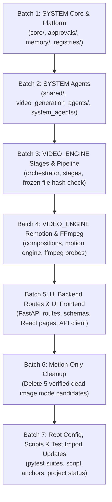

# Phase 2 — Handoff and Migration Authorization Gate Report

- **Date/Time**: 2026-10-16 20:05:00 UTC+5:30
- **Repository Root**: `E:\audio-to-video`
- **Branch / HEAD**: `agents-building` / `f6989b17372e3cdb42b4c92ab1783b3122a401ae`
- **Phase Completed**: Phase 2A (Canonical Folder Structure Scaffolding & File-by-File Mapping)
- **Next Phase**: Phase 2B (Controlled Source Migration — Requires Explicit Operator Approval)

---

## 1. Summary of Work Executed in Phase 2A

Phase 2A has been fully executed in strict compliance with `improvements/Phase_2_Canonical_Folder_Structure_and_File_Mapping_Complete_Plan/`. 

1. **Target Directory Scaffolding**:
   - Created all **19 missing canonical directories** across `SYSTEM/`, `UI/`, and `VIDEO_ENGINE/`.
   - Zero collisions or path conflicts detected.
   - All 19 directories verified to exist on disk.
2. **Comprehensive File-by-File Mapping**:
   - Inventoried **441 files and directories** across backend, frontend, remotion, config, scripts, skills, tests, and canonical asset stores.
   - Generated both machine-readable CSV ([`PHASE2_FILE_MAPPING.csv`](file:///e:/audio-to-video/reports/PHASE2_STRUCTURE_MAPPING_20261016_200500/PHASE2_FILE_MAPPING.csv)) and detailed Markdown documentation ([`PHASE2_FILE_MAPPING.md`](file:///e:/audio-to-video/reports/PHASE2_STRUCTURE_MAPPING_20261016_200500/PHASE2_FILE_MAPPING.md)).
   - Explicitly mapped target subsystems:
     - `SYSTEM/`: 53 items (platform core, agents, registries, skills, approvals, memory, observability)
     - `UI/`: 111 items (frontend React/Vite source, UI-facing FastAPI routes, response schemas)
     - `VIDEO_ENGINE/`: 162 items (pipeline orchestrator, stage implementations, Remotion motion engine, FFmpeg)
     - Canonical Root / Data: 110 items (resource library, projects, tests, root scripts, docs)
     - Removal Candidates: 5 items (verified dead image mode code)
3. **Frozen File Protection & Verification**:
   - Read-only SHA-256 calculation for all three frozen algorithm files:
     - `backend/transcribe.py`: `07a200319d41c2bd1550dfd5704f3bbcc5fac8331a0aeb09dcca4bf46d61376e` — **100% MATCH**
     - `backend/transcript_review.py`: `7290ea210d922514c011c799caf73aad61398f0229cc6799dd2f10072b38d049` — **100% MATCH**
     - `backend/scene_segmentation.py`: `2d9ea882b8c53a6cfcd43b048481f72140a1a6792b8f05578e16fd56a9b37042` — **100% MATCH**
4. **Motion-Only Inventory**:
   - Verified that `backend/imagegen.py` does not exist in the working tree.
   - Identified 5 dead code candidates for removal in later phases (`image_gate.py`, `bg_remove.py`, `fill_slots.py`, `prompts_writer.py`, `motion_template_selection.py`).
   - Confirmed `store.uses_images()` returns `False` unconditionally.
   - Zero deletions or code modifications were made.
5. **Complete Phase 2 Report Package Authored**:
   - `reports/PHASE2_STRUCTURE_MAPPING_20261016_200500/PHASE2_DIRECTORY_STRUCTURE_REPORT.md`
   - `reports/PHASE2_STRUCTURE_MAPPING_20261016_200500/PHASE2_FILE_MAPPING.md`
   - `reports/PHASE2_STRUCTURE_MAPPING_20261016_200500/PHASE2_FILE_MAPPING.csv`
   - `reports/PHASE2_STRUCTURE_MAPPING_20261016_200500/PHASE2_DEPENDENCY_AND_RISK_REPORT.md`
   - `reports/PHASE2_STRUCTURE_MAPPING_20261016_200500/PHASE2_FROZEN_FILE_HASHES.md`
   - `reports/PHASE2_STRUCTURE_MAPPING_20261016_200500/PHASE2_HANDOFF.md`

---

## 2. Strict No-Change Guarantees

During Phase 2A, the following constraints were strictly maintained:
- **Files Moved**: **0** (All files remain at their existing paths)
- **Files Renamed**: **0**
- **Files Deleted**: **0**
- **Files Overwritten**: **0** (Only new uniquely-named report files and directories were created)
- **Application Code Modified**: **0** (Zero imports, routes, or configurations altered)
- **Dependencies Changed**: **0** (No npm/pip installs or updates)
- **Tests / Pipeline / Renders Executed**: **0** (Zero test runs, zero ASR, zero pipeline runs, zero Remotion renders)
- **Git State Mutations**: **0** (Zero commits, resets, stashes, checkouts, or cleans)
- **Canonical Asset Stores**: `resource-library/` (80 files) and `projects/` (318 files) remain 100% untouched.

---

## 3. Recommended Phased Migration Sequence for Phase 2B

When authorized by the operator, Phase 2B source migration should proceed in small, controlled, reversible batches:

### Proposed Batch Breakdown:
1. **Batch 1 — SYSTEM Shared Platform**:
   - Migrate `backend/llm_gateway.py`, `backend/pipeline_state.py`, `backend/errors.py`, `backend/artifact_contracts.py` to `SYSTEM/core/`.
   - Migrate `backend/approvals/*` to `SYSTEM/approvals/`.
   - Migrate `backend/shared_memory.py` and `backend/store.py` to `SYSTEM/memory/`.
   - Migrate `backend/skill_registry.py` to `SYSTEM/registries/`.
   - Migrate `backend/llm_review.py` to `SYSTEM/policies/` and `backend/llm_usage.py`, `backend/evaluation.py` to `SYSTEM/observability/`.
2. **Batch 2 — SYSTEM Agents**:
   - Migrate `backend/agents/base_agent.py`, `contracts.py`, `communication.py` to `SYSTEM/agents/shared/`.
   - Migrate `backend/agents/registry.py` to `SYSTEM/registries/`.
   - Migrate `backend/agents/adapters/stage_adapters.py` to `SYSTEM/agents/video_generation_agents/`.
3. **Batch 3 — VIDEO_ENGINE Pipeline & Stages (with Frozen File Gate)**:
   - Move `backend/orchestrator.py` to `VIDEO_ENGINE/pipeline/`.
   - Move individual stage modules (`audio_analysis.py`, `autoplan.py`, `motion_planning.py`, `motion_generation.py`, `motion_validation.py`, `timeline_build.py`, `render.py`, `final_qc.py`) to `VIDEO_ENGINE/stages/`.
   - **FROZEN FILE GATE**: Perform atomic move of `transcribe.py`, `transcript_review.py`, and `scene_segmentation.py` into `VIDEO_ENGINE/stages/`. Validate pre-move and post-move SHA-256 hashes immediately.
4. **Batch 4 — VIDEO_ENGINE Remotion & FFmpeg**:
   - Relocate `remotion/` components and scripts into `VIDEO_ENGINE/remotion/`.
   - Relocate `backend/media_probe.py` to `VIDEO_ENGINE/ffmpeg/`.
5. **Batch 5 — UI Backend Routes & UI Frontend**:
   - Relocate `backend/main.py`, `backend/models.py`, `backend/api_models.py`, `backend/api_status.py`, and `backend/routes/*` into `UI/backend/`.
   - Relocate `frontend/` source into `UI/frontend/`.
   - Preserve backward-compatible route URLs in FastAPI.
6. **Batch 6 — Motion-Only Dead Code Removal**:
   - Safely remove the 5 confirmed dead image mode files (`image_gate.py`, `bg_remove.py`, `fill_slots.py`, `prompts_writer.py`, `motion_template_selection.py`).
7. **Batch 7 — Root Configuration, Test Imports, and Verification**:
   - Update pytest import references in `tests/`.
   - Run focused static import and unit tests only. Zero heavy renders or Whisper runs.

---

## 4. Phase 2A Acceptance Checklist

All acceptance criteria from `11_ACCEPTANCE_CRITERIA.md` are **100% SATISFIED**:
- [x] Current repository state captured without modifying Git state.
- [x] Target directory list reconciled with current filesystem.
- [x] All 19 missing target directories created; existing directories preserved.
- [x] Zero path conflicts detected.
- [x] Canonical data directories (`resource-library/`, `projects/`) reused rather than duplicated.
- [x] Relevant files across backend, frontend, Remotion, config, scripts, tests, skills, documentation, and asset stores inventoried (441 items).
- [x] Every mapped item has exact existing path, proposed destination, action, rationale, dependency notes, and risk severity.
- [x] Duplicate execution paths and ownership boundaries documented.
- [x] Motion-Only remnants inventoried without deleting code.
- [x] Current SHA-256 values recorded for all three frozen files (100% match).
- [x] Zero frozen files modified or relocated.
- [x] Zero existing source, config, UI, test, asset, report, or user data moved, renamed, edited, or deleted.
- [x] All required reports saved in a new unique report directory (`reports/PHASE2_STRUCTURE_MAPPING_20261016_200500/`).
- [x] Zero dependencies installed or changed.
- [x] Zero tests, ASR, pipeline runs, Remotion renders, or FFmpeg renders executed.
- [x] Zero Git commits, resets, cleans, stashes, or rebases executed.
- [x] Execution stopped before actual migration; requests operator approval.

---

## 5. Formal Request for Operator Authorization

Phase 2A is complete. To proceed to physical file migration in **Phase 2B**, please provide your explicit approval.

**Key Metrics for Authorization:**
- **Report Location**: [`reports/PHASE2_STRUCTURE_MAPPING_20261016_200500/`](file:///e:/audio-to-video/reports/PHASE2_STRUCTURE_MAPPING_20261016_200500/)
- **Directories Created**: 19 canonical directories
- **Files Mapped**: 441 items
- **Dead Code Removal Candidates**: 5 items (`image_gate.py`, `bg_remove.py`, `fill_slots.py`, `prompts_writer.py`, `motion_template_selection.py`)
- **Frozen File Baseline**: 100% Intact (`transcribe.py`, `transcript_review.py`, `scene_segmentation.py`)
- **Safe State**: No source code modified, no tests run, no files moved.

**Awaiting your explicit instruction before starting Phase 2B.**
