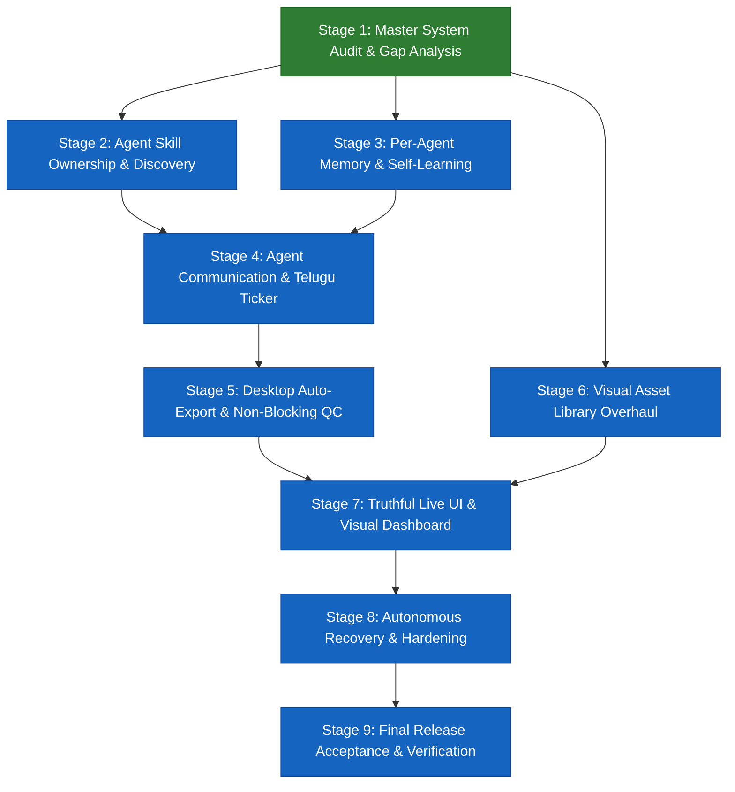

# STAGE 1 — IMPLEMENTATION ROADMAP: STAGES 1 THROUGH 9

**Project:** LAXMAN-AUTONOMOUS VIDEO GENERATION SYSTEM  
**Repository:** `E:\audio-to-video`  
**Branch:** `agents-building`  
**Audit Date:** 2026-10-17  
**Status:** COMPLETE (Stage 1 Master Audit)

---

## 1. Executive Overview

This master implementation roadmap outlines the precise engineering execution plan for transforming the existing released video engine into a fully autonomous, zero-touch, self-learning video production powerhouse. 

### Core System Architectural Objectives
1. **Zero-Touch Execution:** The user provides an audio file (or audio input stream), the system applies robust sensible defaults, and autonomously produces a complete, broadcast-ready video delivered directly to `Desktop\First Video Automation\`.
2. **True Agent Specialization & Ownership:** All 21 agents possess private local skill folders, private memory loops, and specialized capabilities, supported by a system-wide central library and evaluated self-learning.
3. **Safe Dynamic Capabilities:** Sandboxed GitHub discovery and dynamic skill adaptation under strict AST and benchmark evaluation gates.
4. **Natural Bilingual Telemetry:** Transparent inter-agent messaging accompanied by friendly, natural Telugu activity status updates.
5. **Truthful Observability:** Real-time UI reflecting true agent operations, live subagent states, and honest progress metrics.

---

## 2. Stage Progression Flow & Dependency Graph

---

## 3. Detailed Stage-by-Stage Implementation Specifications

### Stage 1: Master System Audit & Gap Analysis
- **Status:** `CURRENT STAGE (COMPLETE)`
- **Goal:** Perform an exhaustive, evidence-based audit of all existing components, verify frozen algorithm hashes, evaluate all 20 end-to-end requirements, catalog all visual resources, and produce a unified roadmap.
- **Boundaries:** Zero git commits/pushes. Zero code or asset modifications. Pure evidence generation.
- **Deliverables:**
  1. `CURRENT_SYSTEM_INVENTORY.md`
  2. `REQUIREMENTS_GAP_MATRIX.md`
  3. `RESOURCE_CLEANUP_AUDIT.md`
  4. `IMPLEMENTATION_ROADMAP.md`
  5. `STAGE_1_HANDOFF.md`
- **Verification Evidence:**
  - Python tests: 180/180 passed.
  - Frontend Vitest: 268/268 passed.
  - Frozen algorithm hashes: 3/3 matched.
  - Working tree: Clean and preserved.

---

### Stage 2: Agent Skill Ownership, Central Skill Library & Discovery
- **Goal:** Equip each of the 21 agents with private, agent-owned skill directories (`SYSTEM/agents/<agent_name>/skills/`), enhance the central skill registry to resolve both private and shared skills, and introduce a sandboxed GitHub skill discovery module.
- **Boundaries:** Agents maintain full backwards compatibility with existing central skills. No unsandboxed code execution.
- **Reusable Components:**
  - `SYSTEM/agents/shared/base_agent.py`
  - `SYSTEM/registries/skill_registry.py`
  - `SYSTEM/agents/skill_factory/skill_factory_agent.py`
  - `SYSTEM/agents/security_policy/ast_sandbox.py`
- **Required Changes:**
  - `SYSTEM/agents/shared/base_agent.py`: Implement `_discover_local_skills()` to automatically load and register skills located in `SYSTEM/agents/{agent_id}/skills/`.
  - `SYSTEM/registries/skill_registry.py`: Add scoped skill lookups (`get_agent_skill(agent_id, skill_name)` with fallback to global).
  - `SYSTEM/agents/capability_finder/github_discovery.py`: Implement `GitHubSkillDiscoveryService` with sanitized query mapping (Telugu audio processing, computer vision, Remotion styling) and metadata extraction.
  - `SYSTEM/agents/skill_factory/skill_factory_agent.py`: Enable target directory routing for synthesized skills (`target_agent_id`).
- **Dependencies:** Stage 1 baseline.
- **Verification & Test Strategy:**
  - Create `tests/test_stage2_agent_skills_discovery.py`.
  - Verify private skill isolation (Agent A cannot execute Agent B's private skill).
  - Verify AST sandbox rejects remote scripts with unauthorized imports or system calls.
- **Acceptance Criteria:**
  - `AssetCuratorAgent` loads and executes private skill `custom_svg_filter` from its own directory.
  - Central `media_probe` skill remains accessible to all agents.

---

### Stage 3: Per-Agent Memory, Self-Learning & Capability System
- **Goal:** Transform the monolithic shared memory (`config/shared_memory.json`) into an active per-agent reflection and experience store where specialist video agents record task performance metrics and tune their prompt/parameter choices over time.
- **Boundaries:** Memory operations must be non-blocking and fail-safe. Benchmark regressions must trigger automatic rollbacks.
- **Reusable Components:**
  - `config/shared_memory.json`
  - `SYSTEM/agents/capability_finder/learning_subsystem.py`
  - `SYSTEM/agents/verification_and_test/verification_agent.py`
- **Required Changes:**
  - `SYSTEM/agents/shared/base_agent.py`: Implement `record_experience()`, `retrieve_agent_memories()`, and `reflect_on_task_outcome()`.
  - `SYSTEM/agents/capability_finder/learning_subsystem.py`: Add partitioned storage indexing (`agent_id`, `task_type`, `outcome_score`).
  - `SYSTEM/agents/video_generation/scene_segmentation_agent.py` & `visual_prompt_agent.py`: Hook post-execution reflections (e.g., scene cut pacing, image style match score).
- **Dependencies:** Stage 2 (Agent base class enhancements).
- **Verification & Test Strategy:**
  - Create `tests/test_stage3_agent_memory_learning.py`.
  - Verify that running 3 mock audio segmentations records 3 experience logs under `scene_segmentation` memory key.
  - Verify rollback if a simulated parameter adjustment degrades audio-sync benchmark score.
- **Acceptance Criteria:**
  - 14 specialist video agents have active memory partitions.
  - No degradation in baseline pipeline execution speed (>50ms per memory lookup).

---

### Stage 4: Agent Communication & Telugu Activity Updates
- **Goal:** Implement natural, friendly, non-technical Telugu activity messaging for live user telemetry while maintaining high-fidelity inter-agent structured communication over SSE.
- **Boundaries:** All Telugu strings must be authentic, natural Unicode without corrupt encodings or broken grammar. Existing English log formats must be preserved for debugging.
- **Reusable Components:**
  - `SYSTEM/agents/shared/communication.py`
  - `communications.jsonl`
  - `backend/main.py` (`/api/stream/events`)
- **Required Changes:**
  - `SYSTEM/agents/shared/telugu_activity_mapper.py`: Author comprehensive mapping between agent operations, pipeline milestones, and idiomatic Telugu phrases.
  - `SYSTEM/agents/shared/communication.py`: Extend `AgentMessage` schema to include `telugu_activity: Optional[str]` and `progress_percent: float`.
  - `backend/services/pipeline_orchestrator.py`: Emit dual-stream status events through SSE bus.
- **Dependencies:** Stage 2 and Stage 3.
- **Verification & Test Strategy:**
  - Create `tests/test_stage4_telugu_activity_stream.py`.
  - Verify SSE emits valid JSON with both English technical log and Telugu natural activity string.
  - Validate Telugu strings against character set regex `[\u0C00-\u0C7F]`.
- **Acceptance Criteria:**
  - Milestone "Transcribing Audio" reliably streams `ఆడియో మాటలను అక్షరాలుగా మారుస్తున్నాము...`.
  - Milestone "Rendering Video" streams `పూర్తి నాణ్యతతో వీడియోను రికార్డ్ చేస్తున్నాము...`.

---

### Stage 5: Desktop Auto-Export & Non-Blocking QC Pipeline
- **Goal:** Enable end-to-end zero-touch autonomous video completion. The pipeline processes raw audio, executes automated technical QC without pausing for manual human clicks, and exports the final verified MP4 to `Desktop\First Video Automation\`.
- **Boundaries:** Output destination must handle Windows path permissions gracefully. Corrupted or out-of-spec videos must never be exported to the desktop.
- **Reusable Components:**
  - `SYSTEM/agents/video_generation/final_qc_agent.py`
  - `SYSTEM/agents/video_generation/final_video_delivery_agent.py`
  - `backend/services/media_probe.py`
- **Required Changes:**
  - `SYSTEM/agents/video_generation/final_video_delivery_agent.py`: Implement `deliver_to_desktop(project_id, video_path)`:
    - Resolves `Path.home() / "Desktop" / "First Video Automation"`.
    - Creates directory if not present.
    - Copies MP4 atomically with collision avoidance (`<title>_<timestamp>.mp4`).
    - Writes `delivery_summary.json` containing hashes, duration, resolution, and QC verdict.
  - `SYSTEM/agents/video_generation/final_qc_agent.py`: Implement automated rubric check. If technical QC passes thresholds (audio loudness, 0 freeze frames, valid duration), set `auto_approved = True` and immediately delegate to delivery.
  - `backend/services/pipeline_orchestrator.py`: Add `auto_pilot_mode = True` eliminating human hold gates.
- **Dependencies:** Stage 4.
- **Verification & Test Strategy:**
  - Create `tests/test_stage5_desktop_delivery_auto_qc.py`.
  - Run mock and end-to-end video render. Verify file is created in test Desktop folder with matching SHA-256 hash.
- **Acceptance Criteria:**
  - Zero manual user clicks required from audio input to desktop file delivery.
  - Verified video file exists in `Desktop\First Video Automation\`.

---

### Stage 6: Visual Asset Library Overhaul & Deprecation Cleanup
- **Goal:** Implement the catalog classifications established in `RESOURCE_CLEANUP_AUDIT.md`. Add missing high-quality visual templates across the 8 categories (especially Andhra Pradesh / Telangana maps and Telugu typography presets), and safely prune obsolete assets.
- **Boundaries:** Zero broken TypeScript builds (`npm run tsc` must exit 0). Zero missing assets during Remotion rendering.
- **Reusable Components:**
  - `resource-library/`
  - `remotion/src/`
  - `resource-library/catalog/registry.json`
- **Required Changes:**
  - Add Andhra Pradesh & Telangana animated SVG map templates to `remotion/src/components/MapLayer.tsx`.
  - Add statistical animated bar, line, and pie chart presets to `remotion/src/components/Chart.tsx`.
  - Remove verified obsolete files:
    - Prune static prototype scenes `remotion/src/generated/scene_1.tsx` to `scene_9.tsx`.
    - Consolidate redundant icon `eyeglass.svg` to `eyeglass-2.svg`.
    - Update `registry.json` to reflect cleaned state.
- **Dependencies:** Stage 1 audit findings.
- **Verification & Test Strategy:**
  - Full TypeScript build check: `npm --prefix remotion run tsc`.
  - Remotion render test across all 8 asset categories.
- **Acceptance Criteria:**
  - All 8 categories contain verified, high-quality production templates.
  - Remotion build completes with zero type errors.

---

### Stage 7: Truthful Live UI, Subagent Visuals & Zero-Touch Controls
- **Goal:** Upgrade the frontend user interface to provide a single-click "Drop Audio & Auto-Generate" intake mode, live Agent Activity Cards showing subagent thinking/action states, and a dedicated Telugu natural activity ticker.
- **Boundaries:** Preserve all existing advanced manual controls in collapsible drawers.
- **Reusable Components:**
  - `frontend/src/App.tsx`
  - `frontend/src/components/FlowchartVisualizer.tsx`
  - `frontend/src/components/AgentCommunicationDrawer.tsx`
  - `frontend/src/services/sse.ts`
- **Required Changes:**
  - `frontend/src/components/ZeroTouchDropzone.tsx`: Implement zero-touch audio submission with default preset options.
  - `frontend/src/components/AgentStatusGrid.tsx`: Display real-time active status cards for all 21 agents with badges, timers, and active subagent states.
  - `frontend/src/components/TeluguStatusTicker.tsx`: Prominent animated ticker displaying natural Telugu activity updates in Hind Guntur font.
- **Dependencies:** Stage 4 (Telugu streaming), Stage 5 (Auto-orchestration), Stage 6 (Visual assets).
- **Verification & Test Strategy:**
  - Frontend Vitest suite: Expand `frontend/tests/pipeline_ui.test.tsx` to test ZeroTouchDropzone and Telugu ticker rendering.
  - Build verification: `npm --prefix frontend run build`.
- **Acceptance Criteria:**
  - Single audio drop immediately initiates autonomous pipeline without opening configuration modals.
  - Telugu status ticker smoothly scrolls live updates.

---

### Stage 8: Autonomous Failure Recovery, Checkpointing & End-to-End Hardening
- **Goal:** Harden the full end-to-end autonomous pipeline against unexpected failures (network timeouts on image downloads, LLM rate limits, audio glitch detection) using the bounded 3-retry checkpoint/resume protocol.
- **Boundaries:** Maximum 3 retries per stage. Exponential backoff. Never loop infinitely.
- **Reusable Components:**
  - `SYSTEM/agents/autonomous_execution/autonomous_execution_agent.py`
  - `SYSTEM/agents/autonomous_execution/task_runner.py`
  - `backend/services/task_runner.py`
- **Required Changes:**
  - Implement automated stage fallback rules (e.g., if AI image generation fails 3 times, fallback to local SVG vector asset from `resource-library`).
  - Wire automated recovery directly into `PipelineOrchestrator` execution loop.
  - Verify end-to-end checkpoint serialization and resume from arbitrary failed stages.
- **Dependencies:** Stages 2 through 7.
- **Verification & Test Strategy:**
  - Create `tests/test_stage8_autonomous_hardening.py`.
  - Simulate asset fetch failure; verify fallback to local resource library without stopping the pipeline.
  - Verify resumption from stage 5 checkpoint without re-running stages 1 through 4.
- **Acceptance Criteria:**
  - System successfully recovers from simulated transient network failure and delivers finished video to Desktop.

---

### Stage 9: Final Release Acceptance, Production Packaging & Verification
- **Goal:** Perform end-to-end production acceptance testing, update release packaging scripts to bundle all new skills, assets, and UI components, and verify clean standalone operation on an isolated Windows environment.
- **Boundaries:** Zero test failures across Python, TypeScript, and Vitest suites. Release zip extracts and runs cleanly.
- **Reusable Components:**
  - `scripts/package_release.py`
  - `SYSTEM/agents/verification_and_test/verification_agent.py`
  - `start.ps1`, `start.bat`
- **Required Changes:**
  - Update `scripts/package_release.py` to include:
    - All agent-owned skill directories (`SYSTEM/agents/*/skills/`).
    - Cleaned and updated `resource-library/` assets.
    - Updated frontend build artifacts.
  - Run full release packaging producing `dist/laxman_video_engine_v2.0.0.zip`.
  - Perform clean sandbox extraction test on temporary path with port testing.
- **Dependencies:** All previous stages (Stages 1 through 8).
- **Verification & Test Strategy:**
  - Complete 100% test run across all test suites.
  - Standalone release package extraction and health check verification.
  - Final end-to-end run from audio input to desktop video file output.
- **Acceptance Criteria:**
  - All tests pass with zero warnings or errors.
  - Release archive is validated and production-ready.

---

## 4. Master Stage Verification & Milestone Matrix

| Stage | Expected Duration | Key Test Suite | Primary Deliverable |
| :--- | :--- | :--- | :--- |
| **Stage 1** | Completed | 180 Pytest / 268 Vitest | 5 Master Audit Reports in `STAGE_1_MASTER_AUDIT_20261017/` |
| **Stage 2** | Next | `test_stage2_agent_skills_discovery.py` | Agent-owned `skills/` directories & sandboxed GitHub finder |
| **Stage 3** | Planned | `test_stage3_agent_memory_learning.py` | Partitioned per-agent memory reflection loops |
| **Stage 4** | Planned | `test_stage4_telugu_activity_stream.py` | Real-time SSE Telugu activity streamer |
| **Stage 5** | Planned | `test_stage5_desktop_delivery_auto_qc.py` | Desktop export & zero-touch auto-pilot pipeline |
| **Stage 6** | Planned | `npm --prefix remotion run tsc` | 8-category visual library overhaul & obsolete cleanup |
| **Stage 7** | Planned | `frontend/tests/pipeline_ui.test.tsx` | Zero-touch dropzone, live agent cards & Telugu ticker |
| **Stage 8** | Planned | `test_stage8_autonomous_hardening.py` | Bounded fault-recovery & fallback resilience |
| **Stage 9** | Planned | Full End-to-End Acceptance Suite | Production release packaging v2.0.0 & operator guide |
