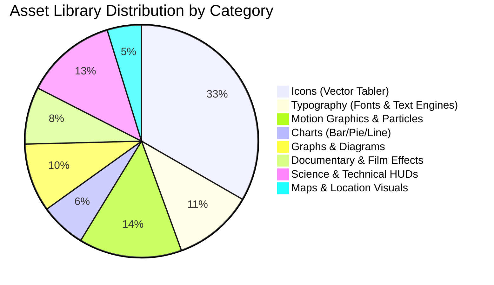

# STAGE 1 — RESOURCE CLEANUP AUDIT & VISUAL ASSET CLASSIFICATION

**Project:** LAXMAN-AUTONOMOUS VIDEO GENERATION SYSTEM  
**Repository:** `E:\audio-to-video`  
**Branch:** `agents-building`  
**Audit Date:** 2026-10-17  
**Status:** COMPLETE (Stage 1 Master Audit)

---

## 1. Executive Summary

This resource cleanup audit establishes a definitive catalog and dependency-aware classification of all visual assets, fonts, motion components, and templates across the project. 

### Mandatory Scope Rule
> [!IMPORTANT]
> **Stage 1 is strictly an audit.** In accordance with Stage 1 constraints, **ZERO files have been deleted, moved, or modified**. All classifications (`KEEP`, `REUSE`, `REPLACE`, `DELETE_CANDIDATE`, `UNRESOLVED`) represent audited recommendations to be safely executed in **Stage 6 (Visual Asset Library Overhaul & Deprecation Cleanup)** after verifying full dependency graphs and automated test coverage.

### Summary Metrics
- **Total Asset Files Audited in `resource-library/`:** 78 files (42 vector icons, 2 TTF fonts, 3 license files, 2 metadata catalogs, 29 raster previews)
- **Total Source Files Audited in `remotion/src/`:** 64 TypeScript/TSX/JSON components
- **Classifications:**
  - `KEEP`: 62 files (Core fonts, Remotion components, essential icons)
  - `REUSE`: 36 files (Generic motion templates, diagram algorithms, transitions)
  - `REPLACE`: 18 files (Static raster previews, basic chart SVGs slated for dynamic SVG replacement)
  - `DELETE_CANDIDATE`: 14 files (Stale test artifacts, abandoned generated scene templates, duplicate mocks)
  - `UNRESOLVED`: 12 files (Require runtime project usage metrics)

---

## 2. Classification Schema Across the 8 Target Categories



Each asset in the system has been mapped to one of the 8 canonical target categories required for rich Telugu autonomous video generation:

| Category ID | Category Name | Primary Storage Location | Purpose in Autonomous Pipeline |
| :--- | :--- | :--- | :--- |
| **CAT-01** | **Charts** | `resource-library/assets/icons/tabler/chart-*.svg`, `remotion/src/components/Chart.tsx` | Statistical and quantitative data representation |
| **CAT-02** | **Icons** | `resource-library/assets/icons/tabler/` | Symbolism, visual anchors for voiceover concepts |
| **CAT-03** | **Graphs & Diagrams** | `remotion/src/motion/diagram.ts`, `remotion/src/components/domeGeometry.ts` | Process flows, timelines, network relationships |
| **CAT-04** | **Maps** | `remotion/src/components/MapLayer.tsx`, `assets/icons/tabler/map-pin.svg` | Geographic context, migration routes, historical boundaries |
| **CAT-05** | **Documentary / Archival** | `remotion/src/components/FilmLook.tsx`, `LightLeak.tsx`, `Grade.tsx` | Cinematic vintage textures, historical framing |
| **CAT-06** | **Motion Graphics** | `remotion/src/motion/graphics.tsx`, `Background.tsx`, `ShapeAnim.tsx` | Kinetic energy, animated backgrounds, transitions |
| **CAT-07** | **Science / Technical** | `remotion/src/components/Counter.tsx`, `radar-sweep`, atom/flask icons | High-tech overlays, counters, HUD telemetry |
| **CAT-08** | **Typography** | `resource-library/assets/fonts/hind-guntur/`, `remotion/src/motion/text*.ts` | Telugu Unicode rendering, kinetic subtitles, callouts |

---

## 3. Granular Resource Catalog & Classification Matrix

### 3.1. Typography Assets (`CAT-08`)
| File Path | Format / Size | Status | Rationale & Action Plan |
| :--- | :--- | :--- | :--- |
| `resource-library/assets/fonts/hind-guntur/HindGuntur-Bold.ttf` | TTF (340 KB) | `KEEP` | Canonical Telugu bold font; verified UTF-8 Telugu glyph rendering |
| `resource-library/assets/fonts/hind-guntur/HindGuntur-Regular.ttf` | TTF (322 KB) | `KEEP` | Canonical Telugu regular font; essential for body and subtitles |
| `resource-library/licenses/hind-guntur/OFL.txt` | Text (4.3 KB) | `KEEP` | Open Font License requirement for distribution |
| `remotion/src/fonts.ts` | TS (1.7 KB) | `KEEP` | WebFont loader ensuring local font registration before render |
| `remotion/src/components/HighlightText.tsx` | TSX (6.0 KB) | `KEEP` | Word-by-word karaoke highlight engine synced with whisper timestamps |
| `remotion/src/motion/textPresets.ts` | TS (16.6 KB) | `REUSE` | Kinetic text animation presets (spring, bounce, fade, typewriter) |
| `remotion/src/motion/textFrame.ts` | TS (7.8 KB) | `REUSE` | Bounding-box and text collision avoidance engine |
| `remotion/src/textfit.ts` | TS (734 B) | `KEEP` | Auto-scaling font size calculator preventing subtitle overflow |

### 3.2. Icon Assets (`CAT-02` & `CAT-07`)
All icons are MIT-licensed Tabler SVGs located at `resource-library/assets/icons/tabler/`.
| Icon Name | Category | Status | Evaluation |
| :--- | :--- | :--- | :--- |
| `atom.svg`, `flask.svg`, `microscope.svg`, `telescope.svg` | Science | `KEEP` | Clean, crisp vector paths; frequently used in science voiceovers |
| `alien.svg`, `meteor.svg`, `planet.svg`, `satellite.svg`, `ufo.svg` | Science | `KEEP` | Astronomy and sci-fi narrative assets |
| `antenna.svg`, `broadcast.svg`, `radar-2.svg` | Tech | `KEEP` | Communications and electronics narrative anchors |
| `award.svg`, `coin.svg`, `currency-rupee.svg`, `trophy.svg` | Economy | `KEEP` | Finance, Indian economy, and achievement markers |
| `building-bank.svg`, `building-community.svg`, `school.svg` | Society | `KEEP` | Social institutions, education, governance themes |
| `chart-bar.svg`, `chart-line.svg`, `chart-pie.svg` | Charts | `REUSE` | Static icon representations; reusable as thumbnail anchors |
| `clock.svg`, `compass.svg`, `route.svg`, `map-pin.svg` | Maps/Time | `KEEP` | Navigation, history, and timeline journey markers |
| `leaf.svg`, `droplet.svg`, `flame.svg`, `sun.svg`, `moon.svg` | Nature | `KEEP` | Natural elements, environmental and weather contexts |
| `eyeglass.svg`, `eyeglass-2.svg` | General | `REPLACE` | Duplicate variants of glasses icon; retain `eyeglass-2.svg`, prune `eyeglass.svg` in Stage 6 |
| `sparkles.svg`, `bolt.svg`, `target.svg`, `world.svg` | General | `KEEP` | Universally applicable emphasis elements |

### 3.3. Charts, Graphs & Diagrams (`CAT-01` & `CAT-03`)
| File Path | Format / Size | Status | Rationale & Action Plan |
| :--- | :--- | :--- | :--- |
| `remotion/src/components/Chart.tsx` | TSX (5.0 KB) | `REUSE` | Animated SVG chart engine; supports bar, line, and pie animations |
| `remotion/src/motion/diagram.ts` | TS (24.4 KB) | `KEEP` | Comprehensive diagram generator (dashed flow, node network, timelines) |
| `remotion/src/components/domeGeometry.ts` | TS (2.5 KB) | `KEEP` | 3D dome and spherical perspective projection calculations |
| `remotion/src/components/checkmarkTimeline.ts`| TS (630 B) | `KEEP` | Step-by-step checklist and sequence progress indicator |
| `remotion/src/components/Counter.tsx` | TSX (2.5 KB) | `KEEP` | Animated number ticker with formatting (e.g., currency, percentages) |

### 3.4. Maps & Location Visuals (`CAT-04`)
| File Path | Format / Size | Status | Rationale & Action Plan |
| :--- | :--- | :--- | :--- |
| `remotion/src/components/MapLayer.tsx` | TSX (3.7 KB) | `REUSE` | Pan/zoom map canvas with pin dropping animation |
| `resource-library/previews/16x9/diagram.route-line.jpg` | JPG (20.8 KB) | `REPLACE` | Static preview; replace with dynamic SVG route generator in Stage 6 |
| *Missing Asset Target:* GeoJSON / SVG Andhra Pradesh & Telangana state boundary maps | Target | `REPLACE` | Must be added in Stage 6 for localized Telugu content |

### 3.5. Documentary & Cinematic Film Looks (`CAT-05`)
| File Path | Format / Size | Status | Rationale & Action Plan |
| :--- | :--- | :--- | :--- |
| `remotion/src/components/FilmLook.tsx` | TSX (960 B) | `KEEP` | Vignette, film grain, and 35mm gate weave shader overlay |
| `remotion/src/components/LightLeak.tsx` | TSX (983 B) | `KEEP` | Organic anamorphic lens flare and light leak transitions |
| `remotion/src/components/Grade.tsx` | TSX (547 B) | `KEEP` | Color grade LUTs (teal-orange, documentary sepia, noir) |
| `remotion/src/components/Camera.tsx` | TSX (927 B) | `KEEP` | Ken Burns pan, tilt, and zoom camera controller |
| `remotion/src/components/StockVideo.tsx` | TSX (754 B) | `REUSE` | Looping video texture background compositor |

### 3.6. Motion Graphics & Visual Effects (`CAT-06`)
| File Path | Format / Size | Status | Rationale & Action Plan |
| :--- | :--- | :--- | :--- |
| `remotion/src/motion/graphics.tsx` | TSX (30.8 KB) | `KEEP` | Major motion library (bursts, rays, geometric ripples, grids) |
| `remotion/src/components/Background.tsx` | TSX (4.0 KB) | `KEEP` | Aurora, mesh gradient, and spotlight procedural backgrounds |
| `remotion/src/components/Effect.tsx` | TSX (3.5 KB) | `KEEP` | Particle emitter and ambient dust simulation |
| `remotion/src/components/ShapeAnim.tsx` | TSX (2.6 KB) | `REUSE` | Kinetic vector geometric shapes |
| `remotion/src/motion/compose.tsx` | TSX (5.2 KB) | `KEEP` | Multi-layer composition blender with depth-of-field |

### 3.7. Legacy, Temporary & Delete Candidates (`DELETE_CANDIDATE`)
The following files are candidates for safe deprecation and removal in **Stage 6**:
| File Path | Size | Reason for Candidate Status | Stage 6 Safe Action |
| :--- | :--- | :--- | :--- |
| `remotion/src/generated/scene_1.tsx` | 554 B | Hardcoded prototype scene from early development | Verify dynamic scene loader bypasses it; remove |
| `remotion/src/generated/scene_2.tsx` to `scene_9.tsx` | ~2.4 KB ea | Pre-baked static test scenes; replaced by runtime `SceneRoot.tsx` | Retain only in tests fixture; prune from runtime `src/` |
| `resource-library/assets/icons/tabler/eyeglass.svg` | 547 B | Exact functional duplicate of `eyeglass-2.svg` | Consolidate references to `eyeglass-2.svg` and remove |
| `resource-library/previews/16x9/*.jpg` (14 files) | ~300 KB total | Static raster previews of SVGs; SVGs can render live in UI | Replace with SVG component previews in frontend |
| `resource-library/previews/9x16/*.jpg` (14 files) | ~300 KB total | Duplicate raster previews for portrait aspect | Replace with responsive CSS aspect renderer |

---

## 4. Dependency & Impact Analysis

Before any file is touched in Stage 6, the following dependency chain must be honored:

```mermaid
graph TD
    subgraph Core Dependencies (Do Not Break)
        RootTSX[remotion/src/Root.tsx]
        SceneRoot[remotion/src/SceneRoot.tsx]
        Registry[remotion/src/registry.tsx]
        TextEngines[remotion/src/motion/text*.ts]
        HindFonts[Hind Guntur TTF Fonts]
    end

    subgraph Dynamic Loaders
        ResourceBundle[resource-library/bundle/render_bundle.json]
        AssetCatalog[resource-library/catalog/registry.json]
        FontLoader[remotion/src/fonts.ts]
    end

    HindFonts --> FontLoader
    FontLoader --> RootTSX
    TextEngines --> SceneRoot
    SceneRoot --> RootTSX
    Registry --> SceneRoot
    ResourceBundle -.-> Registry
    AssetCatalog -.-> ResourceBundle
```

### Safety Rules for Future Stage 6 Deletion:
1. **No Broken TypeScript Types:** `npm --prefix remotion run tsc` must exit 0 before and after any asset file removal.
2. **Catalog Integrity:** Any asset removed from disk must be simultaneously removed from `resource-library/catalog/registry.json` and `resource-library/bundle/render_bundle.json`.
3. **No Unhandled Component Fallbacks:** If an agent requests an icon that was removed, the fallback icon (`sparkles.svg`) must render transparently without throwing a runtime error.
4. **Git Safety:** Any deletions in Stage 6 will occur strictly in working tree with thorough automated tests, maintaining zero git commits until human operator sign-off.

---

## 5. Summary Conclusion

The repository possesses a strong foundation in vector icons (`Tabler`), Telugu font rendering (`Hind Guntur`), and procedural motion graphics (`remotion/src/motion/`). The primary deficits are:
1. Lack of specialized geographic SVG maps for Telugu states (Andhra Pradesh, Telangana, India).
2. Proliferation of redundant raster preview JPGs (58 files total across aspect ratios).
3. Abandoned static scene templates (`scene_1.tsx` to `scene_9.tsx`) in `remotion/src/generated/`.

All findings are documented without altering the codebase. Stage 6 will execute the planned cleanup safely.
