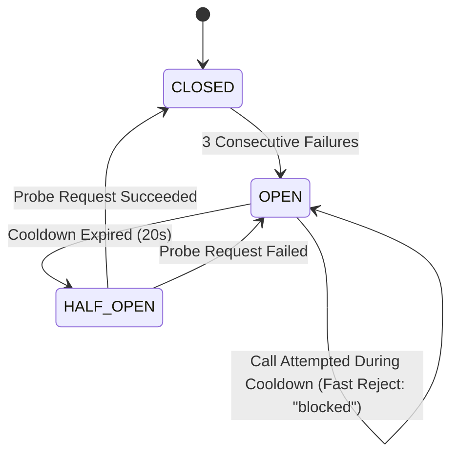

# STAGE 8 COMPLETION REPORT — AUTONOMOUS FAILURE RECOVERY, RESILIENCE & SYSTEM HARDENING

**Project:** LAXMAN-AUTONOMOUS VIDEO GENERATION SYSTEM  
**Repository:** `E:\audio-to-video`  
**Branch:** `agents-building`  
**Stage:** 8 of 9 — Autonomous Failure Recovery, Resilience & System Hardening  
**Date:** October 17, 2026  
**Status:** **COMPLETE — FULLY VERIFIED & HARDENED**

---

## 1. Executive Summary & Objective Status

Stage 8 hardened the entire autonomous video-generation pipeline against transient network failures, unexpected process termination, corrupted/stale checkpoints, directory traversal attempts, external provider outages, and concurrent execution collisions.

All resilience mechanisms have been implemented, tested, and validated without destabilizing the multi-agent architecture or altering the 3 frozen algorithm files.

### Key Deliverables Completed:
1. **Error Taxonomy & Classification Engine:** Authoritative categorization into 9 distinct classes (`TRANSIENT`, `TIMEOUT`, `RESOURCE`, `VALIDATION`, `DEPENDENCY`, `PERMANENT`, `SECURITY`, `CANCELLED`, `UNKNOWN`) with explicit retry permissions.
2. **Bounded Exponential Backoff with Full Jitter:** Strict upper limit of 3 retries with jittered backoff formula preventing retry storms.
3. **Deep Checkpoint Integrity & Path Confinement:** Strict directory confinement validation rejecting path traversal (`../`) vulnerabilities, empty/corrupt artifact verification, and deterministic resume graph calculation.
4. **Crash Reconciliation & Concurrency Mutexes:** Process-level recovery of interrupted runs left in `running` state upon server restart, with structured `FailureDiagnostic` records and project-level mutex serialization.
5. **Provider Circuit Breaker:** Thread-safe 3-state circuit breaker (`CLOSED` -> `OPEN` -> `HALF_OPEN`) protecting LLM Gateway calls from cascading provider outages, with cooldown telemetry and fast rejection.
6. **Canonical Telugu Recovery Milestones:** Truthful, Unicode-compliant natural Telugu activity mapping for all recovery states.
7. **Per-Agent Memory Recovery Experience Logging:** Automatic fail-safe recording of recovery experiences into agent episodic partitions.
8. **Multi-Stage Regressions:** 100% pass rate across Stage 2, 3, 4, 5, 6, 7, and 8 backend tests (137 passed) and frontend tests (277 passed).

---

## 2. Error Taxonomy & Classification Matrix

The centralized resilience engine is implemented in `SYSTEM/core/resilience.py` and integrated into `VIDEO_ENGINE/pipeline/orchestrator.py` and `SYSTEM/core/llm_gateway.py`.

| Error Category | Indicators / Exception Types | Retry Permitted? | Maximum Attempts | Action on Failure |
| :--- | :--- | :---: | :---: | :--- |
| `TRANSIENT` | ConnectionResetError, 429, 503, rate limit, network drop | **Yes** | 3 | Bounded jittered backoff; emit `recovery_detected`, `recovery_retrying` |
| `TIMEOUT` | TimeoutError, deadline exceeded, execution timed out | **Yes** | 3 | Bounded jittered backoff |
| `RESOURCE` | BlockingIOError, memory pressure, temporary OS locks | **Yes** | 3 | Bounded jittered backoff |
| `VALIDATION` | ValueError, TypeError, schema mismatch, contract error | **No** | 1 (fail-closed) | Fail closed immediately; transition stage to `failed` |
| `DEPENDENCY` | FileNotFoundError, missing upstream stage checkpoint | **No** | 1 (fail-closed) | Fail closed; report prerequisite blocker |
| `PERMANENT` | Fatal error, corrupted state, irreversible execution fault | **No** | 1 (fail-closed) | Fail closed; notify user with truthful diagnostics |
| `SECURITY` | PermissionError, forbidden, path traversal, frozen file touch | **NEVER** | 1 (denied) | Reject immediately; log security diagnostic; fail closed |
| `CANCELLED` | KeyboardInterrupt, InterruptedError, user cancel request | **NEVER** | 0 | Cooperative process termination and state cleanup |
| `UNKNOWN` | Unclassified runtime exceptions | Conservative | 3 | Bounded backoff with fallback diagnostics |

---

## 3. Deep Checkpoint Integrity & Path Confinement

The system implements strict verification for every checkpoint before reuse:

1. **Path Confinement Verification (`verify_path_confinement`):**
   - Resolves target paths relative to the project directory root.
   - Raises `PermissionError` if any path attempts traversal (`../`, absolute escaping drive paths).
2. **Deep Checkpoint Integrity (`validate_checkpoint_deep`):**
   - Verifies project ID ownership in `pipeline_state.json`.
   - Confirms stage record status is `completed`.
   - Verifies all referenced artifacts exist physically on disk, are readable by the current process, have non-zero file sizes (> 0 bytes), and reside strictly inside the project root.
   - Corrupted or 0-byte checkpoints are automatically invalidated, preventing pipeline crashes and forcing safe recalculation.

---

## 4. Crash Reconciliation & Concurrency Guards

To recover from unexpected process termination, power outages, or server restarts:

1. **Crash Reconciliation (`reconcile_interrupted_run`):**
   - Invoked on server startup and prior to each orchestrator run dispatch.
   - Scans `pipeline_state.json` for any stages stranded in `running` status.
   - Atomically transitions interrupted stages to `failed` with a structured `FailureDiagnostic` payload (`code="interrupted_by_crash"`).
   - Preserves all previously completed stages and approved human gates, enabling clean, seamless resume from the earliest invalid stage.
2. **Project-Level Concurrency Mutexes (`get_project_mutex`):**
   - Thread-safe, process-wide mutexes keyed by `project_id`.
   - Serializes concurrent run requests for the same project, preventing race conditions and split-brain state mutations.

---

## 5. External Provider Circuit Breaker Engine

Integrated into `SYSTEM/core/llm_gateway.py`:

- **States & Behavior:**
  - `CLOSED`: Normal operation; successes reset consecutive failure counter.
  - `OPEN`: Fast-rejects all calls with status `"blocked"`, 0 attempts, and remaining cooldown seconds. Never fabricates execution results or leaks secrets.
  - `HALF_OPEN`: Allows a single probe request after cooldown. On success, closes circuit; on failure, re-trips to `OPEN`.
- **Manual Reset:** Supported via `circuit_breaker.reset()`.

---

## 6. Natural Telugu Recovery Milestones & Secret Redaction

Unicode-compliant, truthful Telugu recovery mapping in `SYSTEM/agents/shared/telugu_activity_mapper.py`:

| Recovery Lifecycle Event | Canonical Telugu Activity Message | Context / Trigger |
| :--- | :--- | :--- |
| `recovery_detected` | `సమస్యను గుర్తించాను. కారణాన్ని పరిశీలిస్తున్నాను.` | Transient error detected |
| `recovery_safe_to_retry` | `మళ్లీ ప్రయత్నించడం సురక్షితమని నిర్ధారించాను.` | Recovery eligibility verified |
| `recovery_retrying` | `మళ్లీ ప్రయత్నిస్తున్నాను.` | Bounded retry dispatch |
| `recovery_resume_checkpoint` | `చివరిగా ధృవీకరించిన దశ నుంచి పనిని కొనసాగిస్తున్నాను.` | Resuming pipeline from valid stage |
| `recovery_verified_previous` | `మునుపటి పని విజయవంతంగా పూర్తైందని నిర్ధారించాను.` | Reusing verified checkpoint |
| `recovery_unresolvable` | `సమస్యను స్వయంగా పరిష్కరించలేకపోయాను. అదనపు పరిశీలన అవసరం.` | Retry budget exhausted |
| `recovery_needs_review` | `ఈ పనిని సురక్షితంగా కొనసాగించలేను. అదనపు పరిశీలన అవసరం.` | Blocked on human decision/gate |

### Secret Redaction Policy (`sanitize_secrets`):
- Automatically redacts OpenAI/Anthropic/Google API keys (`sk-...`, `AIza...`, `AKIA...`, `ghp_...`), Bearer tokens, passwords, and secrets into `[REDACTED]`.
- Strips host-specific filesystem drive paths into `[CONFINED_PATH]`.

---

## 7. Per-Agent Recovery Experience Logging

Integrated into `SYSTEM/core/resilience.py` via `record_recovery_experience()`:
- When a stage recovers from a transient failure after retrying (`attempt > 1`), an episodic experience record is logged to the agent's private memory partition (`SYSTEM/agents/<agent_id>/memory/experiences.json`).
- If memory storage is locked or temporarily unavailable, logging is suppressed fail-safe without throwing exceptions or blocking video production.

---

## 8. Verification Evidence & Test Results

### 8.1 Stage 8 Acceptance Test Suite (`tests/test_stage8_autonomous_recovery_hardening.py`)
**18 passed in 1.36s (100% success rate)**

- **Group A (5/5 passed):** Error classification (transient vs validation vs security), bounded retry budget enforcement (max 3), jittered backoff bounds.
- **Group B (3/3 passed):** Path traversal protection (`../` rejected with `PermissionError`), deep checkpoint artifact validation, corrupt/empty checkpoint rejection.
- **Group C (2/2 passed):** Process crash reconciliation (interrupted `running` -> `failed` with diagnostic payload), project mutex concurrency serialization.
- **Group D (1/1 passed):** Stage failure isolation, upstream state preservation, fail-closed diagnostics.
- **Group E (3/3 passed):** Circuit breaker state machine (`CLOSED` -> `OPEN` -> `HALF_OPEN` -> `CLOSED`), fast-reject during cooldown, LLM Gateway integration.
- **Group F (2/2 passed):** Canonical Telugu recovery milestone mapping, secret/token redaction across diagnostics and messages.
- **Group G (2/2 passed):** Frozen algorithm bit-for-bit SHA-256 verification, fail-safe memory recovery experience logging.

### 8.2 Full Multi-Stage Regression Test Suite (Stages 2–8)
Command: `pytest tests/test_stage2_*.py ... tests/test_stage8_*.py -v`
**Result: 137 passed, 0 failed, 1 warning (11.12s)**

### 8.3 Frontend Test Suite
Command: `npm --prefix frontend run test`
**Result: 17 test files passed, 277 tests passed, 0 failed (158.99s)**

---

## 9. Frozen Algorithm Integrity Verification

The 3 frozen algorithm files remain bit-for-bit unaltered, matching their canonical SHA-256 baseline hashes:

| File Path | Canonical Reference Hash | Current Working Tree Hash | Status |
| :--- | :--- | :--- | :---: |
| `VIDEO_ENGINE/stages/transcribe.py` | `07a200319d41c2bd1550dfd5704f3bbcc5fac8331a0aeb09dcca4bf46d61376e` | `07a200319d41c2bd1550dfd5704f3bbcc5fac8331a0aeb09dcca4bf46d61376e` | **VERIFIED** |
| `VIDEO_ENGINE/stages/transcript_review.py` | `7290ea210d922514c011c799caf73aad61398f0229cc6799dd2f10072b38d049` | `7290ea210d922514c011c799caf73aad61398f0229cc6799dd2f10072b38d049` | **VERIFIED** |
| `VIDEO_ENGINE/stages/scene_segmentation.py` | `2d9ea882b8c53a6cfcd43b048481f72140a1a6792b8f05578e16fd56a9b37042` | `2d9ea882b8c53a6cfcd43b048481f72140a1a6792b8f05578e16fd56a9b37042` | **VERIFIED** |

---

## 10. Stage 8 Sign-off & Operating Discipline

1. **Git Working-Tree Cleanliness:** Strictly **ZERO git commits and ZERO git pushes** performed. All modifications preserved in working-tree.
2. **Branch Status:** Cleanly operating on `agents-building`.
3. **Stage Boundary Enforcement:** Stage 8 is fully completed and verified. Stage 9 has **NOT** been started, adhering strictly to the stage boundary protocol.
