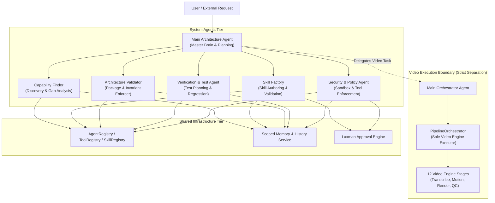

# Current Architecture Map
## System Agents & Infrastructure Baseline

**Date:** 2026-10-17  
**Repository Root:** `E:\audio-to-video`  
**Report Directory:** `reports/SYSTEM_AGENTS_PHASE_0_20261017_054000/`  

---

## 1. Actual Repository Layout

The filesystem reflects the following structural reality:

```text
audio-to-video/
├── SYSTEM/
│   ├── core/
│   │   ├── artifact_contracts.py       # Strict schema contracts for pipeline artifacts
│   │   ├── checks.py                   # Environment & tool pre-flight checks
│   │   ├── cli.py                      # Canonical CLI command interface
│   │   ├── config.py                   # Project root and path definitions
│   │   ├── contracts.py                # Pipeline dataclasses and enums
│   │   ├── errors.py                   # Canonical ApiError taxonomy
│   │   ├── llm_client.py               # Low-level Anthropic client wrapper
│   │   ├── llm_gateway.py              # LLM gateway with fallback and caching
│   │   └── pipeline_state.py           # Atomic stage state machine
│   ├── agents/
│   │   ├── main_architecture_agent/    # Master Brain (Planning, Routing, Self-Learning)
│   │   │   ├── config/                 # Agent config and learning policy
│   │   │   ├── prompts/                # System, planning, and reflection prompts
│   │   │   ├── planning/               # TaskDecomposer, AgentRouter, PlanEvaluator
│   │   │   ├── learning/               # ExperienceCollector, ReflectionEngine, Proposals, StrategyManager, Scheduler
│   │   │   ├── evaluations/            # Deterministic planning & routing benchmarks
│   │   │   ├── strategies/             # active/ (v1.0.0), candidates/, archive/
│   │   │   ├── history/                # experiences.jsonl, proposals.jsonl
│   │   │   └── agent.py                # MainArchitectureAgent implementation
│   │   ├── system_agents/              # NESTED SUBPACKAGE (Target requires sibling layout)
│   │   │   ├── capability_finder/      # CapabilityFinderAgent
│   │   │   └── skill_factory/          # SkillFactoryAgent
│   │   ├── video_generation_agents/    # 14 dedicated video generation agents
│   │   │   ├── audio_input/            # Audio Intake Agent
│   │   │   ├── audio_analyzer/         # Audio Analysis & ASR Review Agent [FROZEN]
│   │   │   ├── scene_segmentation/     # Scene Segmentation Agent [FROZEN]
│   │   │   ├── visual_planning/        # Visual Concept Planning Agent
│   │   │   ├── motion_planning/        # Motion Architecture & Pacing Agent
│   │   │   ├── motion_template_selection/ # Deprecated template agent (fallback to motion_planning)
│   │   │   ├── motion_animation/       # Code-generation Motion Animation Agent
│   │   │   ├── motion_timeline_validation/ # 12-point motion verification suite
│   │   │   ├── timeline_build/         # Composition timeline compiler
│   │   │   ├── timeline_approval/      # Mandatory human approval gatekeeper
│   │   │   ├── render_video/           # Remotion multi-process rendering engine
│   │   │   ├── final_qc/               # Automated media probe & human playback sign-off
│   │   │   ├── final_video_delivery/   # Final packaging and artifact publisher
│   │   │   ├── main_orchestrator/      # Adapter bridging to PipelineOrchestrator
│   │   │   └── stage_adapters.py       # Backward compatibility adapter exports
│   │   ├── shared/                     # Shared agent framework
│   │   │   ├── base_agent.py           # BaseAgent abstract class with lifecycle runner
│   │   │   ├── contracts.py            # AgentMetadata, AgentRequest, AgentResult, MessageType
│   │   │   ├── communication.py        # Durable inter-agent communication bus
│   │   │   └── memory_adapter.py       # Scoped memory accessor for agents
│   │   └── registry.py                 # Convenience alias importing from registries/agent_registry.py
│   ├── registries/
│   │   ├── agent_registry.py           # Authoritative registry mapping 17 agents
│   │   ├── skill_registry.py           # Central skill catalog and static security scanner
│   │   └── tool_registry.py            # Central catalog of system utilities & tools
│   ├── memory/
│   │   ├── memory_scoping.py           # Agent-private, project-scoped isolation enforcement
│   │   ├── memory_service.py           # Scoped memory CRUD service
│   │   ├── shared_memory.py            # Central memory indexing and candidate workflow
│   │   └── store.py                    # Project folder confinement utilities
│   ├── history/
│   │   ├── audit_history.py            # AuditRecord schema
│   │   ├── decision_history.py         # DecisionRecord schema
│   │   ├── execution_history.py        # ExecutionRecord schema
│   │   └── history_service.py          # Central persistent history store (JSONL)
│   ├── approvals/
│   │   ├── approval_engine.py          # Central Laxman Approval Engine (PIN + HMAC)
│   │   ├── pin_service.py              # Cryptographic PBKDF2 PIN hashing & salt
│   │   ├── guard.py                    # Runtime guard enforcing approved state
│   │   └── adapters/                   # eval_adapter, qc_adapter, timeline_adapter
│   ├── skills/                         # Central skills library
│   │   ├── catalog.json                # Master catalog of verified skills
│   │   ├── staging/                    # Quarantine directory for candidate skills
│   │   └── [10 categories]/            # animation, audio, motion, rendering, etc.
│   ├── policies/
│   │   └── llm_review.py               # Mandatory fail-closed LLM stage review gates
│   └── observability/
│       ├── diagnose.py                 # System health and environmental diagnostics
│       ├── evaluation.py               # Two-tier regression evaluation engine
│       └── llm_usage.py                # LLM token usage tracking and quota accounting
├── VIDEO_ENGINE/
│   ├── pipeline/
│   │   ├── orchestrator.py             # PipelineOrchestrator (Sole canonical video execution engine)
│   │   ├── browser_profiles.py         # Headless Chrome temporary profile cleanup
│   │   ├── procs.py                    # Process cancellation tracking
│   │   └── state.py                    # Pipeline checkpoint & recovery state
│   ├── stages/                         # 12 pipeline stage executors
│   │   ├── transcribe.py               # FROZEN Core Algorithm (Whisper ASR)
│   │   ├── transcript_review.py        # FROZEN Core Algorithm (Bilingual Review)
│   │   ├── scene_segmentation.py       # FROZEN Core Algorithm (Scene Grouping)
│   │   ├── visual_planning.py          # Visual design synthesis
│   │   ├── motion_planning.py          # Motion hierarchy & curve planning
│   │   ├── motion_animation.py         # TSX component code synthesis
│   │   ├── motion_validation.py        # AST & timing compliance checks
│   │   ├── timeline.py                 # Multi-track timeline build
│   │   ├── approval.py                 # Approval gate enforcement
│   │   ├── render.py                   # Remotion render subprocess runner
│   │   ├── qc.py                       # FFprobe technical QC probe
│   │   └── final.py                    # Final video asset delivery
│   ├── remotion/                       # React/Remotion TypeScript composition workspace
│   └── ffmpeg/                         # FFmpeg and FFprobe binary wrapper utilities
├── UI/
│   ├── frontend/                       # Vite + React + Tailwind TypeScript application
│   └── backend/                        # FastAPI presentation layer & route controllers
├── config/                             # Central JSON configurations, baselines, and history
├── projects/                           # Project instances, media artifacts, and logs
└── tests/                              # Comprehensive test suites
```

---

## 2. Comparison: Actual vs. Target System Agent Structure

The approved target layout defines **six sibling directories** under `SYSTEM/agents/`:

| Target Directory | Current Physical Location | Status | Path Migration Required? |
|:---|:---|:---:|:---:|
| `SYSTEM/agents/main_architecture_agent/` | `SYSTEM/agents/main_architecture_agent/` | **MATCH** | No |
| `SYSTEM/agents/capability_finder/` | `SYSTEM/agents/system_agents/capability_finder/` | **MISMATCH** | **Yes** (Move from `system_agents/` to sibling directory) |
| `SYSTEM/agents/skill_factory/` | `SYSTEM/agents/system_agents/skill_factory/` | **MISMATCH** | **Yes** (Move from `system_agents/` to sibling directory) |
| `SYSTEM/agents/architecture_validator/` | *(None)* | **MISSING** | **Yes** (Create new dedicated agent) |
| `SYSTEM/agents/verification_test_agent/` | *(None)* | **MISSING** | **Yes** (Create new dedicated agent) |
| `SYSTEM/agents/security_policy_agent/` | *(None)* | **MISSING** | **Yes** (Create new dedicated agent) |
| `SYSTEM/agents/video_generation_agents/` | `SYSTEM/agents/video_generation_agents/` | **MATCH** | No (Preserve separate video agents package) |
| `SYSTEM/agents/shared/` | `SYSTEM/agents/shared/` | **MATCH** | No (Preserve shared agent framework) |

---

## 3. Component Responsibilities & Domain Boundaries



### Strict Architectural Boundaries
1. **The Architectural Boundary**: `MainArchitectureAgent` makes system decisions, parses high-level requirements, and delegates tasks. It does **not** manage video render frames or pipeline state transitions.
2. **The Video Pipeline Boundary**: `VIDEO_ENGINE.pipeline.orchestrator.PipelineOrchestrator` remains the **sole canonical execution engine** for running stages, saving checkpoints, resuming after restarts, and rendering video.
3. **The Capability Boundary**: `CapabilityFinderAgent` scans for reusable capabilities and flags gaps; it does not author skills itself.
4. **The Skill Factory Boundary**: `SkillFactoryAgent` authors and tests skills; it stages them in quarantine (`SYSTEM/skills/staging/`) until verified.
5. **The Governance Boundary**: `LaxmanApprovalEngine` strictly guards human sign-offs (timeline approval, candidate skill/strategy promotions, and critical policy changes).
