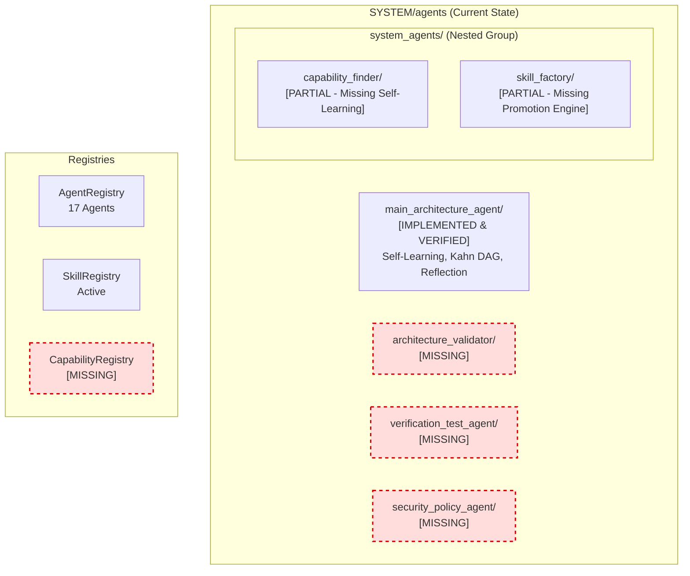
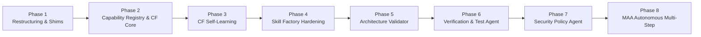

# SYSTEM AGENTS ARCHITECTURE AUDIT — DELIVERABLE 8
## PHASE 0 HANDOFF REPORT & IMPLEMENTATION ROADMAP

**Repository Root:** `E:\audio-to-video`  
**Audit Timestamp:** 2026-10-17T05:40:00+05:30  
**Phase:** 0 — Current Architecture Audit (Strict Read-Only)  
**Status:** PHASE_0_STATUS: COMPLETE  

---

## 1. Phase 0 Audit Sign-Off

Phase 0 of the Laxman-Autonomous Master System audit is **COMPLETE**. All investigations were conducted in strict read-only mode without modifying application source code, running video pipelines, or performing git commits.

### Exit Criteria Verification Checklist

| Criterion | Requirement | Status | Evidence Reference |
| :---: | :--- | :---: | :--- |
| **1** | Evidence-based audit completed without guesswork | **PASS** | [`PHASE_0_EXECUTIVE_SUMMARY.md`](file:///E:/audio-to-video/reports/SYSTEM_AGENTS_PHASE_0_20261017_054000/PHASE_0_EXECUTIVE_SUMMARY.md) |
| **2** | Current filesystem mapped & target delta documented | **PASS** | [`CURRENT_ARCHITECTURE_MAP.md`](file:///E:/audio-to-video/reports/SYSTEM_AGENTS_PHASE_0_20261017_054000/CURRENT_ARCHITECTURE_MAP.md) |
| **3** | Six system agents gap matrix completed with exact statuses | **PASS** | [`SIX_AGENT_GAP_MATRIX.md`](file:///E:/audio-to-video/reports/SYSTEM_AGENTS_PHASE_0_20261017_054000/SIX_AGENT_GAP_MATRIX.md) |
| **4** | Agent, Skill, Tool, and Capability registries audited | **PASS** | [`REGISTRY_AND_INTEGRATION_AUDIT.md`](file:///E:/audio-to-video/reports/SYSTEM_AGENTS_PHASE_0_20261017_054000/REGISTRY_AND_INTEGRATION_AUDIT.md) |
| **5** | Self-learning subsystems audited (MAA vs Capability Finder) | **PASS** | [`SELF_LEARNING_AUDIT.md`](file:///E:/audio-to-video/reports/SYSTEM_AGENTS_PHASE_0_20261017_054000/SELF_LEARNING_AUDIT.md) |
| **6** | Test baseline established (239 passing) & frozen hashes checked | **PASS** | [`TEST_AND_FROZEN_FILE_BASELINE.md`](file:///E:/audio-to-video/reports/SYSTEM_AGENTS_PHASE_0_20261017_054000/TEST_AND_FROZEN_FILE_BASELINE.md) |
| **7** | Legacy paths (`backend/`, `system_agents/`) & risk register documented | **PASS** | [`LEGACY_COMPATIBILITY_AND_RISK_REGISTER.md`](file:///E:/audio-to-video/reports/SYSTEM_AGENTS_PHASE_0_20261017_054000/LEGACY_COMPATIBILITY_AND_RISK_REGISTER.md) |
| **8** | Phased implementation roadmap established | **PASS** | Section 3 of this document |
| **9** | Read-only mode maintained throughout Phase 0 | **PASS** | Zero application files modified; working tree untouched |

---

## 2. Summary of Current Repository State

### Baseline Parameters
- **Branch:** `agents-building`
- **HEAD Commit:** `f6989b17372e3cdb42b4c92ab1783b3122a401ae`
- **Passing Test Suite Baseline:** 239 passed, 8 pre-existing legacy collection errors (missing `scipy`/`openai`).
- **Frozen File SHA-256 Checksums:**
  - `VIDEO_ENGINE/stages/transcribe.py`: `07a200319d41c2bd1550dfd5704f3bbcc5fac8331a0aeb09dcca4bf46d61376e`
  - `VIDEO_ENGINE/stages/transcript_review.py`: `7290ea210d922514c011c799caf73aad61398f0229cc6799dd2f10072b38d049`
  - `VIDEO_ENGINE/stages/scene_segmentation.py`: `2d9ea882b8c53a6cfcd43b048481f72140a1a6792b8f05578e16fd56a9b37042`

---

## 3. Phased Implementation Roadmap

The target architecture defines six direct sibling directories under `SYSTEM/agents/` along with a dedicated `CapabilityRegistry`. Implementation must follow an incremental, strictly verified sequence:

---

### Phase 1: Directory Restructuring & Compatibility Shims
- **Objective:** Move `capability_finder` and `skill_factory` from `SYSTEM/agents/system_agents/` to top-level sibling directories `SYSTEM/agents/capability_finder/` and `SYSTEM/agents/skill_factory/`.
- **Key Tasks:**
  1. Relocate folders without breaking internal logic.
  2. Implement backward-compatible forwarding facades in `SYSTEM/agents/system_agents/capability_finder/` and `SYSTEM/agents/system_agents/skill_factory/` using `sys.modules[__name__] = _canonical`.
  3. Update canonical imports in `SYSTEM/registries/agent_registry.py`.
- **Verification Gate:** `pytest tests/test_agent_architecture_reorg.py` and agent internal tests pass with 0 errors.

---

### Phase 2: Capability Registry & Capability Finder Core
- **Objective:** Establish the dedicated `CapabilityRegistry` and upgrade `CapabilityFinderAgent` core discovery engine.
- **Key Tasks:**
  1. Implement `SYSTEM/registries/capability_registry.py` indexing agents, skills, and tools with capability tags, metadata, and search indexing.
  2. Implement natural language requirement parsing in `CapabilityFinderAgent`.
  3. Implement AST-based code discovery across `SYSTEM/agents/`, `SYSTEM/skills/`, and `VIDEO_ENGINE/`.
  4. Implement Gap Analysis identifying whether missing capabilities require a new skill or new agent.
- **Verification Gate:** Unit tests in `SYSTEM/agents/capability_finder/tests/` verifying exact semantic and AST capability resolution.

---

### Phase 3: Capability Finder Self-Learning Subsystem
- **Objective:** Equip Capability Finder with an adaptive self-learning memory matching MAA's self-learning capabilities.
- **Key Tasks:**
  1. Implement query resolution cache (`query_cache.json`).
  2. Implement learning memory tracking successful capability matches and execution outcomes.
  3. Implement confidence calibration and retrieval feedback loop.
  4. Connect MAA execution feedback into Capability Finder learning history.
- **Verification Gate:** Self-learning benchmark demonstrating improved retrieval speed and precision across repeated synthetic queries.

---

### Phase 4: Skill Factory Production Hardening
- **Objective:** Transform Skill Factory from a prototype to a secure, end-to-end skill generation and promotion pipeline.
- **Key Tasks:**
  1. Implement real `promote` action in `SYSTEM/agents/skill_factory/agent.py` moving validated skills from `quarantine/` to `SYSTEM/skills/`.
  2. Implement automated sandboxed test runner executing skill unit tests before promotion.
  3. Implement rollback mechanism for defective skills.
- **Verification Gate:** End-to-end test generating a mock skill in quarantine, executing tests, passing verification, and promoting to canonical `SYSTEM/skills/`.

---

### Phase 5: Architecture Validator Agent
- **Objective:** Implement the fourth system agent: `SYSTEM/agents/architecture_validator/`.
- **Key Tasks:**
  1. Implement `ArchitectureValidatorAgent` subclassing `BaseAgent`.
  2. Build static rule validation engine (checking folder boundaries, forbidden cross-domain imports).
  3. Build AST dependency cycle detector.
  4. Build interface drift detector verifying contracts across `SYSTEM/agents/shared/contracts.py`.
  5. Register with `AgentRegistry` under `AgentType.SYSTEM`.
- **Verification Gate:** Complete test suite verifying detection of circular dependencies, contract violations, and architecture drift.

---

### Phase 6: Verification & Test Agent
- **Objective:** Implement the fifth system agent: `SYSTEM/agents/verification_test_agent/`.
- **Key Tasks:**
  1. Implement `VerificationTestAgent` subclassing `BaseAgent`.
  2. Build targeted test execution engine wrapping `pytest`.
  3. Build regression detector comparing test outcomes against recorded baselines.
  4. Build automated test synthesis generating test fixtures for newly created skills/agents.
  5. Register with `AgentRegistry` under `AgentType.SYSTEM`.
- **Verification Gate:** Complete test suite verifying programmatic test execution, result parsing, and regression flagging.

---

### Phase 7: Security & Policy Agent
- **Objective:** Implement the sixth system agent: `SYSTEM/agents/security_policy_agent/`.
- **Key Tasks:**
  1. Implement `SecurityPolicyAgent` subclassing `BaseAgent`.
  2. Build AST security scanner detecting banned constructs (`os.system`, `subprocess`, `eval`, `exec`, arbitrary file operations).
  3. Build secret and credential leak detector.
  4. Implement quarantine clearance gate required before Skill Factory promotion.
  5. Register with `AgentRegistry` under `AgentType.SYSTEM`.
- **Verification Gate:** Security test suite confirming detection and quarantine rejection of synthetic unsafe scripts.

---

### Phase 8: MAA Autonomous Multi-Step Execution
- **Objective:** Integrate all six System Agents into MAA's self-learning autonomous coordination loop.
- **Key Tasks:**
  1. Update MAA planning engine to seamlessly invoke Capability Finder, Skill Factory, Architecture Validator, Verification Test Agent, and Security Policy Agent.
  2. Verify full autonomous loop: Requirement -> Capability Discovery -> Skill Generation -> Security Audit -> Architecture Validation -> Verification Test -> Execution -> Self-Learning Reflection.
- **Verification Gate:** Comprehensive end-to-end autonomous integration scenario executing successfully without manual intervention.

---

## 4. Immediate Next Step

Proceed to **Phase 1: Directory Restructuring & Compatibility Shims** upon operator authorization.
