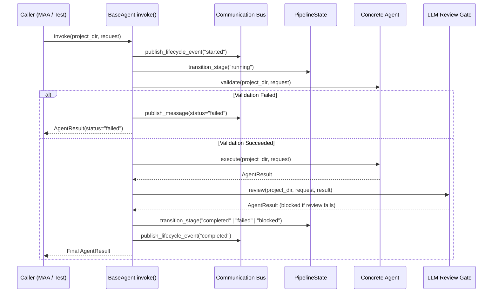

# Registry & Integration Infrastructure Audit

**Date:** 2026-10-17  
**Repository Root:** `E:\audio-to-video`  
**Report Directory:** `reports/SYSTEM_AGENTS_PHASE_0_20261017_054000/`  

---

## 1. Agent Registry Audit

**Canonical Path:** `SYSTEM/registries/agent_registry.py`  
**Convenience Facade:** `SYSTEM/agents/registry.py` -> imports `registry` from `SYSTEM.registries.agent_registry`  
**Public Interface:** `get(agent_id)`, `get_agent(agent_id)`, `list_all_agents()`, `list_video_agents()`, `list_system_agents()`, `validate_registry()`  

### Registered Agent Inventory (17 Agents)

| Agent ID | Name | Category | Status | Stage ID | Target System Agent? |
|:---|:---|:---|:---:|:---:|:---:|
| `main_orchestrator` | Main Orchestrator Agent | `ORCHESTRATOR` | `IMPLEMENTED` | `pipeline` | Video Engine Bridge |
| `audio_input` | Audio Input Agent | `VIDEO_ENGINE_AGENT` | `IMPLEMENTED` | `audio` | Video Generation |
| `audio_analyzer` | Audio Analyzer Agent | `VIDEO_ENGINE_AGENT` | `IMPLEMENTED` | `analyzer` | Video Generation [FROZEN] |
| `scene_segmentation` | Scene Segmentation Agent | `VIDEO_ENGINE_AGENT` | `IMPLEMENTED` | `segmentation` | Video Generation [FROZEN] |
| `visual_planning` | Visual Planning Agent | `VIDEO_ENGINE_AGENT` | `IMPLEMENTED` | `planning` | Video Generation |
| `motion_planning` | Motion Planning Agent | `VIDEO_ENGINE_AGENT` | `IMPLEMENTED` | `motion_plan` | Video Generation |
| `motion_template_selection` | Motion Template Selection Agent | `VIDEO_ENGINE_AGENT` | `IMPLEMENTED` | `motion_template` | Video Generation [DEPRECATED] |
| `motion_animation` | Motion Animation Agent | `VIDEO_ENGINE_AGENT` | `IMPLEMENTED` | `motion_gen` | Video Generation |
| `motion_timeline_validation` | Motion Timeline Validation Agent | `VIDEO_ENGINE_AGENT` | `IMPLEMENTED` | `motion_validation` | Video Generation |
| `timeline_build` | Timeline Build Agent | `VIDEO_ENGINE_AGENT` | `IMPLEMENTED` | `timeline` | Video Generation |
| `timeline_approval` | Timeline Approval Agent | `VIDEO_ENGINE_AGENT` | `IMPLEMENTED` | `approval` | Video Generation [HUMAN GATE] |
| `render_video` | Render Video Agent | `VIDEO_ENGINE_AGENT` | `IMPLEMENTED` | `render` | Video Generation |
| `final_qc` | Final QC Agent | `VIDEO_ENGINE_AGENT` | `IMPLEMENTED` | `qc` | Video Generation [HUMAN GATE] |
| `final_video_delivery` | Final Video Delivery Agent | `VIDEO_ENGINE_AGENT` | `IMPLEMENTED` | `final` | Video Generation |
| `main_architecture_agent` | Main Architecture Agent | `ORCHESTRATOR` | `IMPLEMENTED` | `system` | **System Agent #1** |
| `capability_finder` | Capability Finder Agent | `SYSTEM_SUBAGENT` | `IMPLEMENTED` | `system` | **System Agent #2** |
| `skill_factory` | Skill Factory Agent | `SYSTEM_SUBAGENT` | `IMPLEMENTED` | `system` | **System Agent #3** |

### Registry Gaps & Inconsistencies
1. **Missing Target System Agents:**
   - `architecture_validator` is NOT registered.
   - `verification_test_agent` is NOT registered.
   - `security_policy_agent` is NOT registered.
2. **Path Import Discrepancy:**
   - In `SYSTEM/registries/agent_registry.py` lines 24-25:
     ```python
     from SYSTEM.agents.system_agents.capability_finder.agent import CapabilityFinderAgent
     from SYSTEM.agents.system_agents.skill_factory.agent import SkillFactoryAgent
     ```
     When relocated to `SYSTEM/agents/capability_finder` and `SYSTEM/agents/skill_factory`, these imports must be updated, while retaining backward compatibility facades.
3. **`validate_registry()` Scope:** Currently validates that all 14 video agents exist, but completely ignores system agents.

---

## 2. Capability Registry Audit

**Status:** **MISSING**  
**Evidence:** No file named `capability_registry.py` exists anywhere in the repository.

### Current Capability Derivation
Currently, capabilities are inspected ad-hoc by `CapabilityFinderAgent.execute()` querying three disparate registries:
1. `AgentRegistry.list_all_agents()` for agent capability lists.
2. `SkillRegistry.search_skills()` for skill domain/tag metadata.
3. `ToolRegistry.list_tools()` for tool capabilities.

### Target Capability Registry Architecture (Phase 2 Deliverable)
A dedicated `CapabilityRegistry` (`SYSTEM/registries/capability_registry.py`) is required to:
- Maintain a unified taxonomy of capabilities (`media_processing`, `nlp_transcription`, `visual_design`, `motion_codegen`, `governance`, `testing`, `auditing`).
- Index capabilities by provider ID (`agent`, `skill`, or `tool`).
- Support requirement capability matching with semantic scoring.
- Track capability health, runtime prerequisites, and deprecation status.

---

## 3. Skill Registry Audit

**Canonical Path:** `SYSTEM/registries/skill_registry.py`  
**Storage Root:** `SYSTEM/skills/` (with `catalog.json` and 10 category subdirectories)  
**Public Interface:** `get_skill()`, `search_skills()`, `audit_skill_content()`, `stage_external_candidate()`, `promote_staged_skill()`  

### Implemented Features
1. **Catalog Indexing:** Loads and maintains `SYSTEM/skills/catalog.json`.
2. **Quarantine Staging:** `stage_external_candidate()` writes unverified skills into `SYSTEM/skills/staging/` with timestamped provenance metadata.
3. **Static Security Audit:** `audit_skill_content()` enforces:
   - Prohibited tokens: `eval(`, `exec(`, `os.system(`, `subprocess.call(`, `shutil.rmtree(`, `__import__`, `open(`, `getattr(`.
   - Dangerous imports: `ctypes`, `socket`, `requests`, `urllib`, `pickle`.
   - Shell escape patterns: `rm -rf`, `curl `, `wget `, `bash `, `powershell `.
4. **Promotion Functionality:** `promote_staged_skill()` is implemented in `SkillRegistry`, but `SkillFactoryAgent` does not invoke it (returning `"error": "Action not implemented yet"`).

---

## 4. Tool Registry Audit

**Canonical Path:** `SYSTEM/registries/tool_registry.py`  
**Public Interface:** `register()`, `get(tool_id)`, `list_tools()`, `discover_for_agent()`  

### Registered Tools Inventory (10 Tools)
1. `ffmpeg` (Permission: `safe_write`, Category: `media`)
2. `ffprobe` (Permission: `read_only`, Category: `media`)
3. `faster_whisper` (Permission: `read_only`, Category: `ai`)
4. `llm_gateway` (Permission: `safe_write`, Category: `ai`)
5. `file_storage` (Permission: `safe_write`, Category: `storage`)
6. `skill_registry` (Permission: `read_only`, Category: `governance`)
7. `memory_service` (Permission: `safe_write`, Category: `system`)
8. `laxman_approvals` (Permission: `privileged`, Category: `governance`)
9. `evaluation_engine` (Permission: `safe_write`, Category: `governance`)

### Limitations & Gaps
- `ToolRegistry` is strictly a metadata catalog.
- It does **not** dynamically intercept subprocess calls, file I/O, or network requests at the execution boundary.
- Enforcement currently relies on descriptive `AgentMetadata.allowed_tools` checks.

---

## 5. BaseAgent & Lifecycle Infrastructure

**Canonical Path:** `SYSTEM/agents/shared/base_agent.py`  
**Contracts Path:** `SYSTEM/agents/shared/contracts.py`  

### Lifecycle Pipeline (`BaseAgent.invoke`)


### Verified Features
- **Mandatory Fail-Closed LLM Review:** Integrated directly into `BaseAgent.invoke()` line 115-160. Active stages cannot transition to `completed` without passing LLM review.
- **Durable Event Publishing:** Every lifecycle start, failure, and completion is published to the project event log.
- **Contract Standardization:** Standardized `AgentRequest` and `AgentResult` schemas across all agents.

---

## 6. Main Architecture Agent Delegation Verification

### Verified Delegation Capability
The question was investigated: *Does `MainArchitectureAgent` actually invoke other agents through executable code, or does it only document/simulate delegation?*

**Evidence from `SYSTEM/agents/main_architecture_agent/agent.py#L231-L280`:**
```python
agent_instance = self._registry.get_agent(target_agent_id)
if not agent_instance:
    return AgentResult(agent_id=self.agent_id, status="failed", error=f"No executable adapter found...")

res = agent_instance.invoke(project_dir, sub_request)
duration_ms = (time.time() - start_time) * 1000.0

# Record Experience
exp = ExperienceRecord(...)
experience_collector.record_task_experience(exp)
```

**Finding:** Delegation is **genuinely executable**. The agent dynamically resolves the target agent adapter from `AgentRegistry`, calls `agent_instance.invoke()`, collects real outputs, captures execution duration, redacts sensitive tokens, stores an `ExperienceRecord`, and triggers self-learning schedulers.

---

## 7. Memory & History Service Integration

### Scoped Memory (`SYSTEM/memory/memory_scoping.py`)
- **Agent-Private Scope (`scope="agent"`):** Strictly confined to owner agent ID. Verified readers list checked before access.
- **Project Scope (`scope="project"`):** Accessible to agents collaborating on the same `project_id`.
- **Global Scope (`scope="global"`):** System-wide verified knowledge (e.g. typography guidelines, audio preservation rules).

### History Service (`SYSTEM/history/history_service.py`)
- Thread-safe persistent JSONL files under `config/history/`:
  - `executions.jsonl`: records every pipeline/agent invocation with runtime and status.
  - `decisions.jsonl`: records architectural decisions, rationales, chosen options, and alternatives.
  - `audits.jsonl`: records immutable security and strategy modification events.
