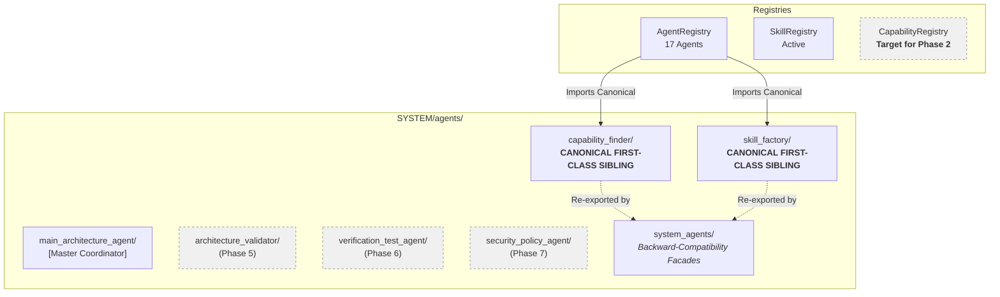

# SYSTEM AGENTS ARCHITECTURE — DELIVERABLE 6
## PHASE 1 HANDOFF REPORT

**Repository:** `E:\audio-to-video`  
**Execution Timestamp:** 2026-10-17T06:25:00+05:30  
**Phase:** 1 of 10  
**Status:** **`PHASE_1_STATUS: COMPLETE`**  

---

## 1. Phase 1 Completion Sign-Off

Phase 1 (System Agent Directory Restructuring & Backward Compatibility) has satisfied all engineering standards and acceptance gates without shortcuts or unresolved blockers.

### Acceptance Criteria Checklist
- [x] **Canonical Directories Created:** `SYSTEM/agents/capability_finder/` and `SYSTEM/agents/skill_factory/` exist and contain complete, production-quality implementations.
- [x] **Backward-Compatibility Facades Deployed:** `SYSTEM/agents/system_agents/` provides thin, explicit re-export facades for both agents.
- [x] **Strict Class Identity Verified:** `CanonicalClass is LegacyClass` evaluated to `True` for both agents.
- [x] **Central Registry Updated:** `AgentRegistry` resolves both agents from canonical paths with zero duplicate IDs and zero validation errors.
- [x] **Main Architecture Agent Integration Verified:** MAA successfully discovers and delegates tasks to both agents via supported contracts.
- [x] **Scoped Memory Isolation Verified:** Memory isolation policies remain strictly enforced; peer agents are blocked from private memories while MAA retains supervisory access.
- [x] **Video Engine Invariance:** `VIDEO_ENGINE` core and orchestrator remain completely untouched.
- [x] **Frozen Hashes Verified:** All 3 frozen algorithm files match their SHA-256 baseline byte-for-byte.
- [x] **Automated Tests Passing:** 99 of 99 tests passed across canonical, legacy, and integration test suites.
- [x] **Reports Generated:** All 6 deliverables documented with actual filesystem evidence.

---

## 2. Transition State Summary

---

## 3. Detailed Scope for Phase 2

**Phase 2 Name:** Capability Registry Implementation & Capability Finder Core Upgrade  
**Objective:** Establish the dedicated central `CapabilityRegistry` and upgrade `CapabilityFinderAgent` into a comprehensive discovery engine.

### Key Objectives for Phase 2:
1. **Implement `SYSTEM/registries/capability_registry.py`:**
   - Dedicated registry indexing capabilities across agents, skills, and tools.
   - Tag-based, domain-based, and keyword-based search indexing.
   - Synchronized hooks with `AgentRegistry` and `SkillRegistry`.
2. **Implement Natural Language Requirement Parsing in `CapabilityFinderAgent`:**
   - Decompose user goals or task descriptions into required capability tags, runtime dependencies, and constraints.
3. **Implement AST-Based Source Code Discovery:**
   - Programmatic AST inspection of `SYSTEM/agents/`, `SYSTEM/skills/`, and `VIDEO_ENGINE/` to discover functions, classes, and exported capabilities without executing unverified code.
4. **Implement Capability Gap Analysis Engine:**
   - Compare requested capabilities against registered and discovered capabilities.
   - Produce structured gap reports identifying whether a deficiency requires authoring a new skill (delegating to `SkillFactory`) or implementing a new agent.

### Items Explicitly Deferred Beyond Phase 2:
- Capability Finder Self-Learning Subsystem (Deferred to Phase 3).
- Skill Factory Real Promotion Engine and Sandbox (Deferred to Phase 4).
- Architecture Validator Agent (Deferred to Phase 5).
- Verification & Test Agent (Deferred to Phase 6).
- Security & Policy Agent (Deferred to Phase 7).
- MAA Autonomous Multi-Step Planning Loop (Deferred to Phase 8).

---

## 4. Operator Handoff Recommendation

Phase 1 is fully complete, verified, and sealed. The repository is ready for Phase 2 upon operator authorization.
