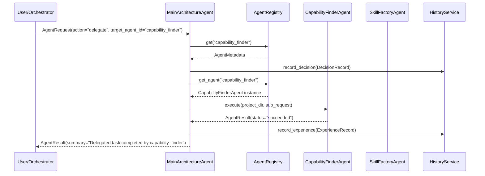

# SYSTEM AGENTS ARCHITECTURE — DELIVERABLE 4
## REGISTRY AND MAA INTEGRATION REPORT

**Repository:** `E:\audio-to-video`  
**Execution Timestamp:** 2026-10-17T06:25:00+05:30  
**Phase:** 1 of 10  
**Status:** COMPLETE  

---

## 1. Executive Summary

This report documents the integration of the restructured System Agents with the central `AgentRegistry` and the `MainArchitectureAgent` (MAA). It provides evidence that the registry correctly indexes the canonical agents with stable IDs, that duplicate registrations are strictly prevented, that registry validation passes with zero issues, and that MAA delegates tasks to both agents using supported contracts with full history and memory isolation.

---

## 2. Central Agent Registry Integration

### 2.1 Configuration and Registration Updates
In `SYSTEM/registries/agent_registry.py`, lines 24–25 were updated to import the canonical classes directly:
```python
from SYSTEM.agents.capability_finder.agent import CapabilityFinderAgent
from SYSTEM.agents.skill_factory.agent import SkillFactoryAgent
```

Both agents are registered during `_init_defaults()` with authoritative metadata:
- **`capability_finder`**:
  - `name`: `"Capability Finder Agent"`
  - `category`: `AgentCategory.SYSTEM_SUBAGENT`
  - `capabilities`: `["capability-query", "skill-discovery", "prerequisite-inspection"]`
  - `allowed_tools`: `["agent_registry", "skill_registry", "tool_registry"]`
- **`skill_factory`**:
  - `name`: `"Skill Factory Agent"`
  - `category`: `AgentCategory.SYSTEM_SUBAGENT`
  - `capabilities`: `["skill-authoring", "security-audit", "skill-staging", "version-registration"]`
  - `allowed_tools`: `["skill_registry", "static_auditor", "file_storage"]`

### 2.2 Registry Inventory Verification
Automated assertions in `tests/test_phase1_system_agents_restructuring.py` verified the following inventory counts:
- **Total Registered Agents:** 17
- **Video Generation Agents:** 14 (Core pipeline stages)
- **System Agents:** 3 (`main_architecture_agent`, `capability_finder`, `skill_factory`)
- **Duplicate IDs:** 0 (Verified: `len(agent_ids) == len(set(agent_ids))`)
- **Validation Issues:** `reg.validate_registry() == []` (0 issues)

---

## 3. Main Architecture Agent Delegation

The `MainArchitectureAgent` acts as the master coordinator and delegates tasks using `_handle_delegate()`:



### 3.1 Verified Delegation Tests
1. **Delegation to Capability Finder:**
   - Request: Query for `"motion"` capabilities with prerequisite checks enabled.
   - Result: `status="succeeded"`, discovered matching agents, approved skills, available tools, and FFmpeg/Whisper environment readiness.
2. **Delegation to Skill Factory:**
   - Request: Action `"audit"` on a valid SKILL.md payload.
   - Result: `status="succeeded"`, `is_safe=True`, zero security violations.
3. **Delegation to Missing/Invalid Agent:**
   - Request: Target agent `"nonexistent_agent"`.
   - Result: `status="failed"`, `error="Target agent 'nonexistent_agent' not found in registry"`.

---

## 4. Scoped Memory and Isolation

Agent memory access was verified through `ScopedMemoryManager`:
- Private facts belonging to `capability_finder` (`scope="agent"`) are readable by `capability_finder`.
- Peer agents (`skill_factory`, `motion_animation`, `final_qc`) are **strictly blocked** from reading `capability_finder`'s private memories.
- The `MainArchitectureAgent`, as the system-level master brain, possesses supervisory read access to all agent memories for global planning and reflection purposes.

---

## 5. Invariance of Video Engine Core

The Video Engine remains completely decoupled and frozen:
- `VIDEO_ENGINE/stages/` was **not modified**.
- `VIDEO_ENGINE/pipeline/orchestrator.py` was **not modified**.
- All 14 stage adapters continue to instantiate and validate with 100% fidelity.
