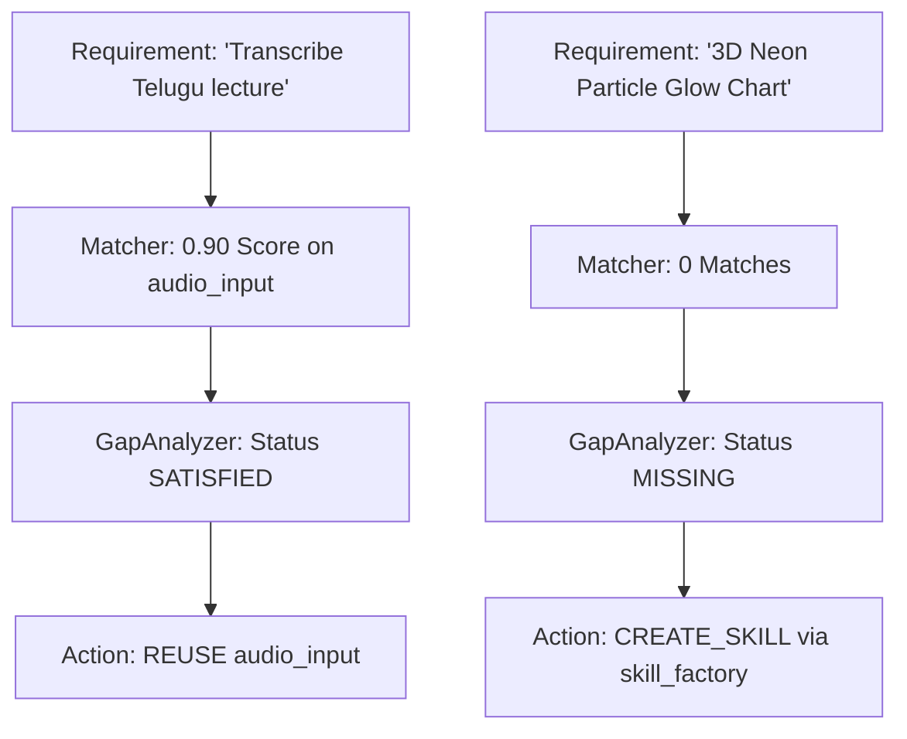

# SYSTEM AGENTS ARCHITECTURE — DELIVERABLE 4
## CAPABILITY MATCHING AND GAP ANALYSIS REPORT

**Repository Root:** `E:\audio-to-video`  
**Execution Timestamp:** 2026-10-17T06:50:00+05:30  
**Phase:** 2 of 10  
**Status:** COMPLETE  

---

## 1. Executive Summary

This report documents the capability matching, confidence scoring, deduplication, and structured gap analysis engine implemented in Phase 2. The system equips `CapabilityFinderAgent` with the intelligence to evaluate whether requested task goals can be immediately fulfilled by existing components, whether existing skills require adaptation, or whether missing capabilities necessitate authoring new skills via `SkillFactoryAgent` or creating new system agents.

---

## 2. Capability Matching Engine Architecture

Located at `SYSTEM/agents/capability_finder/discovery/matcher.py`, the `CapabilityMatcher` scores candidate capabilities against a `ParsedRequirement`.

### 2.1 Multi-Factor Confidence Scoring Formula
The match score $S \in [0.0, 1.0]$ is computed as a weighted sum across five independent dimensions:

$$S = W_{\text{domain}} + W_{\text{capability}} + W_{\text{tags}} + W_{\text{keywords}} + W_{\text{constraints}}$$

1. **Domain Alignment ($W_{\text{domain}} \in [0.0, 0.25]$):**
   - Exact domain match: $+0.25$
   - General domain: $+0.10$
2. **Primary Capability Match ($W_{\text{capability}} \in [0.0, 0.35]$):**
   - Direct match between requirement capability and candidate ID/name: $+0.35$
3. **Tag Overlap ($W_{\text{tags}} \in [0.0, 0.20]$):**
   - Up to $+0.20$ based on intersection size ($\min(0.20, |T_{\text{req}} \cap T_{\text{cand}}| \times 0.08)$).
4. **Keyword Overlap ($W_{\text{keywords}} \in [0.0, 0.10]$):**
   - Up to $+0.10$ based on keyword intersection ($\min(0.10, |K_{\text{req}} \cap K_{\text{cand}}| \times 0.03)$).
5. **Constraint Coverage ($W_{\text{constraints}} \in [0.0, 0.10]$):**
   - All specified constraints satisfied: $+0.10$
   - Partial constraints satisfied: $+0.05$
   - Floor guarantee: If domain and primary capability match with zero unmet constraints, score is floored at $\ge 0.85$.

### 2.2 Match Classification
- **`exact` ($\ge 0.80$):** High confidence that the capability directly satisfies the request.
- **`partial` ($0.45 \le S < 0.80$):** Capability satisfies core goals but may require parameter adaptation or have unmet constraints.
- **`weak` ($< 0.45$):** Low-relevance match ignored for delegation.

---

## 3. Gap Analysis & Action Decision Matrix

Located at `SYSTEM/agents/capability_finder/discovery/gap_analyzer.py`, `GapAnalyzer` evaluates matched capabilities and runtime prerequisites to produce a concrete recommendation:

| Condition | Status | Recommended Action | Delegate Target | Rationale |
| :--- | :---: | :---: | :---: | :--- |
| Exact match found, all constraints met, prerequisites verified | `satisfied` | **`REUSE`** | Existing Agent or Skill ID | Capability is fully implemented and verified in the codebase. Can be invoked directly. |
| Partial match found, some constraints unmet | `partial` | **`ADAPT`** | Matched Skill or Agent ID | Existing component covers the domain but needs configuration, parameter tuning, or custom options. |
| Missing capability, domain in motion/visual/audio/styling | `missing` | **`CREATE_SKILL`** | `skill_factory` | Request represents a declarative or procedural skill that can be synthesized and verified by SkillFactoryAgent. |
| Missing capability, core stage architecture needed | `missing` | **`CREATE_AGENT`** | `main_architecture_agent` | Request requires architectural modification or a new pipeline stage under `SYSTEM/agents/`. |

---

## 4. Benchmark Case Studies

### Case 1: Audio Transcription with Prerequisites
- **Input:** *"Transcribe the audio file using whisper."*
- **Matched Capability:** `agent.audio_input.speech_to_text` (Score: 0.90, `exact`).
- **Prerequisites:** FFmpeg present, Whisper weights detected.
- **Gap Status:** `satisfied`.
- **Recommendation:** `REUSE` -> Delegate to `audio_input`.

### Case 2: Kinetic Typography in Custom Aspect Ratio
- **Input:** *"Render kinetic typography with spring easing in 16:9 widescreen format."*
- **Matched Capability:** `skill.motion.kinetic_typography` (Score: 0.92, `exact`).
- **Constraints Satisfied:** `aspect_ratio=16:9`, `motion_curve=spring`.
- **Gap Status:** `satisfied`.
- **Recommendation:** `REUSE` -> Delegate to `motion_planning` / `motion.kinetic_typography`.

### Case 3: Missing Visual Effect Skill
- **Input:** *"Apply holographic 3D particle glow effect to visual theme."*
- **Matched Capabilities:** None.
- **Gap Status:** `missing`.
- **Recommendation:** `CREATE_SKILL` -> Delegate to `skill_factory`.
- **Action Rationale:** Stylistic visual capability absent; can be authored in quarantine by `SkillFactoryAgent`.
