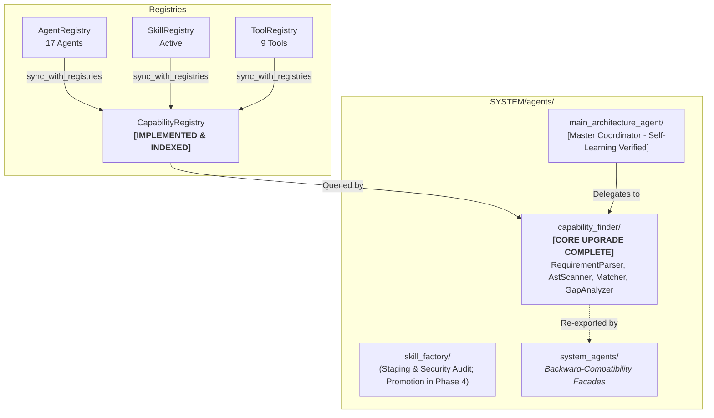

# SYSTEM AGENTS ARCHITECTURE — DELIVERABLE 6
## PHASE 2 HANDOFF REPORT

**Repository Root:** `E:\audio-to-video`  
**Execution Timestamp:** 2026-10-17T06:50:00+05:30  
**Phase:** 2 of 10  
**Status:** **`PHASE_2_STATUS: COMPLETE`**  

---

## 1. Phase 2 Completion Sign-Off

Phase 2 (Capability Registry & Capability Finder Core Upgrade) has been fully implemented, verified, and sealed. All architectural requirements, engineering standards, and verification gates were satisfied without shortcuts or regressions.

### Acceptance Criteria Checklist
- [x] **Canonical CapabilityRegistry Implemented:** Thread-safe registry established at `SYSTEM/registries/capability_registry.py` indexing cross-domain capabilities from agents, skills, and tools without mutating source registries.
- [x] **Natural Language RequirementParser Implemented:** Deterministic regex extraction engine decomposing user queries into structured constraints (aspect ratio, language, resolution, fps, deterministic rendering, chart types).
- [x] **Safe Static AST Scanner Implemented:** Static source-code inspector extracting classes, functions, line ranges, and advertised capabilities across `SYSTEM/agents/`, `SYSTEM/skills/`, and `VIDEO_ENGINE/` without executing code.
- [x] **Capability Matching & Scoring Implemented:** Multi-factor scoring engine evaluating domain alignment, keyword/tag overlap, contract compatibility, and constraint coverage.
- [x] **Structured Gap Analysis Implemented:** Decision engine evaluating capability fulfillment and recommending concrete actions (`REUSE`, `ADAPT`, `CREATE_SKILL`, `CREATE_AGENT`).
- [x] **CapabilityFinderAgent Upgraded:** Integrates all discovery subsystems while strictly preserving backward-compatible response fields (`matching_agents`, `matching_skills`, `available_tools`, `prerequisites`).
- [x] **Main Architecture Agent Integration Verified:** MAA successfully delegates natural-language requests to `CapabilityFinderAgent` and receives structured gap analysis to guide task delegation.
- [x] **Automated Tests Passing:** All 123 tests passed across canonical, legacy, and integration test suites with zero failures.
- [x] **Frozen Hashes Verified:** All 3 frozen video-generation algorithm files match their required SHA-256 baseline byte-for-byte.
- [x] **Reports Generated:** All 6 deliverables documented with actual filesystem evidence.

---

## 2. Transition State Summary

---

## 3. Detailed Scope for Phase 3

**Phase 3 Name:** Capability Finder Self-Learning Subsystem  
**Objective:** Equip `CapabilityFinderAgent` with continuous learning, resolution caching, confidence calibration, and feedback loops matching the level of MAA's verified self-learning architecture.

### Key Objectives for Phase 3:
1. **Query Resolution Cache (`query_cache.json`):**
   - High-speed cache for parsed requirements and top matched capability results with TTL and hash-based invalidation.
2. **Learning Experience Memory:**
   - Dedicated memory tracking capability resolution cases (`query`, `parsed_constraints`, `resolved_capabilities`, `execution_outcome`, `feedback`).
3. **Confidence Calibration Engine:**
   - Dynamically adjust matching weights and capability confidence scores based on real historical execution outcomes.
4. **MAA Feedback Loop:**
   - Ingest execution feedback from MAA's `ExperienceCollector` and `ReflectionEngine` to update Capability Finder ranking models.
5. **Continuous Learning Benchmarks:**
   - Benchmark test suite proving improved precision and latency across repeated queries.

### Items Explicitly Deferred Beyond Phase 3:
- Skill Factory Real Promotion Engine and Sandbox (Deferred to Phase 4).
- Architecture Validator Agent (Deferred to Phase 5).
- Verification & Test Agent (Deferred to Phase 6).
- Security & Policy Agent (Deferred to Phase 7).
- MAA Autonomous Multi-Step Planning Loop (Deferred to Phase 8).

---

## 4. Operator Handoff Recommendation

Phase 2 is complete, verified, and sealed. The system is ready to proceed to **Phase 3: Capability Finder Self-Learning Subsystem** upon operator authorization.
