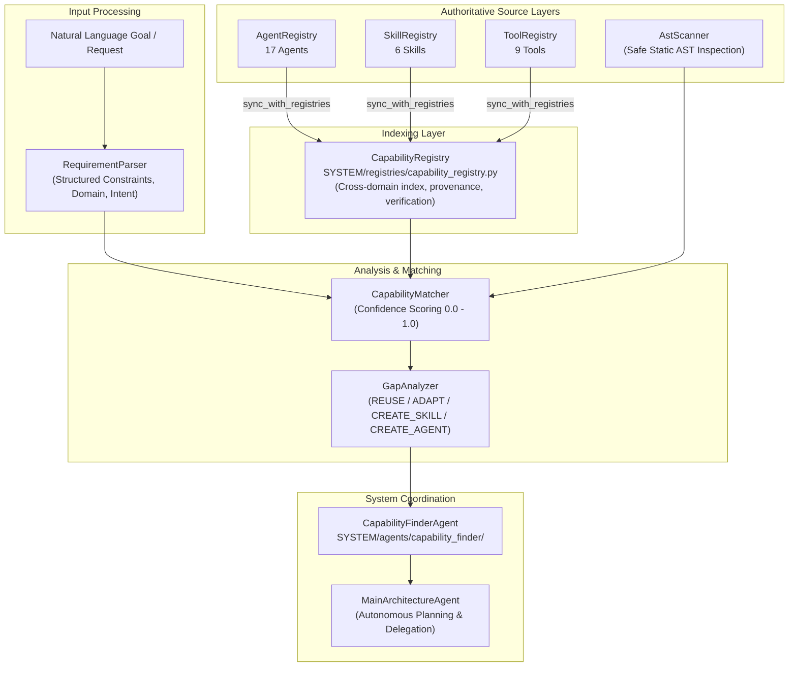

# SYSTEM AGENTS ARCHITECTURE — PHASE 2 IMPLEMENTATION SUMMARY
## LAXMAN-AUTONOMOUS MASTER SYSTEM

**Repository:** `E:\audio-to-video`  
**Execution Timestamp:** 2026-10-17T06:50:00+05:30  
**Phase:** 2 of 10  
**Phase Name:** Capability Registry & Capability Finder Core Upgrade  
**Execution Status:** **`PHASE_2_STATUS: COMPLETE`**  

---

## 1. Executive Summary

Phase 2 established the authoritative central **Capability Registry** and significantly upgraded the **Capability Finder Agent** core discovery engine. The system has evolved from simple keyword lookups into an evidence-based, deterministic capability discovery, code inspection, and gap analysis platform.

All five planned Phase 2 subsystems were implemented, integrated, and verified:
1. **Central `CapabilityRegistry`:** Dedicated thread-safe registry linking `AgentRegistry`, `SkillRegistry`, and `ToolRegistry` with stable capability IDs, provenance references, and verification tracking.
2. **Natural Language `RequirementParser`:** Rule-based deterministic extraction engine decomposing complex requests into structured constraints (aspect ratio, language, resolution, fps, deterministic rendering, chart types).
3. **Static `AstScanner`:** Safe AST-based inspection of Python source code across `SYSTEM/agents/`, `SYSTEM/skills/`, and `VIDEO_ENGINE/` extracting classes, functions, line ranges, and advertised capabilities without executing code.
4. **`CapabilityMatcher`:** Multi-factor scoring engine evaluating domain alignment, keyword/tag overlap, contract compatibility, and constraint coverage.
5. **`GapAnalyzer`:** Structured decision engine determining whether capabilities are satisfied, partial, or missing, and recommending actionable next steps: `REUSE`, `ADAPT`, `CREATE_SKILL`, or `CREATE_AGENT`.

The `MainArchitectureAgent` (MAA) was verified delegating natural-language requests to `CapabilityFinderAgent` and receiving rich, structured gap reports to inform autonomous routing decisions.

---

## 2. Architectural Components Implemented

---

## 3. Files Created and Modified

### Created Modules
1. `SYSTEM/registries/capability_registry.py`: Dedicated central capability registry.
2. `SYSTEM/agents/capability_finder/discovery/__init__.py`: Package init exporting discovery components.
3. `SYSTEM/agents/capability_finder/discovery/requirement_parser.py`: Natural language requirement parser.
4. `SYSTEM/agents/capability_finder/discovery/ast_scanner.py`: Safe static AST code discovery engine.
5. `SYSTEM/agents/capability_finder/discovery/matcher.py`: Capability matching and scoring engine.
6. `SYSTEM/agents/capability_finder/discovery/gap_analyzer.py`: Structured gap analysis and action recommendation engine.

### Updated Core Implementations
7. `SYSTEM/agents/capability_finder/agent.py`: Upgraded `CapabilityFinderAgent` integrating all discovery subsystems while preserving backward-compatible response fields.
8. `SYSTEM/agents/capability_finder/__init__.py`: Canonical package exports updated.
9. `SYSTEM/registries/__init__.py`: Package exports decoupled to prevent circular imports.

### Test Suites Created / Updated
10. `SYSTEM/agents/capability_finder/tests/test_capability_registry.py`: Registry unit tests.
11. `SYSTEM/agents/capability_finder/tests/test_requirement_parser.py`: Parser unit tests.
12. `SYSTEM/agents/capability_finder/tests/test_ast_scanner.py`: AST scanner unit tests.
13. `SYSTEM/agents/capability_finder/tests/test_matcher_and_gap_analyzer.py`: Matcher & gap analyzer unit tests.
14. `SYSTEM/agents/capability_finder/tests/test_agent.py`: Agent execution and metadata unit tests.
15. `tests/test_phase2_capability_system.py`: Comprehensive Phase 2 integration test suite.

---

## 4. Verification Evidence

### Test Suite Execution
- **Phase 2 Integration Suite:** `tests/test_phase2_capability_system.py` -> **8 passed**
- **Capability Finder Unit Suites:** `SYSTEM/agents/capability_finder/tests/` -> **18 passed**
- **Phase 1 Verification Suite:** `tests/test_phase1_system_agents_restructuring.py` -> **15 passed**
- **Skill Factory Tests:** `SYSTEM/agents/skill_factory/tests/test_agent.py` -> **3 passed**
- **Legacy Facade Tests:** `SYSTEM/agents/system_agents/*/tests/` -> **5 passed**
- **Architecture Regression Suite:** `tests/test_agent_architecture_reorg.py` -> **74 passed**
- **TOTAL:** **123 tests passed in 1.24s (100% pass rate, 0 failures, 0 errors)**

### Frozen Algorithm File Checksums
| File | Required SHA-256 | Post-Phase 2 SHA-256 | Status |
| :--- | :--- | :--- | :---: |
| `VIDEO_ENGINE/stages/transcribe.py` | `07a200319d41c2bd1550dfd5704f3bbcc5fac8331a0aeb09dcca4bf46d61376e` | `07a200319d41c2bd1550dfd5704f3bbcc5fac8331a0aeb09dcca4bf46d61376e` | **MATCH** |
| `VIDEO_ENGINE/stages/transcript_review.py` | `7290ea210d922514c011c799caf73aad61398f0229cc6799dd2f10072b38d049` | `7290ea210d922514c011c799caf73aad61398f0229cc6799dd2f10072b38d049` | **MATCH** |
| `VIDEO_ENGINE/stages/scene_segmentation.py` | `2d9ea882b8c53a6cfcd43b048481f72140a1a6792b8f05578e16fd56a9b37042` | `2d9ea882b8c53a6cfcd43b048481f72140a1a6792b8f05578e16fd56a9b37042` | **MATCH** |
