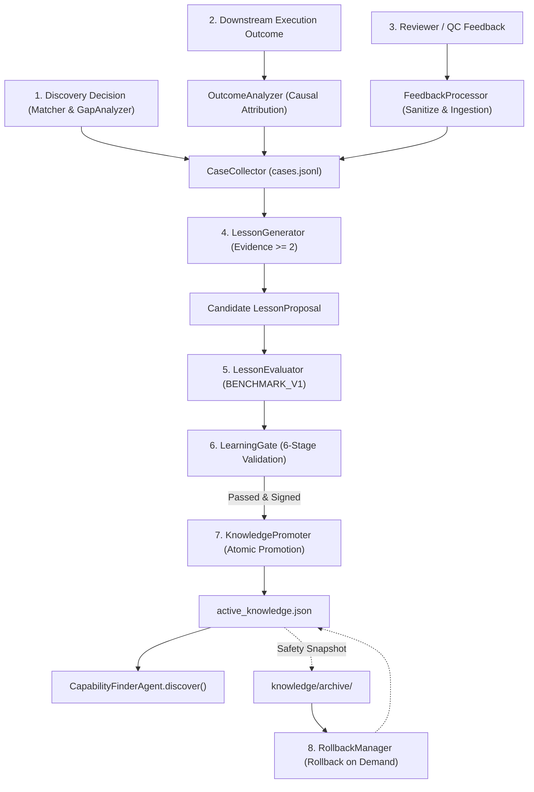

# Learning System Architecture: Capability Finder Self-Learning Subsystem

## 1. Architectural Topology

The Capability Finder Self-Learning Subsystem is organized into dedicated, decoupled components under `SYSTEM/agents/capability_finder/`:

```
SYSTEM/agents/capability_finder/
├── agent.py                            # Canonical CapabilityFinderAgent (dispatches learning actions)
├── discovery/                          # Core Phase 2 discovery modules (RequirementParser, AstScanner, Matcher, GapAnalyzer)
├── schemas/                            # Strict JSON schemas
│   ├── learning_case.schema.json       # Experience memory case schema
│   ├── lesson_proposal.schema.json     # Candidate lesson proposal schema
│   └── learning_evaluation.schema.json # Offline benchmark evaluation schema
├── history/                            # Thread-safe persistent memory
│   └── cases.jsonl                     # Sanitized append-only JSONL experience records
├── knowledge/                          # Declarative system knowledge
│   ├── active/
│   │   └── active_knowledge.json       # Current active knowledge configuration
│   └── archive/                        # Historical snapshots for rollback
│       └── active_knowledge_*.json
├── learning/                           # Phase 3 self-learning pipeline modules
│   ├── __init__.py
│   ├── case_collector.py               # CaseCollector: memory collection and secret sanitization
│   ├── outcome_analyzer.py             # OutcomeAnalyzer: causality & attribution engine
│   ├── feedback_processor.py           # FeedbackProcessor: reviewer feedback ingestion & injection defenses
│   ├── lesson_generator.py             # LessonGenerator: pattern clustering & proposal generation
│   ├── lesson_evaluator.py             # LessonEvaluator: BENCHMARK_V1 runner & regression checker
│   ├── learning_gate.py                # LearningGate: multi-stage verification & promotion gates
│   ├── knowledge_promoter.py           # KnowledgePromoter: atomic promotion & snapshot archiving
│   └── rollback_manager.py             # RollbackManager: snapshot restoration & pre-rollback safety
└── tests/                              # Comprehensive test suites
```

---

## 2. Component Responsibilities and Data Flow



### Module Descriptions
- **[CaseCollector](file:///E:/audio-to-video/SYSTEM/agents/capability_finder/learning/case_collector.py)**: Thread-safe collector managing in-memory caching and JSONL disk persistence with mandatory redaction of secrets, tokens, and credentials.
- **[OutcomeAnalyzer](file:///E:/audio-to-video/SYSTEM/agents/capability_finder/learning/outcome_analyzer.py)**: Differentiates between environmental defects (e.g. missing FFmpeg), input defects (e.g. corrupted audio), and actual capability mismatches.
- **[FeedbackProcessor](file:///E:/audio-to-video/SYSTEM/agents/capability_finder/learning/feedback_processor.py)**: Sanitizes reviewer notes, checks for prompt-injection patterns (e.g. `"ignore prior instructions"`), validates score ranges, and prevents duplicate submissions.
- **[LessonGenerator](file:///E:/audio-to-video/SYSTEM/agents/capability_finder/learning/lesson_generator.py)**: Clusters cases by recurring pattern and generates declarative proposals only when $\ge 2$ independent supporting cases exist.
- **[LessonEvaluator](file:///E:/audio-to-video/SYSTEM/agents/capability_finder/learning/lesson_evaluator.py)**: Runs the fixed 10-scenario `BENCHMARK_V1` suite to measure recommendation accuracy, false-reuse rate, and false-creation rate, detecting regressions.
- **[LearningGate](file:///E:/audio-to-video/SYSTEM/agents/capability_finder/learning/learning_gate.py)**: Multi-stage policy barrier enforcing schema validation, evidence thresholds, non-regression, security constraints, and human authorization.
- **[KnowledgePromoter](file:///E:/audio-to-video/SYSTEM/agents/capability_finder/learning/knowledge_promoter.py)**: Archives current active knowledge, bumps version numbers (semver minor increment), and writes updated knowledge atomically using tempfile replacement.
- **[RollbackManager](file:///E:/audio-to-video/SYSTEM/agents/capability_finder/learning/rollback_manager.py)**: Lists historical snapshots, snapshots the current active state (`pre_rollback`), and atomically restores a specified or most recent archive snapshot.
