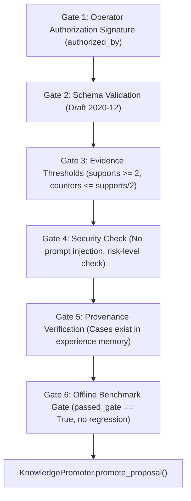

# Promotion Gates and Rollback Report: Capability Finder Self-Learning Subsystem

## 1. Multi-Stage Verification Gates

Before any candidate proposal can be promoted into `active_knowledge.json`, [LearningGate](file:///E:/audio-to-video/SYSTEM/agents/capability_finder/learning/learning_gate.py) enforces 6 independent verification gates:

### Gate Definitions

1. **Gate 1: Authorization Signature**: Requires explicit, non-empty `authorized_by` signature.
2. **Gate 2: Schema Compliance**: Validates against [lesson_proposal.schema.json](file:///E:/audio-to-video/SYSTEM/agents/capability_finder/schemas/lesson_proposal.schema.json) and [learning_evaluation.schema.json](file:///E:/audio-to-video/SYSTEM/agents/capability_finder/schemas/learning_evaluation.schema.json).
3. **Gate 3: Evidence Threshold**: Requires $\ge 2$ independent supporting cases and counterexamples $\le \lfloor \text{supporting} / 2 \rfloor$.
4. **Gate 4: Security Policy**: Rejects proposals with prompt injection patterns or risk level "high" unless signed by an elevated authority (`system_admin`, `security_officer`, `laxman_admin`).
5. **Gate 5: Provenance Verification**: Verifies all supporting case IDs exist in persistent memory.
6. **Gate 6: Non-Regression Gate**: Requires `passed_gate == True`, `has_regression == False`, and $\Delta \text{Acc} \ge 0.0$.

---

## 2. Controlled Knowledge Promotion

[KnowledgePromoter](file:///E:/audio-to-video/SYSTEM/agents/capability_finder/learning/knowledge_promoter.py) handles the promotion transaction:
1. **Pre-Promotion Snapshot**: Archives the existing `active_knowledge.json` to `knowledge/archive/active_knowledge_{timestamp}_v{version}.json`.
2. **Semantic Version Increment**: Bumps the minor version (e.g., `1.0.0` $\rightarrow$ `1.1.0`).
3. **Rule Application**: Updates routing preferences, synonym expansions, and constraint overrides.
4. **Atomic Replacement**: Writes updated data to a temporary file on the same filesystem and replaces `active_knowledge.json` via atomic rename (`shutil.move`).

---

## 3. Rollback Procedures

[RollbackManager](file:///E:/audio-to-video/SYSTEM/agents/capability_finder/learning/rollback_manager.py) provides safe rollback to any prior archived state:
1. **Current State Safety Backup**: Automatically archives the current state with a `pre_rollback_` prefix before modifying active knowledge.
2. **Target Archive Selection**: Restores a specified archive snapshot or defaults to the most recent non-prerollback snapshot.
3. **Atomic Restoration**: Atomically writes restored data into `active_knowledge.json`.
4. **Audit Log**: Records timestamp, operator signature, previous version, and restored version.

Verification tests in [test_promotion_and_rollback.py](file:///E:/audio-to-video/SYSTEM/agents/capability_finder/tests/test_promotion_and_rollback.py) verify successful round-trip promotion and rollback.
