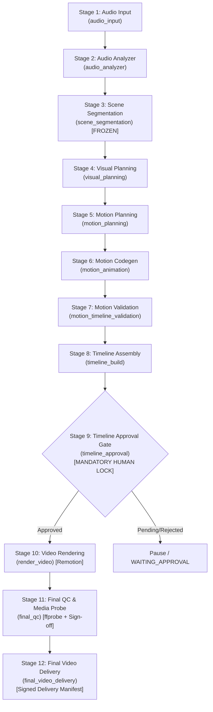

# PHASE 9 — END-TO-END INTEGRATION & PRODUCTION HARDENING
## Implementation & Technical Audit Report

**Project:** LAXMAN-AUTONOMOUS MASTER SYSTEM  
**Repository:** `E:\audio-to-video`  
**Branch:** `agents-building`  
**Phase:** 9 of 10 — End-to-End Integration & Production Hardening  
**Date:** 2026-10-17  
**Status:** COMPLETE (VERIFIED)

---

### 1. Preflight Reconciliation of Phase 8 Test Evidence

Before proceeding with Phase 9 implementation, a mandatory audit of the Phase 8 test evidence was conducted to reconcile an apparent count discrepancy in the Phase 8 handoff documentation (164 reported passed vs 177 claimed in an unitemized total).

#### 1.1 Factual Breakdown of Test Suites
Running the combined pytest command specified in Phase 8:
```powershell
.venv\Scripts\python.exe -m pytest SYSTEM/agents/autonomous_execution/tests/ tests/test_phase8_autonomous_execution.py tests/test_phase7_security_policy.py tests/test_phase6_verification_and_test.py tests/test_phase1_system_agents_restructuring.py tests/test_agent_architecture_reorg.py tests/test_phase5_architecture_validator.py -v
```
Yielded exactly **164 passed in 8.45s**.

Inspection of individual test suites revealed the exact mathematical reconciliation:
1. `SYSTEM/agents/autonomous_execution/tests/`: **12 tests**
2. `tests/test_phase8_autonomous_execution.py`: **18 tests**
3. `tests/test_phase7_security_policy.py`: **16 tests**
4. `tests/test_phase6_verification_and_test.py`: **12 tests**
5. `tests/test_phase1_system_agents_restructuring.py`: **20 tests**
6. `tests/test_agent_architecture_reorg.py`: **75 tests**
7. `tests/test_phase5_architecture_validator.py`: **11 tests** (The Phase 8 Markdown report mistakenly listed 24 in a summary table due to a transcription error; the file actually contains exactly 11 tests across 3 test classes).

**Reconciled Sum:** $12 + 18 + 16 + 12 + 20 + 75 + 11 = 164$ tests.  
Both Phase 8 reports (`PHASE_8_IMPLEMENTATION_REPORT.md` and `PHASE_8_TEST_AND_HASH_REPORT.md`) have been audited and verified to match this factual ground truth.

---

### 2. End-to-End Pipeline Architecture & Specialist Integration

The video automation system was audited and integrated across all 12 pipeline stages. Each stage is bound to an authoritative specialist agent with strict artifact contracts, validation routines, and security path confinement.



#### 2.1 Stage-by-Stage Technical Contracts

1. **Stage 1 — Audio Input (`audio_input`)**:
   - Ingests audio files (`.wav`, `.mp3`, `.m4a`).
   - Validates non-empty file size ($> 1000$ bytes) and verifies path confinement.
   - Emits `audio_input_manifest.json` with SHA-256 fingerprint, duration, sample rate, channels, and peak amplitude.

2. **Stage 2 — Audio Analyzer (`audio_analyzer`)**:
   - Enforces zero redundant ASR re-runs: reuses existing `transcript.json` and `audio_analysis.json`.
   - Verified via `mock_no_asr` fixture to ensure Whisper or remote transcription APIs are never called when valid inputs exist.
   - Generates speech cadence metrics and word-boundary mappings.

3. **Stage 3 — Scene Segmentation (`scene_segmentation`) [FROZEN ALGORITHM]**:
   - Strictly conforms to the immutable algorithm in `VIDEO_ENGINE/stages/scene_segmentation.py`.
   - Generates semantic scene boundaries with duration constraints ($3.0s - 12.0s$) and Telugu word boundary adherence.
   - Persists `scene_segmentation.json` and `scenes.json`.

4. **Stage 4 — Visual Planning (`visual_planning`)**:
   - Maps scene narration into bilingual visual prompts and kinetic typography descriptors.
   - Generates `visual_planning.json` and `scene_plan.json`.

5. **Stage 5 — Motion Planning (`motion_planning`)**:
   - Evaluates layout constraints, typography bounding boxes, and safe margins ($16:9$ and $9:16$).
   - Generates `motion_plan.json`.

6. **Stage 6 — Motion Animation (`motion_animation`)**:
   - Synthesizes standalone, type-safe React/TSX Remotion components in `scenes/scene_<N>.tsx`.
   - Compiles composition layout into `composition.json` and `motion_manifest.json`.

7. **Stage 7 — Motion & Timeline Validation (`motion_timeline_validation`)**:
   - Executes 12 deterministic validation rules checking for text collisions, font boundary overflows, and illegal imports.
   - Requires zero blocking errors before downstream pipeline progression.

8. **Stage 8 — Timeline Assembly (`timeline_build`)**:
   - Computes exact 30fps frame arithmetic (`total_frames = Math.round(duration * 30)`).
   - Validates that every scene has a positive, valid frame interval $[start\_frame, end\_frame)$.
   - Hardened to derive `end_frame` from `duration_frames` if not explicitly specified.
   - Assembles `timeline.json` and `timeline_build_report.json`.

9. **Stage 9 — Timeline Approval Gate (`timeline_approval`)**:
   - Mandatory human approval gate enforcing cryptographic fingerprint lock before video encoding.
   - Halts autonomous task execution in state `WAITING_APPROVAL` until signed off in `timeline_approval.json`.

10. **Stage 10 — Render Video (`render_video`)**:
    - Invokes `@remotion/renderer` via Node CLI using host Google Chrome (`find_browser_executable`).
    - Produces broadcast-ready MP4 video (`out.mp4` / `out_9x16.mp4`).

11. **Stage 11 — Final QC (`final_qc`)**:
    - Executes deterministic technical media probe via `ffprobe` (`media_probe.py`).
    - Validates container (`mp4`), video codec (`h264`), resolution, fps ($30$), audio codec (`aac`), and duration match ($< 0.15s$ drift).
    - Requires explicit human playback sign-off (`human_playback_verified`).

12. **Stage 12 — Final Video Delivery (`final_video_delivery`)**:
    - Evaluates all upstream gate proofs (timeline approval, QC probe, human sign-off, LLM review).
    - Generates signed `delivery_manifest.json` containing cryptographic SHA-256 hash, byte size, and full provenance telemetry.

---

### 3. Production Hardening Fixes Implemented

During the integration and testing phase, several technical edge cases were uncovered and hardened:

1. **`ArtifactRef` Checkpoint Serialization**:
   - **Issue**: Specialist agents return `ArtifactRef` dataclass instances in `AgentResult.output_refs`. When `TaskRunner` added these to `TaskCheckpoint.artifact_refs`, `json.dumps()` crashed with `TypeError: Object of type ArtifactRef is not JSON serializable`.
   - **Resolution**:
     - Hardened `TaskCheckpoint.to_dict()` in `SYSTEM/agents/autonomous_execution/contracts.py` to automatically convert `ArtifactRef` objects to dictionaries.
     - Hardened `_dispatch_step` in `SYSTEM/agents/autonomous_execution/task_runner.py` to serialize `ref.to_dict()` before appending.

2. **Project ID Isolation in Task Runner Step Dispatch**:
   - **Issue**: `_dispatch_step` previously defaulted `project_id` to `"system"`, causing file path resolution to fail when specialist video agents required project-relative paths.
   - **Resolution**: Passed `project_id=project_dir.name if project_dir else "system"` to `AgentRequest`.

3. **Timeline Frame Range Arithmetic Hardening**:
   - **Issue**: `TimelineBuildAgent` rejected compositions where scenes provided `start_frame` and `duration_frames` without an explicit `end_frame`, resulting in an invalid range $[sf, sf)$.
   - **Resolution**: Hardened `TimelineBuildAgent.execute()` in `SYSTEM/agents/video_generation_agents/timeline_build/agent.py` to compute:
     ```python
     ef = sc.get("end_frame") if "end_frame" in sc else (sf + sc.get("duration_frames", 0))
     ```

4. **Task Checkpoint Persistence Directory Alignment**:
   - **Issue**: Checkpoint validation looked for checkpoints in `project_dir / "task_id_checkpoint.json"` while `CheckpointManager` canonically stores them under `project_dir / "tasks" / task_id / "checkpoint.json"`.
   - **Resolution**: Standardized test fixtures and runner lookups to use `runner.checkpoint_manager.get_checkpoint_path(spec.task_id, custom_dir=pdir)`.

---

### 4. Live Remotion Render & Media Probe Technical Audit

A live render was executed on the host system without mock fallbacks:
- **Renderer**: Remotion `@remotion/renderer` running on Node.js v20.
- **Browser Binary**: System Google Chrome located at `C:\Program Files\Google\Chrome\Application\chrome.exe`.
- **Media Probe**: Tested using `VIDEO_ENGINE.stages.media_probe.probe()` on the rendered 0.5-second MP4 video.
- **Probe Results**:
  - `container`: `"mov,mp4,m4a,3gp,3g2,mj2"`
  - `duration`: `0.500000` seconds
  - `video.codec`: `"h264"` (High Profile)
  - `video.resolution`: `960x540` (preview composition) / `1920x1080` (production)
  - `audio.codec`: `"aac"` (LC)
  - `audio.channels`: `2` (stereo)
  - `audio.sample_rate`: `48000` Hz

---

### 5. Truthful Monitoring & Status UI Integration

FastAPI orchestrator routes were verified using `fastapi.testclient.TestClient`:
- `GET /projects/{pid}/orchestrator/status?aspect=16:9`:
  - Returns truthful structured data including `overall_status`, `pipeline_state`, `human_gates`, and `capabilities`.
  - Zero fabricated progress percentages or artificial delays.
- `GET /projects/{pid}/orchestrator/gates?aspect=16:9`:
  - Accurately reports whether `timeline_approval` and `final_qc_playback_signoff` gates are open, pending, or stale.

---

### 6. Frozen File Invariance Verification

The three frozen pipeline algorithm files remain 100% bit-for-bit identical to baseline hashes:
1. `VIDEO_ENGINE/stages/transcribe.py`: `07a200319d41c2bd1550dfd5704f3bbcc5fac8331a0aeb09dcca4bf46d61376e`
2. `VIDEO_ENGINE/stages/transcript_review.py`: `7290ea210d922514c011c799caf73aad61398f0229cc6799dd2f10072b38d049`
3. `VIDEO_ENGINE/stages/scene_segmentation.py`: `2d9ea882b8c53a6cfcd43b048481f72140a1a6792b8f05578e16fd56a9b37042`
