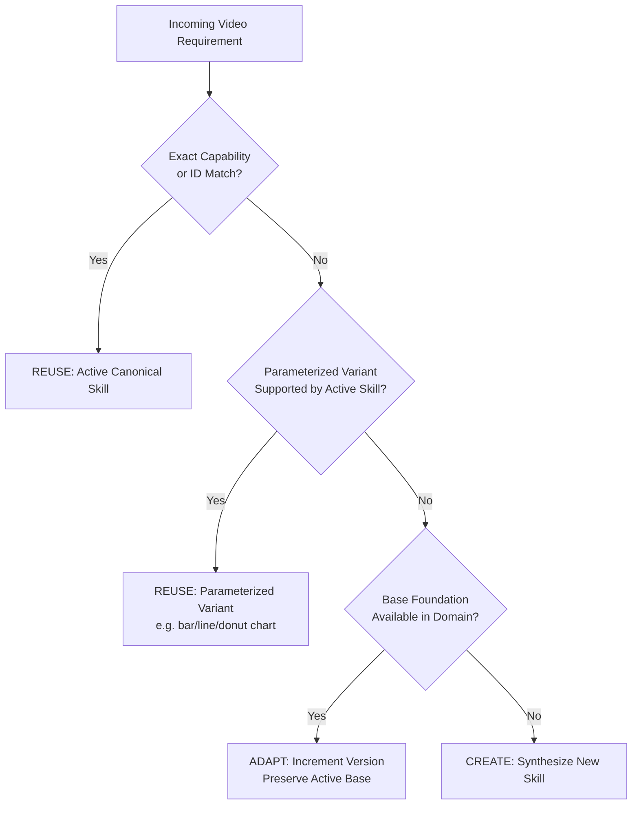

# Video Skill Factory Architecture and Gap Report
## Specialization and Master Readiness for Automated Video Generation

**Repository:** `E:\audio-to-video`  
**Branch:** `agents-building`  
**System:** LAXMAN-AUTONOMOUS MASTER SYSTEM  
**Subsystem:** Canonical Skill Factory (`SYSTEM/agents/skill_factory/`)  
**Shared Skill Library:** `SYSTEM/skills/`  
**Date:** 2026-10-17  
**Official Verdict:** `PASS — VIDEO-SPECIALIZED SKILL FACTORY VERIFIED`

---

## 1. Executive Mission & Architectural Focus

The Dark World Video Generation Agent is an autonomous system whose sole objective is turning spoken Telugu audio narration into broadcast-ready documentary and motion graphics MP4 videos (9:16 vertical shorts/reels and 16:9 landscape displays) at 30 fps.

The Skill Factory (`SYSTEM/agents/skill_factory/`) is **not a universal software development platform**. Its specialized responsibility is discovering, creating, adapting, evaluating, versioning, and publishing reusable capabilities specifically tailored to the 12-stage video generation pipeline:

```text
Audio Input -> Audio Analyzer -> Scene Segmentation -> Visual Planning -> 
Motion Planning -> Motion Generation -> Motion Validation -> Timeline Assembly -> 
Timeline Approval Gate -> Video Render -> Final QC -> Final Delivery
```

---

## 2. Existing Implementation Audit

Prior to this specialization phase, the Skill Factory had completed Phase 4 hardening and Phase 4.1 sandbox isolation. An audit of `SYSTEM/skills/` revealed:

### Current Skills in Catalog:
1. `audio.bilingual_preservation`: Governs Telugu script vs. English technical vocabulary.
2. `motion.kinetic_typography`: Kinetic typography pacing, layout, and readability.
3. `motion.remotion_spring_curves`: Spring curves, damping, and interpolation math.
4. `validation.layout_safe_zones`: 9:16 and 16:9 bounding box collision enforcement.
5. Legacy test stubs (`draft.skill`, `staged.remote_skill`, `test.checksum`, `test.skill`).

### Critical Pipeline Gaps Identified:
- **Visual Scene Planning Gap**: No approved skill governed semantic visual concept generation, element breakdown, and z-index layering from scene narration.
- **Data Visualization Gap**: No reusable skill existed for animated SVG charts (bar, line, donut, counter), leading to duplicate ad-hoc motion scripts.
- **Telugu Typography & Captioning Gap**: No specialized skill validated Noto Sans Telugu Unicode shaping, line breaking rules, and bottom UI overlay exclusion zones.
- **FFmpeg Operations Gap**: No canonical skill defined contracts for container probing, A/V duration synchronization checks, and freeze-frame detection.
- **Timeline Composition Gap**: No approved skill enforced the mathematical locking of timeline frames to spoken audio duration at 30 fps with gap/overlap prevention.

---

## 3. Video-Specific Skill Domain Map (16 Domains)

The system boundaries cover 16 specialized video generation domains:

| # | Domain | Primary Pipeline Stage | Canonical Active Skill | Scope & Responsibility |
| :- | :--- | :--- | :--- | :--- |
| 1 | `audio.timing_analysis` | Audio Input / Analyzer | `audio.bilingual_preservation` | Speech-timing interpretation, phonetics, sentence pauses. |
| 2 | `transcript.bilingual_vocabulary` | Audio Analyzer [FROZEN] | `audio.bilingual_preservation` | Preserves native Telugu script; standardizes English loan terms. |
| 3 | `segmentation.scene_boundary` | Scene Segmentation [FROZEN] | Integrated in stage 3 | Narrative cut points, sentence boundaries, pacing constraints. |
| 4 | `content.scene_purpose` | Segmentation / Planning | `visual.scene_planning` | Semantic scene intent, tone, educational/documentary focus. |
| 5 | `visual.planning` | Visual Planning | `visual.scene_planning` *(New)* | Visual concept synthesis, element breakdown, z-index hierarchy. |
| 6 | `broll.asset_suitability` | Visual Planning | Motion-Only Policy | Governs asset suitability (external stock/image mode disabled). |
| 7 | `prompt.generation` | Motion Planning | Custom-Code Remotion | Synthesizes scene-specific TSX prompts from visual plans. |
| 8 | `motion.planning` | Motion Planning | `motion.kinetic_typography` | Kinetic pacing, emphasis timing, typography rhythm. |
| 9 | `motion.remotion_primitives` | Motion Generation | `motion.remotion_spring_curves` | Remotion spring physics, interpolate math, frame bounds. |
| 10 | `motion.gsap_react` | Remotion Runtime | `remotion/src/gsapTimeline.ts` | Number-scrubbing GSAP adapter for checkmark effects. |
| 11 | `media.ffmpeg_operations` | Render / Final QC | `media.ffmpeg_operations` *(New)* | Stream probing, codec verification, audio muxing. |
| 12 | `typography.telugu_caption` | Timeline / Motion | `typography.telugu_rendering` *(New)* | Noto Sans Telugu shaping, line breaking, UI safe-zones. |
| 13 | `graphics.data_visualization` | Motion Generation | `graphics.data_visualization` *(New)* | Multi-variant SVG charts (bar, line, donut, metric counter). |
| 14 | `timeline.synchronization` | Timeline Assembly | `timeline.composition_assembly` *(New)* | Audio-locked duration at 30 fps, transition windows. |
| 15 | `rendering.verification` | Video Render | `media.ffmpeg_operations` *(New)* | Multi-process render verification, resolution, bitrate. |
| 16 | `qc.audio_video_sync` | Final QC | `validation.layout_safe_zones` | A/V sync (<100ms delta), freeze/black frame detection. |

---

## 4. Reuse Before Adaptation Before Creation Strategy

The Decision Engine (`decision_engine.py`) was enhanced with **parameterized variant matching**:



### Preventing Redundant Skill Proliferation:
Broad reusable skills declare `supported_variants` in metadata or input contracts. For example, `graphics.data_visualization` supports:
- `bar_chart`
- `line_chart`
- `donut_chart`
- `metric_counter`

When a video stage requests a "bar chart" or "donut graph", the Skill Factory recommends `REUSE` of `graphics.data_visualization` configured via parameters, rather than authoring dozens of redundant standalone skills.

---

## 5. Architectural Ownership Boundaries

- **Main Architecture Agent**: High-level workflow orchestration and stage delegation.
- **Capability Finder**: Discovers active skills and identifies capability gaps.
- **Skill Factory**: Authoritative owner of skill creation, adaptation, quality evaluation, caching, publication, and rollback.
- **Pipeline Orchestrator**: Deterministic driver of the 12 pipeline stages.
- **Video Generation Agents**: Consumer of approved active skills during autonomous execution.
- **Central Registries (`SkillRegistry`, `CapabilityRegistry`)**: Authoritative sources of truth for active production capabilities.
